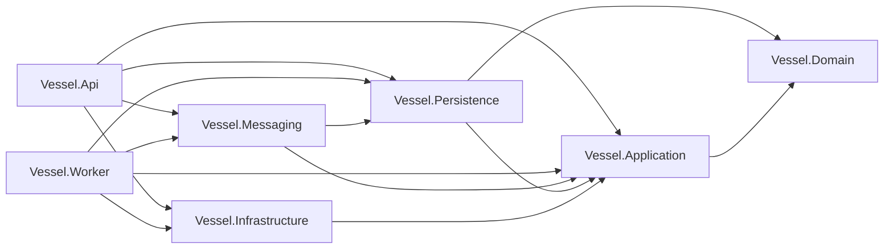
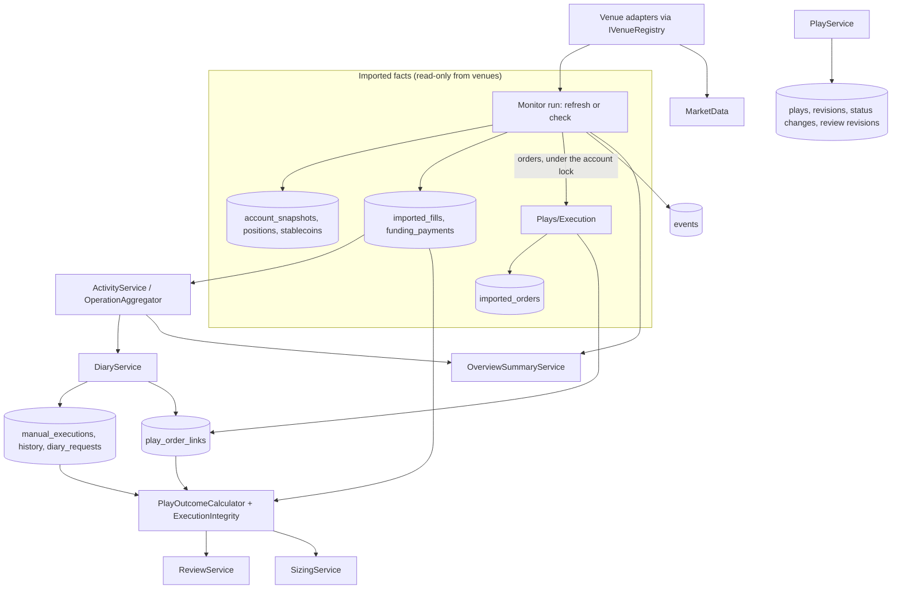

# Backend guide

Start here if you are new to the Vessel backend. This guide explains how the code is organised, what each module does, how the modules work together and which rules hold everywhere. It describes the code as of October 17, 2026, after the background monitor, venue funding and the October 16–17 improvement pass. The contracts and state documents in this folder hold the detailed rules for each feature. Where this guide and the code disagree, the code wins; please fix the guide.

For a shorter tour of the whole app, start with [App today](../app-status.md). Read [`CONTEXT.md`](../../CONTEXT.md) for the product vocabulary. Improvement work is tracked in [`backend-review.md`](backend-review.md).

## What the backend is

Vessel is a self-hosted, single-owner trading diary. The backend is an ASP.NET Core 10 minimal API over PostgreSQL (EF Core 10 with Npgsql). It:

- keeps portfolios, accounts and Plays (trading ideas with plans, revisions, status and review);
- reads venue data (Hyperliquid, RISEx and Lighter) **read-only** and keeps normalized facts: the latest account snapshot, imported fills and imported orders;
- links venue orders to Plays and moves Plays between Planned, Open and Closed from linked fills;
- derives Activity (position round trips), Overview totals, Review metrics and sizing suggestions from those facts;
- records funding payments as signed settlements beside the fills;
- checks open Plays against the venue in a separate background worker and records every change as an event that the browser streams and RabbitMQ subscribers receive;
- serves public market data (candles, market context, a live stream) and stores evidence images.

It never places orders, never signs anything at a venue and never treats a price touch as a fill.

## Solution layout

```text
backend/
  Vessel.slnx                 solution
  Directory.Build.props       net10.0, nullable, warnings as errors, NuGet lock files
  src/
    Vessel.Domain/            entities and pure rules; no package references
    Vessel.Application/       use cases, DTOs and ports (interfaces); no package references
    Vessel.Persistence/       EF Core DbContext, stores (port implementations), migrations
    Vessel.Infrastructure/    auth, credential vault, evidence storage, venue adapters, shared use-case registration
    Vessel.Messaging/         Wolverine/RabbitMQ adapter: outbox, topology, subscriptions, feature modules
    Vessel.Api/               composition root, middleware and HTTP endpoints
    Vessel.Worker/            background host (monitor scheduler, subscription catch-up, event retention)
  tests/Vessel.Tests/         one xUnit project: unit, API (WebApplicationFactory) and PostgreSQL tests
```

Dependencies point inward. `tests/Vessel.Tests/ArchitectureTests.cs` enforces the project references and keeps Domain and Application free of package references.



| Project | Holds | Must not hold |
| --- | --- | --- |
| Domain | Entities (`Account`, `Portfolio`, `Play`, `PlayOrderLink`, `PlayEvidence`, …), fact records (`ImportedFill`, `ImportedOrder`, `AccountSnapshot`), the execution vocabulary (`ExecutionFacts`) and pure rules (`TrackRecord`, `Exposure`, `SizingLimits`). | EF, HTTP, JSON contracts, venue knowledge. |
| Application | One folder per feature with its use-case service, request/response DTOs and the store port it needs. Venue ports and the `IVenueRegistry`. | SQL, EF types, `HttpClient` configuration, venue wire formats. |
| Persistence | `VesselDbContext`, per-entity configurations, one store class per port, the `UnitOfWork`, the event store, dispatcher and retention (`Events/`), explicit migrations. Registers the context and stores. | Business rules beyond locking and storage. |
| Infrastructure | Bearer authentication and owner context, AES-GCM credential vault, evidence object stores (local and S3-compatible), venue adapters and their caches. `ApplicationServices` (`AddVesselApplication()`, `AddVesselMonitoring()`): the use-case registrations both hosts share, and the host-side `Monitoring/MonitorRunExecutor`. | Use-case logic. |
| Messaging | The only project that references Wolverine and RabbitMQ: the outbox behind `IVesselEventOutbox`, the `vessel.events` topic and subscription queues, provisioning commands, and feature modules (`Modules/Monitor`) that declare their own topology and hosted services. | Business decisions; Domain and Application never reference it. |
| Api | `Program.cs` pipeline (calls the shared `AddVesselApplication()` and `AddVesselMonitoring()`), endpoint mapping files and transport rules for credentials, compression, forwarded headers and production configuration. | Business decisions. |
| Worker | `Program.cs` (`WorkerHost`): the same shared registrations, then the modules in `Vessel:Worker:Modules` (default `["monitor"]`, whose `MonitorScheduler` claims due accounts) and subscription maintenance. Shipped in the API image with its own entrypoint. | HTTP endpoints. |

## How a request flows

`Program.cs` builds one pipeline for every request:

1. **Startup checks.** Outside Development, `ProductionConfiguration.Validate` refuses to start without a 32+ character token and a connection string.
2. **Forwarded headers.** Only explicitly configured proxies are trusted (`ForwardedHeadersConfiguration`).
3. **Security headers.** `nosniff`, `X-Frame-Options: DENY`, `no-referrer`, and `Cache-Control: no-store` on `/api` unless an endpoint set its own policy.
4. **Error mapping.** Exceptions become RFC 7807 Problem Details. `ProblemException(status, detail)` maps to its status and safe message. `DomainValidationException` maps to 400 and `DomainRuleException` to 409. Bad bodies map to 400/413; transient database or network failures anywhere in the exception chain, and an evidence storage outage (`EvidenceStorageUnavailableException`), map to 503. Anything else is a 500 logged once by `SafeExceptionDiagnostics`, with trace ID, route, exception type and method names only, never messages or data.
5. **Compression.** Only endpoints marked with `CompressMarketData` metadata (instruments, candles, market context) are compressed.
6. **Authentication and authorization.** `BearerTokenHandler` compares a hash of the bearer token with the configured token in constant time and issues the configured owner identity. The fallback policy makes every endpoint private unless it opts out (`/health/live`, `/health/ready`). Repeated wrong tokens from one address get 429 (`AuthFailureLimiter`).
7. **Endpoint transport.** `CarriesCredential()` marks token routes with the HTTPS guard and a 4 KiB body limit. `WithBodyLimit()` marks manual writes with 16 KiB and retrospective creation with 128 KiB. The guard and server body limit run after authorization, before binding. Matched routes use their metadata; an unmatched-route fallback preserves the old error responses for malformed URLs and unsupported methods. Non-loopback credential entry requires HTTPS outside Development.
8. **Endpoint.** A thin lambda binds the request, calls one application service and returns `Results.Ok/Created/NoContent`.

Application services throw `ProblemException` from `Application/Common` for expected request failures. Entities use the two Domain exception types for invalid input and rule conflicts. The API maps them centrally; unrelated `ArgumentException` or `InvalidOperationException` failures remain server errors.

## Ownership and security model

- **One owner per installation.** The bearer token maps to a configured owner ID (`Vessel:Auth:OwnerId`). `IJournalOwnerContext` exposes it to the application; request bodies never carry an owner.
- **Every entity implements `IOwned`.** Model construction fails if a mapped entity lacks the owner contract. `VesselDbContext` builds query filters from that contract, and `SaveChanges` checks both current and original owner IDs. Composite owner foreign keys prevent cross-owner relationships. Raw SQL still needs its own explicit owner predicate.
- **Venue secrets.** Only Lighter needs one: a read-only `ro:` token, verified at the venue, sealed with AES-GCM (associated data binds owner, account and purpose, built once by `VenueCredentialPurpose`) and stored in `account_credentials`. Verification runs with no transaction or lock open; a short locked recheck then saves, or answers 409 if the account or its credential changed meanwhile. Keys come from configuration or a mode-600 key file, never from the database. See [`venue-credentials.md`](venue-credentials.md).
- **No leaks.** Venue payloads, exception messages, tokens and connection strings are never logged or returned. HTTP clients have logging removed; EF error events are downgraded to Debug.

## Modules

Each Application folder is a feature. The table lists its entry point, what it reads and writes, and the contract document with its detailed rules.

| Module | Entry point | Store port | What it does | Contract |
| --- | --- | --- | --- | --- |
| Workspace | `WorkspaceService`, `AccountDiscoveryService` | `IWorkspaceStore` | Portfolios and accounts (create, rename, move, enable/disable, delete), latest snapshot, recent fills, funding payments, instrument catalogue, Overview balances and coverage. The refresh itself runs through Monitoring. | [core-workspace-contract](core-workspace-contract.md), [account-management-contract](account-management-contract.md) |
| Venues | `IVenueRegistry`, `VenueDescriptor` | — | Finds the descriptor and adapters for a venue ID. Use cases check **capabilities**, never venue names. | [venue-registry](venue-registry.md), [execution-facts](execution-facts.md), [venue-instruments](venue-instruments.md) |
| Credentials | `AccountCredentialService`, `AccountCredentialReader` | `IAccountCredentialStore`, `ICredentialVault` | Save, verify, read and delete read-only venue tokens. | [venue-credentials](venue-credentials.md) |
| MarketData | `CandleService`, `MarketContextService`, `MarketStreamService` | — (uses venue ports and in-memory caches) | Bounded candle windows, market statistics and a server-sent-events relay over one shared Hyperliquid WebSocket. | [chart-plan](chart-plan.md), [performance-plan](performance-plan.md) |
| Plays | `PlayService` | `IPlayStore` | Create and edit Plays, plan normalization (`PlayDocuments`), status changes (plan, pause, resume, cancel), history, Draft deletion. List views (`GET /api/plays`) and counts (`/api/plays/counts`) with search, scope and pages over projected summary columns. | [play-lifecycle](play-lifecycle.md), [plays-workspace-contract](plays-workspace-contract.md), [list-paging](list-paging.md) |
| Plays/Execution | `PlayExecutionService`, `ExecutionMatcher`, `ExecutionIntegrity` | `IPlayExecutionStore` | Retain venue orders, link orders to plan levels (automatically when unambiguous, otherwise as suggestions), move Plays to Open/Closed from linked fills. Called by Monitoring as its `IMonitorImporter`; the owner links and unlinks by hand. | [play-lifecycle](play-lifecycle.md) |
| Monitoring | `MonitorCoordinator`, `MonitorDiscrepancyService`, `MonitorExecutionView` | `IMonitorStore`, `IMonitorDiscrepancyStore` | Account Refresh and Check admission, leases and the two-read budget, the run that imports facts and reconciles Plays, venue-versus-Play discrepancies and exit watches. | [play-monitor-plan](play-monitor-plan.md), [messaging-and-workers](messaging-and-workers.md) |
| Events | `IVesselEventSink`, `IVesselEventReader`, `IVesselEventSubscriber` | (implemented in `Persistence/Events`) | Events appended in the same transaction as the change, read by the browser (`/api/events`, `/api/events/stream`) and delivered to subscriptions with receipts and catch-up. | [messaging-and-workers](messaging-and-workers.md) |
| Diary | `DiaryService`, `ManualLedger` | `IDiaryStore` | Owner-entered manual executions with correction history, retrospective Plays from completed imported operations, idempotent writes by request ID. | [diary-completion-contract](diary-completion-contract.md) |
| Activity | `ActivityService`, `OperationAggregator`, `OperationFunding` | `IActivityStore`, `IWorkspaceStore` | Turns retained fills into position round trips ("operations") with explicit coverage notices, and attributes funding payments to them when the timestamps allow. Filters, orders and pages them on the server (`GET /api/activity`); one operation's rows load on expand (`/api/activity/fills`). | [activity-operations](activity-operations.md), [list-paging](list-paging.md), [venue-funding](venue-funding.md) |
| Overview | `OverviewSummaryService` | reuses Workspace and Activity | Scoped balance, availability, unrealized and realized summaries grouped by portfolio or account. | [core-workspace-contract](core-workspace-contract.md) |
| Review | `ReviewService` | `IReviewStore` | Scores saved closed Plays: metrics, equity series, groups, exclusions. | [portfolio-review](portfolio-review.md) |
| Sizing | `SizingService` (+ Domain `TrackRecord`, `Exposure`, `SizingLimits`) | `ISizingStore` | Track record, exposure ladder and suggestion limits. | [sizing-suggestions](sizing-suggestions.md) |
| Evidence | `EvidenceService`, `EvidenceMarkup`, `EvidenceImage` | `IEvidenceMetadataStore`, `IEvidenceObjectStore` | Images attached to saved Plays, with notes and vector markup kept beside the original bytes. | [chart-plan](chart-plan.md) (captures) |
| Metadata | `SystemMetadata` | — | `/api/system`: version, owner, venues and their capabilities for the browser. | [venue-registry](venue-registry.md) |

### How the modules depend on each other



Facts flow in one direction: venues produce facts, the owner produces intent (Plays, plans, manual facts, links), and reporting (Activity, Overview, Review, Sizing) only reads both. Reporting never assigns fills, changes a status or calls a venue.

## Venue integration

A venue is a **module**: a `VenueDescriptor` plus one adapter class implementing the ports the venue supports. `AddVenueModule<TAdapter>()` in `Infrastructure/DependencyInjection.cs` registers the descriptor, a logger-free named HTTP client and a scoped adapter. Its supported reader, discovery and credential-verification ports resolve to that same scoped instance. `VenueRegistry` indexes those ports by venue ID. The shared Hyperliquid stream has its own singleton registration.

| Port | Purpose | Hyperliquid | RISEx | Lighter |
| --- | --- | --- | --- | --- |
| `IPerpetualVenueReader` | Instrument catalogue and account refresh (snapshot + fills) | yes | yes | yes |
| `IVenueOrderReader` | Open orders and recent order history | yes | yes | yes (token) |
| `ICandleReader` | Trade candles | yes | yes | yes |
| `IMarketContextReader` | Mark/oracle price, volume, open interest, funding | yes | yes | no |
| `IMarketStream` | Live candles and context over WebSocket | yes | no | no |
| `IVenueAccountDiscovery` | List subaccounts for an address | no | no | yes |
| `IVenueCredentialVerifier` | Verify a read-only token | no | no | yes |

`manual` is a pseudo-venue: owner-entered values, no adapter, and the only one with `ManualExecutions`.

`IVenueFundingReader` (signed funding settlements over a bounded window) is implemented by all three adapters; the registry finds it on the reader.

Every adapter follows the same rules (see `Venues/Common`):

- **Bounded reads.** `BoundedJsonHttp` gives one 20-second deadline to a whole multi-request read, caps the response size, limits JSON depth and rejects duplicate properties. Each adapter reuses one instance and parses the buffered body without copying it.
- **Strict parsing.** `StrictJson` rejects anything unexpected; decimals keep their exact value or the read fails (never rounded).
- **Normalization.** Adapters translate the venue's encoding into `ExecutionFacts` (buy/sell, open/close/flip/unknown, fee basis, PnL basis) and canonical instrument keys (`kPEPE` → `1000PEPE`), keeping the venue's own words beside them for display. `VenueFactChecks` rejects adapter output outside that vocabulary before anything is stored.
- **Safe failures.** Every failure becomes `VenueReadException` with a fixed message; services turn it into 502.

Caches are in-memory singletons that hold public data only: catalogues (per venue), candle windows (`CandleCache`) and market context (`MarketContextCache`), all built on `BoundedMarketDataCache` (LRU, bounded size, single-flight loads with their own deadline). Authorization is never cached.

## Key flows

### Account refresh (`POST /api/accounts/{id}/sync`)

The endpoint calls `MonitorRunExecutor.RefreshAsync`, the same run the worker's Checks use; there is no separate sync service.

1. `MonitorCoordinator.AdmitRefreshAsync` locks the account and its `monitor_accounts` row in a short unit of work. It checks the account is enabled and the venue has `Sync`, applies any venue `Retry-After` and the owner's two-read budget (429 with `Retry-After` when busy), and takes a five-minute lease for the API. Pending check work that no worker claimed within `Lease + HeartbeatTimeout` returns to idle here, so it never blocks Refresh.
2. `RunAsync` reads the venue **outside** any transaction or lock; the lease, renewed every minute, spans the read. Funding for the last 30 days is read too; a funding failure keeps retained payments and says so.
3. A short fenced unit under the account lock applies the snapshot, new fills and funding (`WorkspaceStore.SaveRefreshAsync`). It is discarded as superseded if the lease, enabled state, `SettingsRevision`, source, venue or credential revision changed, or a newer observation is stored. The snapshot replaces only a strictly newer observation; fills are de-duplicated (also by a unique index).
4. Orders are read (Lighter needs the token) and retained in a second fenced unit with the order-history notice. An order-read failure still keeps the public refresh. Refresh never links orders or moves Plays.

A caller cancellation releases the lease and is not recorded as a venue sync failure.

### Checks and the monitor worker

The worker's `MonitorScheduler` claims due accounts (a check falls due every `Vessel:Monitor:Interval`, 10 minutes by default) with `FOR UPDATE SKIP LOCKED`, within the same two-read budget, and runs `MonitorCoordinator.RunAsync` on its lease. The owner's Check (`POST /api/accounts/{id}/monitor/run`, alias `POST /api/plays/{id}/execution/check`) only admits work and returns 202; the worker runs it. With a stale worker heartbeat the Check returns 503 and records nothing; during the 60-second cooldown after completion it answers 429.

A check run:

1. reads the snapshot, fills and orders outside the database, as above;
2. in one unit under the account lock, imports the facts, then `ReconcileAsync`:
   - upsert orders placed since the earliest active Play on that contract;
   - `MatchAsync`: for every unlinked order, `ExecutionMatcher.Candidates` finds plan levels with the same side whose price is within the venue's tolerance (fifth significant figure or one tick). Exactly one candidate links automatically; several become suggestions; a dismissed level is never proposed again;
   - `ApplyTransitionsAsync`: the first non-contradicting linked entry fill marks the Play Open; when linked exits equal linked entries, nothing is missing or out of order (`ExecutionIntegrity`) and no entry order rests, the Play becomes Closed. Repeat up to three passes, because opening a Play can make its exit orders matchable;
3. compares venue positions and resting orders with open Plays (`MonitorDiscrepancyService`), flags discrepancies without correcting anything, and updates exit watches;
4. appends the resulting events in the same transaction and schedules the next run.

The browser does not poll Check. It follows `/api/events/stream` (server-sent events read from a database cursor, ended after `Vessel:Events:StreamMaxLifetime`, 30 minutes by default, and resumed from the last cursor) and reloads stored reads once a minute as a fallback. `GET /api/plays/{id}/execution` returns totals, per-entry progress, links, suggestions, recent unlinked orders and the monitor view.

### Events and the unit of work

Every write use case runs in one `IUnitOfWork.ExecuteAsync`, which owns the only transaction and commit; stores and their lock helpers participate and never commit. Before commit, the event store captures link, fill and status changes and appends their events (and any staged commands) under the owner's `event_cursors` row lock, so an event exists only if its change committed. After commit, the outbox publishes once to the `vessel.events` topic; subscribers settle each delivery through a receipt in PostgreSQL and recover by catch-up from the database. Object-storage I/O refuses to start inside a unit. Details: [`messaging-and-workers.md`](messaging-and-workers.md).

### Plays and plans

- A Play starts as a Draft. `PlayDocuments.Normalize` validates the plan (direction, sizing mode, whole-number leverage, entries with stops and targets, notes) and keeps every number as the exact text the owner typed.
- Planning (`POST /status` with `planned`) records plan revision 1. Later plan changes need a reason and append a revision. The account and instrument are fixed once planned.
- Entries with fills or linked orders cannot change price, share or direction (`RequireFilledEntriesKept`).
- Only Drafts can be deleted. Closed and Cancelled Plays keep their plan; only the review can change, and every review change appends a review revision.
- Every update carries `ExpectedVersion`; a stale version is a 409.

### Manual executions and retrospective Plays (Diary)

- Manual accounts record owner-entered entries and exits. `ManualLedger.Calculate` replays them in time order with average-cost accounting and exact arithmetic, and projects them into the same shape as linked fills, so outcome, Review and sizing use one calculation. Corrections keep a before/after history with a reason.
- A completed imported operation from Activity can become a retrospective Play: `PreviewAsync` lists every reason it is ineligible and returns a fingerprint; `CreateRetrospectiveAsync` re-runs the preview under the account lock and refuses if the fingerprint changed. Whole orders are linked; no thesis, leverage or initial risk is invented.
- Diary writes are idempotent: the client sends a `RequestId`; a retry with the same payload returns the stored response, a different payload is a 409.

### Reporting: Activity, Overview, Review, Sizing

- **Activity** groups retained fills per account and native contract and walks the signed position to find round trips. When the history is incomplete or several fills share a timestamp ambiguously, the operation is marked incomplete with a notice instead of guessed. Filters and pages apply after aggregation, so they never change a metric. Shared `ListScope` and `ListPaging` (`Application/Common/ListQuery.cs`) parse the `scope`, `page` and `pageSize` used by Overview, Activity and Plays.
- **Overview** reuses workspace balances and Activity operations to build scoped totals and grouped rows.
- **Review and Sizing** read closed Plays with their revisions, linked fills and known-incomplete orders (`SizingStore.ClosedPlaysAsync`). `PlayOutcomeCalculator` computes the net result (reported closed PnL minus USDC fees on gross-basis fills), entry notional and planned risk. Review applies stricter eligibility and explains every exclusion; Sizing feeds the Domain track record, exposure ladder and limits.

### Market data

- **Candles**: validate account, instrument and a native interval, resolve the instrument from the catalogue, then serve a 500-candle window from the cache (10 s for live windows, 24 h for historical ones).
- **Market context**: one cached snapshot per venue (10 s).
- **Market stream** (`GET /api/accounts/{id}/market-stream`): server-sent events. All checks run before headers are written; at most 8 streams per process, one hour each, keepalive every 15 s. `HyperliquidMarketStream` keeps one shared WebSocket with reference-counted subscriptions and reconnects with backoff.

### Evidence

Uploads are multipart. The format is detected from the bytes, the storage key is built from IDs only, the bytes are written first (outside any unit of work), then the metadata row is inserted under a per-Play advisory lock that enforces the 50-image limit. A failure after writing deletes the object. The store is local files or an S3-compatible service ([`evidence-storage.md`](evidence-storage.md)); a storage outage answers 503. Markup is validated vector JSON stored beside the untouched original.

## Concurrency and locking

Several requests, API processes and workers can touch the same account at once: an owner Refresh, a worker Check, settings changes and Play edits. PostgreSQL locks serialize them, and no lock is held across a venue call: Refresh and Check hold a monitor lease instead. Always acquire locks in this order:

| Order | Lock | Taken by |
| --- | --- | --- |
| 0 | Advisory `vessel-diary-request:{owner}:{requestId}` | Idempotent diary writes (`DiaryStore.WithRequestLockAsync`) |
| 1 | Advisory `vessel-management:{owner}` | Portfolio/account grouping changes, Play moves between accounts (`WorkspaceStore.WithManagementLockAsync`, `PlayStore.WithPlayLockAsync`) |
| 2 | Account row `FOR UPDATE` | Refresh and Check admission and apply, settings, delete, credential save (`MonitorStore.LockedAsync`, `WorkspaceStore.WithAccountLockAsync`, `ExecutionStore.WithAccountLockAsync`, `MonitorDiscrepancyStore`) |
| 3 | `monitor_accounts` row `FOR UPDATE` | Monitor admission, claims, renewals and apply (`MonitorStore.LockedAsync`) |
| 4 | Advisory `vessel-monitor-budget:{owner}` | The two-concurrent-reads budget (`MonitorStore.ReadCapacityAsync`) |
| 5 | Advisory `vessel-execution:{account}` | Order linking and reconciliation (`ExecutionStore.WithAccountLockAsync`) |
| 6 | Play row `FOR NO KEY UPDATE` | Play edits and status changes (`PlayStore.WithPlayLockAsync`, `ExecutionStore.ActivePlaysAsync`) |
| last | `event_cursors` row `FOR UPDATE` | Event sequence allocation just before commit (`VesselEventStore.BeforeCommitAsync`), held until commit |
| — | Advisory `vessel-evidence:{play}` | Evidence count limit (`EvidenceStore.AddAsync`) |
| — | Owner retention advisory key (`VesselEventSql.RetentionLock`) | Exclusive for retention floor publication; shared for subscription dispatch and admin receipt retries, before the receipt row lock |

The worker's `ClaimDueAsync` locks accounts with `SKIP LOCKED` in the same account-then-monitor order. The lock helpers require an active unit of work and join its transaction, so nested calls within a request share it. After acquiring a row lock, the store reloads the entity because the scoped `DbContext` may already track an older copy. Plays also use `Version` as an optimistic concurrency token, and account settings use `SettingsRevision`.

## Data model

All tables have `OwnerId` and composite owner foreign keys. Entity mappings live in `Vessel.Persistence/Configurations`; the context loads them before applying owner filters. A decimal pre-convention maps both `decimal` and nullable decimal properties to unconstrained PostgreSQL `numeric`, independent of mapping order.

| Table | Entity | Notes |
| --- | --- | --- |
| `portfolios` | `Portfolio` | Name and icon key. Deleting a portfolio unlinks its accounts. |
| `accounts` | `Account` | Venue, optional portfolio (null = Unassigned), source identity (address or account index), manual value, sync status, coverage notice, `IsEnabled`, `SettingsRevision`. Unique `(OwnerId, VenueId, SourceId)`. |
| `account_credentials` | `AccountCredential` | Sealed token (key ID, nonce, ciphertext, tag), scope and expiry. Cascades with the account. |
| `account_snapshots`, `account_positions`, `account_stablecoins` | `AccountSnapshot`, … | Latest observation only. Perpetual state and wallet have independent observation times. |
| `imported_fills` | `ImportedFill` | Normalized execution facts. Unique `(OwnerId, AccountId, ContractId, SourceFillId)`. Check constraints mirror `ExecutionFacts`. |
| `imported_orders` | `ImportedOrder` | Latest known state of each venue order. Unique per owner, account, canonical contract and `ExternalOrderId`; Play order links reference its internal `Id` (`ImportedOrderId`) through a composite owner/account foreign key, and fills belong to it by the same external key (see [order identity](order-identity.md)). |
| `plays` | `Play` | Plan and drawings as `jsonb`, `Direction` kept in step with the plan for lists, status, origin (planned or retrospective), structured review, `Version`. |
| `play_plan_revisions`, `play_status_changes`, `play_review_revisions` | | Append-only history. |
| `play_order_links` | `PlayOrderLink` | Order ↔ plan level, state Linked/Suggested/Dismissed. A partial unique index allows one Linked row per order. |
| `manual_executions`, `manual_execution_history` | | Owner-entered facts and their corrections. |
| `diary_requests` | `DiaryRequest` | Idempotency records (payload hash and stored response). |
| `play_evidence` | `PlayEvidence` | Metadata; bytes live in the evidence object store. |
| `sizing_settings` | `SizingSettings` | Risk per trade. |
| `funding_payments`, `account_funding_states` | `FundingPayment`, … | Signed funding settlements with native identities, and the covered window per account. |
| `monitor_accounts`, `monitor_heartbeats`, `monitor_venue_budgets`, `monitor_exit_watches` | | Monitor state, lease and schedule per account; worker heartbeat; venue `Retry-After`; watched exits. |
| `play_discrepancies` | | Venue-versus-Play discrepancies and their lifecycle. |
| `events`, `event_cursors`, `event_dedup`, `event_fills`, `event_baselines` | (SQL, `Persistence/Events`) | The event log, per-owner sequence and epoch, de-duplication and captured fill baselines. |
| `event_subscriptions`, `event_receipts`, `messaging_deployments` | (SQL) | Subscription registrations, low-water marks and per-event receipts; provisioned deployments. |

Migrations live in `Vessel.Persistence/Migrations` and are **never** applied at API startup. Apply them with `pnpm db:migrate` in development, or the `/app/migrate` bundle in the API image (see [`deploy/README.md`](../../deploy/README.md)).

## Conventions you will meet everywhere

- **Exact numbers.** `Domain/Numerics/ExactDecimal` owns the named parsing profiles and invariant formatting. Profiles preserve each caller's accepted syntax rather than imposing one parser everywhere. Financial facts reject inexact decimal values; plans retain validated text. `ExactAmount` uses 28-place `BigInteger` arithmetic for sums that may exceed `decimal`. Sizing estimates retain their separate eight-place rounding rule. PostgreSQL uses `numeric`, and API amounts are strings.
- **Unknown is null, not zero.** Missing balances, prices or results stay null, and responses carry coverage (`complete`, `partial`, `unavailable`) or notices explaining what is missing.
- **Notices are part of the API.** Many responses include a `Notice`/`ScopeNote` string that the browser shows verbatim. They describe the limits of the data (incomplete history, nominal USD, funding not included). Change them deliberately.
- **Capabilities, not names.** Check `VenueDescriptor.Capabilities`, never `venueId == "hyperliquid"`.
- **Time.** Inject `TimeProvider`; store UTC.
- **Facts versus intent.** Imported fills and orders are facts and are never edited. Plays, plans, links and manual facts are the owner's intent and are versioned.

## Configuration

| Setting | Meaning |
| --- | --- |
| `Vessel__Auth__Token` | Bearer secret (32+ characters outside Development). |
| `Vessel__Auth__OwnerId`, `Vessel__Auth__OwnerName` | Owner identity issued for the token. |
| `ConnectionStrings__Vessel` | PostgreSQL connection. Resolved lazily, so `/health/live` and `/api/system` work without a database. |
| `Vessel__Credentials__…` | Key ring for venue credentials (`ActiveKeyId` + `Keys`, or `KeyFile`). |
| `Vessel__Evidence__…` | Upload limits and storage (`Local` root by default, or `Provider=S3`). |
| `Vessel__Monitor__…` | Check interval, protection grace, manual cooldown, heartbeat timeout, watch and unobservable lifetimes. |
| `Vessel__Events__…` | Event retention days, stream poll interval and `StreamMaxLifetime`. |
| `Vessel__Messaging__…`, `Vessel__Worker__…` | RabbitMQ URI and deployments; the worker's modules and deployment name. |
| `Vessel__ForwardedHeaders__…` | Trusted proxies and networks. |

Development setup is in [`docs/development.md`](../development.md); production in [`deploy/README.md`](../../deploy/README.md).

## Tests

```sh
dotnet test backend/Vessel.slnx
```

- `tests/Vessel.Tests` contains pure rule tests, adapter tests over recorded JSON, API tests through `WebApplicationFactory` with fake venues, and PostgreSQL tests.
- `[PostgresFact]` tests need `Vessel_TEST_POSTGRES` (CI provides it). Each test migrates a random schema and drops it afterwards; they never touch the development tables. Broker tests need `Vessel_TEST_EVENT_RABBIT`.
- Live venue tests are opt-in (`Vessel_TEST_RISEX_ADDRESS`, `Vessel_TEST_LIGHTER_PUBLIC=1`).
- `pnpm check` runs the full repository check, as CI does.

## Recipes

### Add an endpoint

1. Put the request/response records in the feature's `Contracts.cs` and the logic in its service. Throw `ProblemException` with a safe message for expected request failures.
2. Map it in the feature's `*Endpoints.cs` inside an authorized group. Keep the lambda to binding and one service call.
3. If the service is new, register it in `Infrastructure/ApplicationServices.cs`, which the API and worker share (`HostCompositionTests` checks both containers).
4. Mark token-bearing routes with `CarriesCredential()` and other bounded JSON writes with `WithBodyLimit()`.
5. Add an API test and, if it touches locking or SQL, a `[PostgresFact]` test.

### Add a table

1. Add the entity to Domain implementing `IOwned`, with `OwnerId` and private setters where it has rules.
2. Add the `DbSet` and an `IEntityTypeConfiguration<T>` in `Persistence/Configurations`, including composite owner foreign keys. Owner filtering and save validation apply automatically. Extend ownership tests to cover the new table.
3. `dotnet ef migrations add Name --project src/Vessel.Persistence --output-dir Migrations` from `backend/`, and review the generated SQL.

### Add a venue

1. Write the adapter in `Infrastructure/Venues/<Venue>/`, implementing only the ports the venue supports, using `BoundedJsonHttp` and `StrictJson`, mapping into `ExecutionFacts` and canonical instrument keys.
2. Declare a `VenueDescriptor` with its capabilities, source kind (`evm-address` or `account-index`), candle intervals and price rule.
3. Call `AddVenueModule<TAdapter>()` in `Infrastructure/DependencyInjection.cs` with the descriptor and client configuration. The helper registers a logger-free named `HttpClient` and the adapter's supported ports. Register a stream separately if it needs a shared lifetime.
4. Add adapter tests over recorded responses, and a live test behind an environment variable.
5. Document coverage limits in the venue's notices and in a `docs/architecture/<venue>-…` document.

## Where to read more

- Product and scope: [`project-brief.md`](../project-brief.md), [`mvp-alignment.md`](mvp-alignment.md)
- Original architecture decision: [`proposal.md`](proposal.md)
- Feature contracts: the documents linked in the module table above
- Improvement backlog: [`backend-review.md`](backend-review.md)
