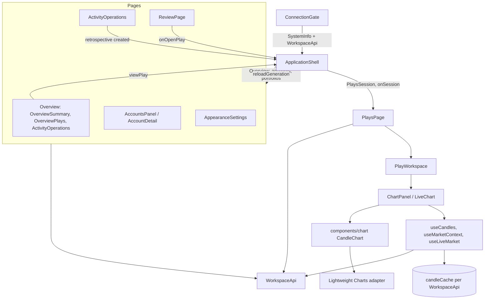

# Frontend guide

Start here if you are new to the Vessel frontend. This guide explains how the code is organised, what each module does, who owns which state and which rules hold everywhere. It describes the code as of October 14, 2026 (after PR #37). The contract documents in this folder hold the detailed rules for each feature. Where this guide and the code disagree, the code wins; please fix the guide.

Read [`CONTEXT.md`](../../CONTEXT.md) first for the product vocabulary (Play, Plan, Order link, Fill, Portfolio, Account and so on). The [backend guide](backend-guide.md) explains the API this client talks to. Improvement work is tracked in [`frontend-review.md`](frontend-review.md).

## What the frontend is

A single-page React 19 application built with Vite 8 and TypeScript 6, styled with Tailwind 4 plus hand-written CSS, using Radix primitives (through editable shadcn-style components) and Lightweight Charts 5 for candles. There is no router, global state library or form library: hash navigation and React state cover everything.

It talks to one same-origin API (`/api`, proxied by Vite in development and by nginx in the release image). It:

- connects with the owner's bearer token, kept only in memory;
- shows Overview, Plays, Review, Portfolios, Accounts, Activity and Settings;
- edits Plays as an in-memory draft and saves them through the API;
- draws venue candles with planned levels, drawings and indicators, and captures the chart as evidence;
- never sends orders, never signs anything and never treats a price touch as a fill.

## Layout

```text
frontend/
  index.html                 the app; review-proposal.html is a standalone design mock
  vite.config.ts             dev proxy for /api and /health, Vitest settings
  eslint.config.js           TypeScript, React hooks and refresh rules, zero warnings
  Dockerfile, nginx.conf.template, static-security.conf, 19-trusted-proxy.sh   release image
  src/
    main.tsx                 applies the stored theme, then renders WorkspacePage
    styles.css               Tailwind entry, Graphite fallback tokens, base styles
    pages/WorkspacePage.tsx  ConnectionGate around ApplicationShell
    api/                     typed requests, runtime guards and safe errors (one file per API area)
    features/
      connection/            the token form
      workspace/             the shell, Overview, Portfolios, Accounts, Activity and their dialogs
      plays/                 the Plays list and editor: draft, plan maths, chart integration, journal, evidence, execution
      market/                candle cache, candle/market-context/live-stream hooks, chart preferences
      review/                the Review page
      settings/              appearance: themes, customizer, theme builder
    components/
      chart/                 renderer-neutral chart, Lightweight Charts adapter, drawings, indicators, chart chrome
      notifications/         popup notification stack
      ui/                    Button, Input, Dialog, Tabs (shadcn-derived, MIT notice kept)
    lib/utils.ts             cn() for class names
    design/portfolio-review/ standalone mock of the Review proposal (not part of the app)
    test/                    Vitest setup, render helper and shared fixtures
```

Dependencies point downward: `features` use `components`, `api` and `lib`;
`components` does not import `features`; `api` imports neither `features` nor
`components`. `src/test/architecture.test.ts` checks those boundaries and
synchronous import cycles. Shared contract types and values live in leaf API
modules, rather than feature components.

## How the application starts

1. `main.tsx` calls `initAppearance()` so the stored theme is on `<html>` before the first paint, then renders `WorkspacePage` in `StrictMode`.
2. `ConnectionGate` (`features/connection`) shows the token form. On submit it calls `getSystem(token)` (`GET /api/system`), then creates the client with `createWorkspaceApi(token)`. The field is cleared whether or not it worked.
3. With a `SystemInfo` and a client, the gate renders `ApplicationShell`. Disconnect drops both, clears the candle cache and returns to the form.
4. `ApplicationShell` wraps the app in `NotificationProvider` and `VenuesProvider` (the venues from `/api/system`), loads `GET /api/overview` and renders the current page.

A new `WorkspaceApi` object means a new session. Shell memory, the Plays session
and the old client's candle cache are reset. Request cancellation is not yet
complete: execution checks, link mutations and some Play and account-import
requests can continue after their caller leaves. Review items R3 and N5 track
these gaps.

## Routing and the shell

`ApplicationShell` keeps the current page in state and mirrors it in the hash (`#overview`, `#plays`, `#review`, `#portfolios`, `#accounts`, `#activity`, `#settings`). There is no router; account detail is shell state on the Accounts page, not a URL.

The shell owns:

- **Navigation**: the sidebar (collapsible to a 78-pixel rail on desktop, a focus-trapped drawer at 800 pixels and below), the page heading and its actions.
- **Workspace data**: the `Overview` document (portfolios, accounts, totals), reloaded after every change through `reload()`, which bumps `reloadKey`. Pages receive `reloadGeneration` and refetch their own data when it changes.
- **Account refresh**: `sync(id)` and `refreshAll()` share one abortable session, show progress and report failures as one notification.
- **Dialogs**: create and manage portfolio or account.
- **Shell memory** (see [State ownership](#state-ownership)).

The page bodies for Overview, Portfolios and Settings are currently inline in the shell (review item S5); Plays, Review, Accounts and Activity are separate components.

## The API client

`api/workspace.ts` defines the `WorkspaceApi` interface and `createWorkspaceApi(token)`, which returns an object of methods closing over the token. Feature code only ever calls these methods.

`api/request.ts` implements the shared transport through `createApiCall`.
Endpoints supply their timeout, response decoder or guard, and error-message
options. `getSystem` uses the same transport. API events notify the candle cache
of unauthorized responses and removed or disabled accounts without importing the
cache into the API layer.

Ordinary JSON requests:

- send `Authorization: Bearer …`, `credentials: 'omit'`, `redirect: 'error'` and `cache: 'no-store'`;
- combine the caller's `AbortSignal` with a timeout (10 to 60 seconds depending on the endpoint);
- turn network failures, timeouts and caller aborts into `ApiError('unavailable', …)`, so callers check `signal.aborted` before showing an error;
- map HTTP failures to safe messages: 401/403 is "token rejected" (and clears the candle cache); 400, 409, 413 and 415 may show the server's Problem Details `detail` (at most 500 characters); 502, 503 and 404 use fixed texts; 5xx adds `Reference: <trace id>` only when `X-Correlation-ID` is 32 hex characters;
- parse JSON and run a **runtime guard** before returning. A body that fails its guard is an `ApiError('invalid-response')`.

Binary and streaming requests differ. `evidenceImage` returns a `Blob`, not a
guarded JSON document. `marketStream` validates individual SSE events. Its
25-second connection timeout ends when response headers arrive, so an established
stream has no overall timeout. Caller cancellation ends the stream without
reporting an error. Endpoints without a response body also skip JSON parsing.

`ApiError` in `api/errors.ts` carries a `kind` (`missing-token`, `unauthorized`,
`unavailable`, `invalid-response`, `http`), the message to show and the status.
`errorMessage(cause, fallback)` returns that safe message or the caller's fixed
fallback, never an arbitrary exception message.

| File | Covers |
| --- | --- |
| `system.ts` | `/api/system`, venue descriptors and capability validation |
| `request.ts`, `errors.ts`, `events.ts` | shared transport, safe errors and per-client cache-invalidation events |
| `guards.ts` | named primitives for text, decimal, date and collection validation |
| `fills.ts`, `markup.ts` | shared imported-fill and image-markup contracts and guards |
| `candles.ts`, `portfolio-icons.ts` | shared interval and portfolio-icon keys without UI dependencies |
| `venues.ts` | `Venues` lookups and `VenuesProvider`/`useVenues()` |
| `workspace.ts` | the client, portfolios, accounts, snapshots, fills, instruments, candles, market context, the live stream, account sync |
| `account-access.ts` | Lighter discovery and read-only token metadata, token transport rules and messages |
| `plays.ts` | Play documents, plans, history, status changes, evidence, execution and order links |
| `diary.ts` | manual executions and the request ID generator |
| `retrospective.ts` | retrospective preview and creation |
| `activity.ts` | Activity operations |
| `overview-summary.ts` | the scoped Overview summary |
| `review.ts` | Review report and exclusions |
| `sizing.ts` | sizing record, exposure and limits |
| `sse.ts` | an incremental, bounded server-sent-events parser |

**Guards** are hand-written to mirror the C# DTOs: exact decimal strings by regular expression, GUIDs, ISO dates, counts, enumerations, length limits and cross-field invariants (for example an Overview summary's totals must match its rows). `guards.ts` names the differing acceptance profiles, including plain and diary decimals and ISO and strict UTC timestamps. Endpoint guards choose the profile required by their contract. Optional fields marked "older servers" were added during rollouts. When a backend DTO changes, update the TypeScript type, its guard and the fixtures in `src/test/` together.

**The live stream** (`marketStream`) uses `fetch` with the bearer header, never `EventSource` and never a token in the URL. `SseParser` handles split chunks and bounds memory; each event is validated with the same candle and context guards as the REST endpoints.

## Feature modules

| Module | Entry points | What it does | Contract |
| --- | --- | --- | --- |
| connection | `ConnectionGate` | Token form, `/api/system` check, session start and end. | [scaffold-contract](scaffold-contract.md) |
| workspace | `ApplicationShell`, `AccountsPanel`, `AccountDetail`, `ActivityOperations`, `OverviewSummary`, `OverviewPlays`, `CreateDialogs`, `ManageDialogs`, `WalletAccountImport`, `AccountCredential`, `RetrospectivePreview` | The shell and the Overview, Portfolios, Accounts and Activity pages; portfolio and account management, Lighter discovery and tokens, retrospective Play creation from an operation. | [core-workspace-contract](core-workspace-contract.md), [account-management-contract](account-management-contract.md), [activity-operations](activity-operations.md), [lighter-delivery-contract](lighter-delivery-contract.md), [diary-completion-contract](diary-completion-contract.md) |
| plays | `PlaysPage`, `PlayWorkspace` | The list of saved Plays and the editor: context fields, capital context, suggestions, chart, journal, position editor and summary; save, status changes, revisions, history, evidence, execution and manual executions. | [plays-workspace-contract](plays-workspace-contract.md), [play-lifecycle](play-lifecycle.md), [sizing-suggestions](sizing-suggestions.md), [diary-completion-contract](diary-completion-contract.md) |
| market | `useCandles`, `useMarketContext`, `useLiveMarket`, `candleCache`, `useChartPreferences` | Candles with a per-connection cache, header statistics, the live stream with reconnect and polling fallback, chart view preferences. | [chart-plan](chart-plan.md), [performance-plan](performance-plan.md) |
| review | `ReviewPage` | Scored closed Plays: periods, scorecard, equity chart, breakdowns, drill-down and exclusions. | [portfolio-review](portfolio-review.md) |
| settings | `AppearanceSettings`, `appearance.ts`, `themes.ts`, `generator.ts` | Built-in themes, per-theme overrides, the theme builder and the contrast checks. | [appearance-settings](appearance-settings.md) |

Inside **plays**, the pure modules carry the rules and the components stay thin:

| File | Holds |
| --- | --- |
| `draft.ts` | `PlayDraft`, entry and exit creation, share splitting, renumbering |
| `saved.ts` | `PlaysSession`, saved state and dirty checks, draft ↔ document conversion, evidence sync, plan change descriptions |
| `levels.ts` | level prices (percentages are returns at the leverage), chart overlays, drag and pick placement, price rounding |
| `sizing.ts` | position size, exit estimates, liquidation estimate, budget checks, formatting in quote/base units |
| `position-risk-summary.ts` | the summary's money, coverage and R:R figures |
| `planChecks.ts` | wrong-side stops and targets, the fixes offered, stops past liquidation |
| `suggestions.ts` | sizing suggestions from the sizing document |
| `execution.ts`, `manual.ts` | order and level names for the Execution tab; manual execution drafts and requests |
| `evidence.ts`, `markup.ts` | image limits and signature checks; vector markup and its SVG/PNG rendering |
| `instruments.ts` | the venue catalogue hook and instrument search |

### How the modules work together



Pages talk to each other only through the shell: opening a Play from Overview or Review sets `requestedPlay` and navigates to Plays, where `PlaysPage` opens it unless that would replace unsaved work. Any change that affects accounts or totals calls the shell's `reload()`.

## State ownership

| State | Owner | Lifetime |
| --- | --- | --- |
| Token | `createWorkspaceApi` closure | Until Disconnect or reload. Never stored. |
| `SystemInfo`, venues | `ConnectionGate`, `VenuesProvider` | The session. |
| Overview document (accounts, portfolios, totals) | `ApplicationShell` | Reloaded on demand; pages read it as props. |
| Shell memory: account filters, portfolio filter, Activity filters, Overview scope and grouping, selected account, sidebar collapsed | `ApplicationShell` | Survives navigation; resets on a new API identity. Missing scopes and options fall back to "All". |
| Plays session: list or editor view, the draft, the saved state, the manual execution form, the observed version | `ApplicationShell` (`playsSession`), edited by `PlaysPage` | Survives navigation. Reload and Disconnect discard it. |
| Plays mutation guard (`workRef`) | `ApplicationShell`, acquired by `PlaysPage` | One save, status change, open, delete or manual write at a time. |
| Page data (Activity, Review, account detail, Overview summary, Plays list) | Each page component | Refetched when its key or `reloadGeneration` changes. |
| Candles | `candleCache` (`features/market`), one per `WorkspaceApi` | The session, at most 20 series of 5,000 candles; never stored in the browser. |
| Chart undo/redo, drawing tool and selection | `useChartHistory`, `useDrawingEditor` | Per account and instrument; reset when it changes. |
| Theme choice, overrides, saved themes | `appearanceStore` → `localStorage['vessel.appearance']` | Persistent; a browser preference, not workspace data. |
| Chart preferences (interval, favourites, magnet, live, indicators) | `useChartPreferences` → `localStorage['vessel.chart.preferences.v1']` | Persistent; view preferences only. |

Tokens and financial data are not persisted in browser storage. They remain in
memory for the active session.

**Patterns you will see.**

- *Keyed request state.* A component stores its result with the key it was requested for (API identity, IDs, `reloadGeneration`, a retry counter) and treats any other key as loading. Many request effects create an `AbortController` and abort it in cleanup. This is the intended pattern, not a guarantee for every request; R3 and N5 list exceptions.
- *Latest refs.* Async work that finishes later reads `latest.current` (updated in an effect) instead of the render's props, so it applies to the current draft, not the one from the click.
- *Adjusting state during render.* A few components compare a source prop with stored state and call `setState` during render (React's documented pattern for derived resets), for example when a selection must drop rows that are no longer shown.

## The Plays editor

`PlaysPage` shows the list or the editor. The editor (`PlayWorkspace`) keeps the approved layout from [the baseline](../design/approved-baseline.md): play fields and plan notices on top, capital context and suggestions above the workspace, the chart and journal on the left, the bounded position editor on the right, the summary below. Themes and responsive widths never move these sections.

- Every edit produces a new `PlayDraft` through `onChange`; `PlaysPage` writes it into the shell session.
- **Saving** sends `fieldsFromDraft(draft)` with the expected version (and a revision reason after planning), then syncs evidence (deletes, uploads, note and markup updates). Edits made while saving stay in the draft.
- **Status** changes (`Plan it`, `Pause`, `Resume`, `Cancel play`) go through `POST /status`; planning a dirty draft saves it first.
- A **saved Play** is tracked by `usePlayExecution`: it reads `/execution`, runs `/execution/check` when opened and every 60 seconds while visible, and offers order links. A status that moved on the server (Open, Closed) reloads the Play.
- **Manual accounts** show `ManualExecutionPanel` instead, with idempotent request IDs.
- **Unsaved work** is protected: opening another Play or starting a new one never replaces a dirty draft.

## The chart stack

```text
features/plays/PlayChart.tsx      ChartPanel: plan overlays, plan tools, drawings, history, rail and favourites
  └ LiveChart                     candles + market context + live stream, toolbar, capture, expanded dialog
      └ components/chart/CandleChart.tsx   renderer-neutral React component (memoized)
          └ lazy.ts → lightweight.ts       Lightweight Charts adapter, loaded as its own chunk
              ├ LevelsPrimitive            planned levels, tags and drag handles on the canvas
              ├ DrawingsPrimitive + DrawingController   drawings, hit testing and gestures
              └ paneLayout.ts + indicators.ts           EMA lines, Volume and RSI panes
```

- `CandleChart` receives display candles, `PriceOverlay`s, drawings, the active tool and callbacks. It never sees a Play. Its `ChartAdapter` interface (`types.ts`) is the only way into the renderer, and tests replace it with a fake (`src/test/setup.ts` mocks `lightweight`).
- **Data**: `useCandles` reads from `candleCache`, which shows cached candles immediately, revalidates the latest window, pages older windows, merges live candles and drops entries on 404/409. `useLiveMarket` reads the SSE stream, reconnects with backoff, falls back to 15-second polling and pauses when the tab is hidden. Prices are observations, never fills.
- **Levels**: `planOverlays` (in `features/plays/levels.ts`) turns entries into overlays. Dragging previews on the canvas only and commits once on release; a percentage level dragged on the chart becomes a price.
- **Drawings** are anchored to UTC time and price, stored in the draft per `venueId:contractId`, and drawn on the canvas so captures include them.
- **Captures** use `takeScreenshot` plus a caption footer and go into the draft's evidence.
- **Theme**: the adapter reads tokens (`--background`, `--chart-candle-*`, `--positive`, …) from computed styles and re-reads them when `<html>` changes.
- Lightweight Charts requires its attribution logo; level tags keep clear of it.

## Theming

- `features/settings/themes.ts` defines ten built-in themes (seven dark, three light). A theme sets sixteen colours and a radius; nothing else.
- `appearance.ts` resolves the selected theme plus overrides into CSS custom properties on `<html>` (`themeTokens`), and stores the choice in `localStorage`.
- `styles.css` keeps the Graphite values as the fallback and maps tokens into Tailwind (`@theme inline`).
- **Component CSS reads tokens only**: `var(--card)`, `var(--positive)`, or `color-mix` of tokens. Do not write a literal colour in component CSS.
- Every built-in theme must pass `contrastChecks` (WCAG AA for text and signals on every surface, 3:1 for the focus ring); `appearance.test.tsx` enforces it.
- Feature CSS files are imported by the component that uses them (`application-shell.css`, `plays-workspace.css`, `review.css`, `chart.css`, …). Review styles use a `pr-` prefix and alias tokens (`--pr-green: var(--positive)`).

## Conventions

- **Exact numbers.** API amounts are decimal strings. Format them with `Intl.NumberFormat` on the original string (`money`, `amount`, `reviewMoney`); use `Number` only for chart geometry, sorting or display estimates. Compare or sum exactly with `BigInt` when it matters.
- **Unknown stays unknown.** Null is shown as "—", "Unavailable" or "Unknown", never as zero.
- **Notices are part of the API.** Server notices and scope notes are shown verbatim.
- **Capabilities, not names.** Use `useVenues().can(venueId, 'candles')` and friends, never `venueId === 'hyperliquid'`.
- **Errors.** Show `ApiError.message` or a fixed fallback; never a raw response body.
- **Accessibility.** Every icon button has an accessible name; dialogs restore focus to their trigger; the expanded entry editor and chart are in-page dialogs closed with Escape.
- **IDs** for entries, exits, evidence and drawings are generated locally without `crypto.randomUUID` (unavailable on plain-HTTP LAN previews).
- **Package manager.** pnpm only, from the repository root.

## Testing

```sh
pnpm --filter vessel-frontend typecheck
pnpm --filter vessel-frontend lint
pnpm --filter vessel-frontend test
pnpm --filter vessel-frontend build
```

- Vitest with jsdom and Testing Library; tests sit next to the code (`*.test.ts(x)`). The default timeout is 15 seconds for slow CI runners.
- `src/test/setup.ts` adds jest-dom matchers, stubs `scrollTo` and object URLs, and replaces the Lightweight Charts adapter with a fake, because jsdom has no canvas.
- `src/test/render.tsx` renders inside `VenuesProvider` with the shared `systemFixture`. Fixtures for accounts, Plays, Activity, Review and the Overview summary are in `src/test/`.
- API tests stub `fetch` and check both requests (headers, bodies, paths) and guards. Feature tests usually pass a partial fake `WorkspaceApi`.
- Canvas rendering, real layout and gestures are checked in a browser, not jsdom. Use synthetic data only; see [`docs/product-review/verification/`](../product-review/verification/) and `scripts/release-browser-smoke.cjs`, which intercepts venue market-data routes so no venue is called.

## Recipes

### Add a page

1. Add `{ id, label, icon, description }` to `pages` in `ApplicationShell.tsx`; the hash route and navigation follow.
2. Create the page component in its feature folder. Take `api`, `reloadGeneration` and the shell data it needs as props; keep its own request state with an `AbortController`.
3. Render it in the shell's main area for `page === '<id>'`. Anything that must survive navigation goes into shell memory, not the page.
4. Add a feature CSS file that reads theme tokens, and tests next to the component.

### Add an API call

1. Add the response type and a guard in the matching `api/*.ts` file. Mirror the C# DTO exactly: decimal strings, nullable fields, limits.
2. Add the method to the `WorkspaceApi` interface and implement it in `createWorkspaceApi` through the existing request helpers, with a timeout and any endpoint-specific error message.
3. Test the request shape and the guard in `api/*.test.ts` with a stubbed `fetch`, including a rejected body.
4. Call it from a component with an `AbortController`, check `signal.aborted` before setting error state, and show `ApiError.message`.

### Add a theme token

1. Add the colour to `ThemeColors` in `themes.ts` and give every built-in theme a value (the dark and light helpers can derive it).
2. Emit it in `themeTokens` (`appearance.ts`) and add the Graphite fallback to `:root` in `styles.css`.
3. If it is text or a signal, add it to `contrastChecks`; the built-in theme test must keep passing.
4. If owners should edit it, add it to `colorGroups` in `AppearanceSettings.tsx`.
5. Use it in CSS as `var(--token)`.

### Add a drawing tool

1. Add the kind to `DrawingKind` and `pointCount` in `components/chart/drawings.ts`.
2. Teach `DrawingController` to build, hit-test and render it.
3. Add its label, hint, icon and group in `drawingTools.tsx` and `toolIcons.tsx`.
4. Test the model in `drawings.test.ts` and the interaction in `drawingInteraction.test.tsx`; check it in a browser.

## Where to read more

- Product and scope: [`project-brief.md`](../project-brief.md), [`mvp-alignment.md`](mvp-alignment.md)
- Approved layout: [`approved-baseline.md`](../design/approved-baseline.md), [`plays-workspace-contract.md`](plays-workspace-contract.md)
- Chart, captures and indicators: [`chart-plan.md`](chart-plan.md); performance: [`performance-plan.md`](performance-plan.md)
- Themes: [`appearance-settings.md`](appearance-settings.md)
- Venues in the browser: [`venue-registry.md`](venue-registry.md), [`venue-instruments.md`](venue-instruments.md)
- The API: [`backend-guide.md`](backend-guide.md)
- Improvement backlog: [`frontend-review.md`](frontend-review.md)
