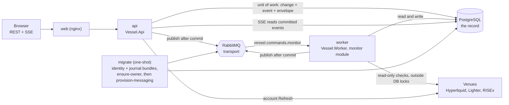
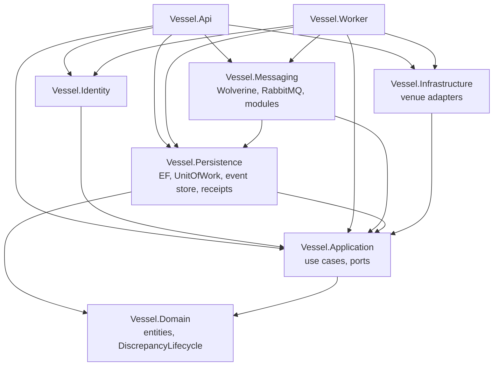
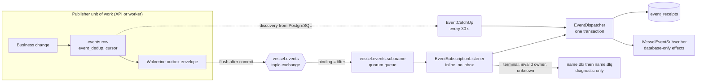
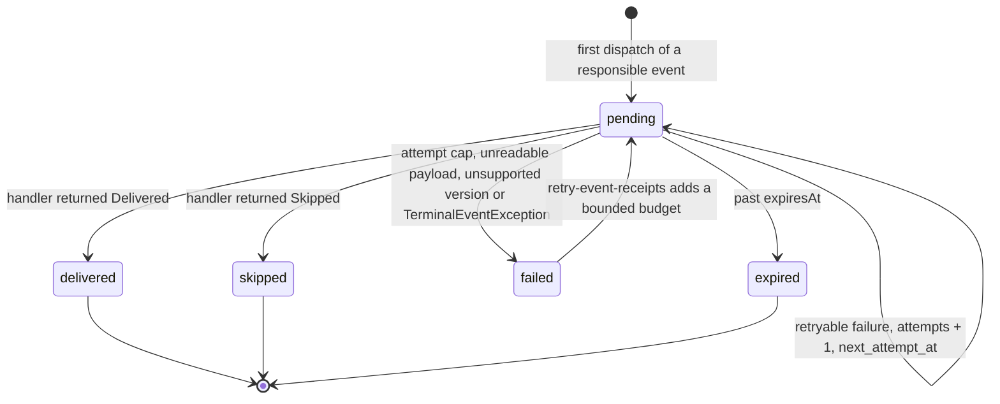
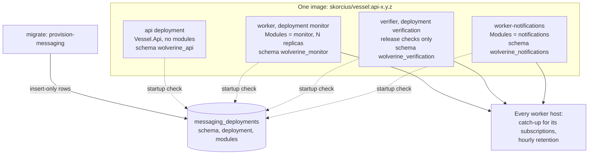
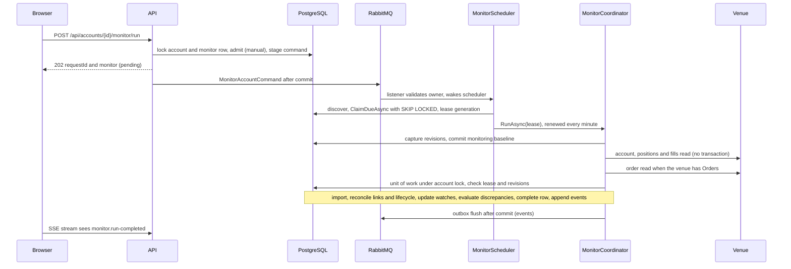
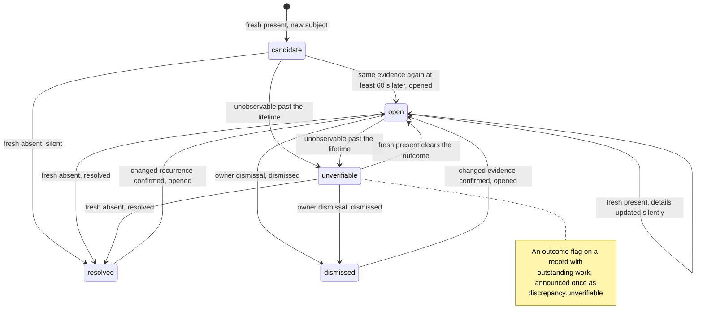
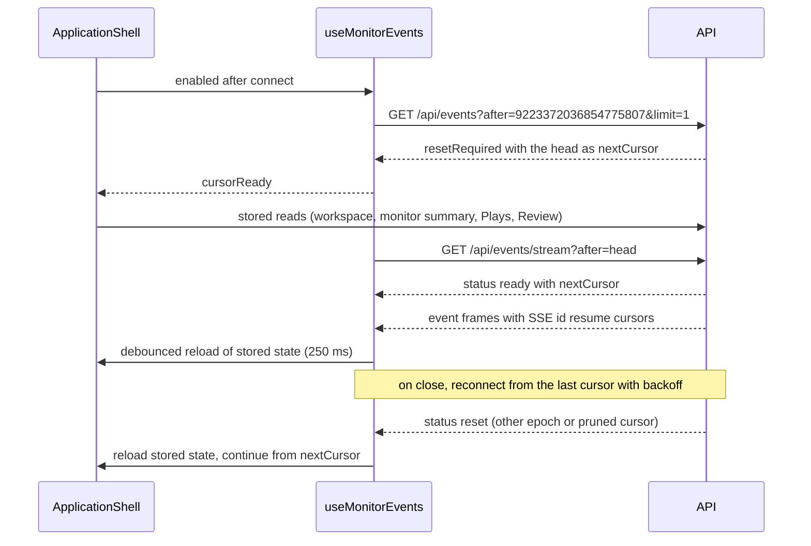

# Messaging, events and workers

October 18, 2026. Developer and operator reference for the implemented event, messaging, worker and monitor design. It describes what the code does and how to work with it. The owner's decisions and their reasons are in the [monitor plan](play-monitor-plan.md); the browser API is in the [monitor API contract](play-monitor-api-contract.md); deployment commands are in [`deploy/README.md`](../../deploy/README.md). A diagram overview is in [play-monitor-overview.html](play-monitor-overview.html). Update this document with the code.

## Contents

- [Overview and principles](#overview-and-principles)
- [Projects and dependencies](#projects-and-dependencies)
- [Unit of work](#unit-of-work)
- [Event model](#event-model)
- [Topology](#topology)
- [Subscriptions](#subscriptions)
- [Modules](#modules)
- [Worker host](#worker-host)
- [Monitor](#monitor)
- [Discrepancies](#discrepancies)
- [Browser](#browser)
- [Configuration reference](#configuration-reference)
- [Operations runbook](#operations-runbook)
- [Testing map](#testing-map)

## Overview and principles

- **PostgreSQL is the record.** Events, each subscription's progress and receipts, pending monitor requests, leases and discrepancies live in PostgreSQL. Everything can be rebuilt from it.
- **RabbitMQ is transport.** It wakes subscribers and carries commands. Losing its volume costs latency, not data; subscribers catch up from PostgreSQL and pending monitor requests are found again in `monitor_accounts`. Dead-letter contents and broker diagnostics are not reconstructed.
- **Publishers never know subscribers.** An event is written once in the business transaction and published once to the topic, with the event type as routing key. No per-subscriber rows, no consumer list, no producer republish.
- **Each subscriber owns its subscription:** queue, filter, dead-letter queue, receipts, retries and recovery.
- **Domain and Application are free of Wolverine and RabbitMQ.** All broker code is in `Vessel.Messaging`; `ArchitectureTests` enforces it.
- **Nothing is created at runtime.** The API and workers never migrate, create envelope storage or declare broker topology. The one-shot `migrate` step does, explicitly.
- **Events come from Vessel's own state changes** inside the unit of work, never from re-read venue rows. A price touch is never a fill. Discrepancies are flagged, never corrected.
- **Owner scope everywhere.** Every message carries `ownerId`; hosts validate Active/Suspended/Unknown through `IJournalOwnerDirectory` and create an assigned `IOwnerScopeFactory` scope. Token mode has one configured owner; Wallet mode has identity-backed users. A message never mutates an HTTP scope.



## Projects and dependencies



Arrows point to what a project references. `backend/tests/Vessel.Tests/ArchitectureTests.cs` checks these exact references, that Domain and Application have no package references, and that no project except Messaging references a `WolverineFx*` or `RabbitMQ*` package.

| Project | Messaging and monitor parts |
|---|---|
| `Vessel.Domain` | `Monitoring/MonitorAccount` (admission, leases, state and `StateRevision`), `MonitorExitWatch`, `PlayDiscrepancy`, `DiscrepancyLifecycle` |
| `Vessel.Application` | Ports: `IUnitOfWork`, `IUnitOfWorkParticipant`, `IVesselEventSink`, `IVesselEventReader`, `IMonitorCommandSink`, `IVesselEventSubscriber`, `IVesselCommandHandler<T>`. Contracts: `VesselEvent`, `VesselEventDraft`, `VesselEventCursor`, `VesselEventValues.Types`, `MonitorAccountCommand`. Use cases: `MonitorCoordinator`, `MonitorDiscrepancyService`, `MonitorCommandHandler`, `MonitorOptions`; `Venues/OrderMechanics` |
| `Vessel.Persistence` | `UnitOfWork`; `Events/`: `VesselEventStore` (sink, cursor, dedup), `VesselEventMutationCapture`, `VesselEventHistory` (reader), `EventRetention`, `EventStreamEpoch`, `IVesselEventOutbox`; `Events/Subscriptions/`: `EventSubscription`, `EventSubscriptionLimits`, `TopicFilter`, `EventDispatcher`, `EventCatchUp`, `EventSubscriptionRegistry`, `EventReceiptAdmin`; `MonitorStore`, `MonitorDiscrepancyStore`, `OwnerScopeFactory`, `ServerStateStore`, `SystemMonitorStore`, `SystemEventSubscriptionStore` (registered by `AddVesselPersistence`) |
| `Vessel.Infrastructure` | `ApplicationServices.AddVesselMonitoring` (monitor use cases and `Vessel:Monitor`, shared by the API and the monitor worker), `Monitoring/MonitorRunExecutor` (lease renewal through fresh scopes), `MonitorRunLog` |
| `Vessel.Messaging` | `MessagingSettings`, `MessagingHosting` (`AddVesselMessaging`), `MessagingTopology`, `MessagingProvisioning`, `MessagingCommands` (offline CLI), `MessagingDeployments`, `EventSubscriptionListener`, `SubscriptionMaintenanceService`, `WolverineVesselEventOutbox`; `Modules/`: `IVesselModule`, `VesselModuleRegistry`, `Monitor/`, `Notifications/`, `Verification/` |
| `Vessel.Identity` | `IdentityOwnerDirectory`, cookie-session principal validity and offline administration; its own context/schema, no journal-table access |
| `Vessel.Worker` | `WorkerHost`, `WorkerSettings`, `WorkerModules`, `MonitorScheduler`, `MonitorWakeup`, `NotificationHeartbeat`, `NotificationRetentionService` |
| `Vessel.Api` | `AddVesselMessaging("api")`, offline command dispatch, `VesselEventEndpoints`, `MonitorEndpoints` |

Subscription definitions (`EventSubscription`) live in Persistence because the dispatcher, catch-up and registry use them; module descriptors live in Messaging; business handlers implement Application ports.

## Unit of work

`IUnitOfWork` (Application) and `UnitOfWork` (Persistence) own every database write boundary on the scoped, owner-filtered `VesselDbContext`.

- **One top-level transaction.** The outer `ExecuteAsync` starts the EF transaction and must own it; it refuses to adopt an existing transaction. Stores and their lock wrappers (for example `LockedAsync`) participate; they never begin, commit or roll back.
- **Nested participation.** A nested `ExecuteAsync` runs inside the outer one and saves its tracked changes before returning, so the caller reads them and conflicts surface at the nested call. It never commits. Intermediate `SaveChangesAsync` calls are allowed and stay inside the transaction.
- **Sequential only.** Calls in a scope must be awaited in order. Parallel, dangling or fire-and-forget callbacks are rejected and make the unit roll back.
- **Failures poison the unit.** Once a participant throws, the unit rolls back even if a caller catches the exception. Do not wrap participating calls in catch-and-continue blocks; only non-participating work (a venue HTTP read) can be handled and recorded, and then a new unit records it.
- **Commit.** After the operation, the final save and every participant's `BeforeCommitAsync`, the commit runs with `CancellationToken.None`: cancellation is honoured up to the commit, never halfway through it.
- **Rollback.** A rollback failure never replaces the original exception; it is attached under the exception data key `Vessel.UnitOfWork.RollbackError` and the scope becomes unusable.
- **Events and envelopes are staged before commit, published after it.** `VesselEventStore` is a participant: `BeforeCommitAsync` sequences and inserts events and stages their outbox envelopes on the same transaction; `AfterCommitAsync` flushes the outbox. A flush failure after a successful commit is logged and left to Wolverine's durable outbox and subscriber catch-up; the operation still succeeded. `RollbackAsync` discards every buffered event and command. Never call Wolverine's `SaveChangesAndFlushMessagesAsync` or flush before the outer commit.
- **No object I/O inside a transaction.** `IUnitOfWork.IsActive` is true while a unit runs in the scope (including a dispatcher savepoint) and for any EF, explicitly enlisted or ambient `System.Transactions` transaction. Evidence upload, deletion and Play deletion call `RequireOutermost` and refuse before touching storage, because a rollback cannot undo it. The same applies to any network call.
- **`IsolateAsync` is the dispatcher's savepoint.** `UnitOfWork.IsolateAsync` (internal) runs a subscription handler and saves its effects in a savepoint. On failure it rolls back to the savepoint, clears tracked entities and every participant's buffered state, and keeps the unit and its row locks, so the dispatcher can record the attempt in the same transaction. Call it before any other buffered participant write in the unit, since that state is discarded too. Only the dispatcher uses it.

## Event model

### Envelope

`VesselEvent` (`backend/src/Vessel.Application/Events/VesselEventContracts.cs`) is the one payload for storage, broker and API. Serialization (`VesselEventJson`, and the same policy in Wolverine) uses web casing and writes every absent optional value as an explicit `null`.

| Field | Meaning |
|---|---|
| `id` | UUIDv7, stable; subscribers and dedup tables key on it |
| `type`, `version` | One of `VesselEventValues.Types`; version `1` (the store rejects others) |
| `ownerId` | The journal owner |
| `sequence` | Owner-scoped, commit-ordered position as a decimal string |
| `runId` | The monitor run or owner action that produced it; groups related events |
| `dedupKey` | Unique per owner, at most 1,024 characters; a repeated key creates no event |
| `severity` | `info`, `warning` or `critical` |
| `occurredAt` / `detectedAt` | Source time when known, and when Vessel recorded it |
| `timeliness` | `late` when `detectedAt − occurredAt` is strictly more than twice `Vessel:Monitor:Interval`, else `timely` |
| `relevance` | `superseded` when a later change in the same unit overtook it, else `current` |
| `expiresAt` | Optional; a subscriber settles an event past it as `expired`. No v1 producer sets it yet |
| `subject` | `accountId`, `venueId`, `contractId`, `playId`, `entryId`, `levelId`, `discrepancyId`, each possibly `null` |
| `source` | `trigger` (`owner` or `monitor`), `orderIds`, `fillIds` (at most 200 IDs of at most 256 characters each, or `null`) |
| `data` | Type-specific JSON object, at most 32 KiB, exact decimal strings |

### Catalogue, version 1

| Type | Produced by | Severity | Dedup key |
|---|---|---|---|
| `play.opened` | Mutation capture: Planned or Paused → Open | `info`; `warning` from Paused | `play:{playId}:opened` |
| `play.closed` | Mutation capture: Open → Closed | `info` | `play:{playId}:closed` |
| `play.status-changed` | Mutation capture: other status changes | `info` | `status-change:{statusChangeId}` |
| `execution.filled` | Mutation capture: new linked fill quantity | `info`; `warning` for stops | `order:{accountId}:{importedOrderId}:filled:{cumulativeQuantity}` (internal order ID; payload `source.orderIds` stay venue IDs) |
| `link.needs-confirmation` | Mutation capture: link became `suggested` | `warning` | `link:{linkId}:suggested` |
| `execution.link-changed` | Mutation capture: other link changes | `info` | `link-change:{changeId}` |
| `discrepancy.opened` | `MonitorDiscrepancyService` | per kind | `discrepancy:{id}:{revision}:opened` |
| `discrepancy.resolved` | `MonitorDiscrepancyService`, cleared or dismissed (`data.resolution`) | `info` | `discrepancy:{id}:{revision}:resolved` or `…:dismissed` |
| `discrepancy.unverifiable` | `MonitorDiscrepancyService`, subject unobservable past the lifetime | `warning` | `discrepancy:{id}:{revision}:unverifiable` |
| `monitor.state-changed` | `MonitorCoordinator`, persisted state change | `warning` when leaving `live` (except to `idle`), else `info` | `monitor:{accountId}:{stateRevision}:{state}` |
| `monitor.run-completed` | `MonitorCoordinator`, owner Check finished | `info` | `monitor-run:{accountId}:{requestId}` |
| `credential.expiring` | `MonitorCoordinator`, token expires within 14 days | `warning` | `credential:{accountId}:{credentialRevision}:expiring` |

Field-level payloads and the decision history are in the [plan's event contract](play-monitor-plan.md#event-contract). Golden JSON for the lifecycle producers is checked by `VesselEventGoldenTests`.

### Writing events

- Producers call `IVesselEventSink.AppendAsync(VesselEventDraft)` inside an active unit; `SetRunAsync(runId, "owner" | "monitor")` sets the run identity for the unit's events. Link, fill and status mutations are captured automatically by `VesselEventMutationCapture`, an EF interceptor; producers do not append those.
- **Causal order.** At `BeforeCommitAsync` the store orders captured link changes, then the fills they claim, then the status changes they caused, then explicit drafts (discrepancies, monitor and credential events).
- **Sequence allocation.** The store locks the owner's `event_cursors` row (`FOR UPDATE`, held to commit), inserts `event_dedup` first (`ON CONFLICT DO NOTHING`; a duplicate key creates nothing), increments the cursor and inserts the `events` row with its sequence, then stages the envelope. No database sequence object is used, so a sequence below the committed cursor can never appear later. Sequences can have holes (account deletion, pruning), never late arrivals.
- **Durable identities.** `event_dedup` (key → event ID, subject account), `event_baselines` (per-account watch start) and `event_fills` (known fill identities) survive retention, so a pruned event cannot be re-created. Deleting an account removes its baselines, fill identities, events, dedup rows and their receipts.

### Cursor and epoch

`event_cursors` holds, per owner, `sequence` (last allocated), `retention_floor` (highest pruned sequence) and `epoch` (random UUID). The browser cursor is `{epoch}.{sequence}` with the epoch as 32 lowercase hex digits (`VesselEventCursor`), or `0` for the start of a stream not yet seen. A cursor from another epoch, below the floor, ahead of the database, or a bare pre-epoch sequence gets `resetRequired: true` and the head as `nextCursor`. `rotate-event-epoch` gives every owner a new epoch after a restore; `migrate` never rotates it.

## Topology

Names come from `MessagingTopology` with `Vessel:Messaging:Prefix` (default `vessel`):

| Name | What |
|---|---|
| `vessel.events` | Durable topic exchange; routing key = event type |
| `vessel.events.sub.<subscription>` | Durable quorum queue per subscription, bound to the exchange once per filter |
| `vessel.commands.<queue>` | Durable quorum command queue owned by a module, for example `vessel.commands.monitor` |
| `<queue>.dlx` | Durable fanout dead-letter exchange of each queue above |
| `<queue>.dlq` | Durable quorum queue bound to that exchange |

Every subscription and command queue is declared with `x-queue-type: quorum`, `x-delivery-limit: Vessel:Messaging:DeliveryLimit` (default 20) and `x-dead-letter-exchange: <queue>.dlx`. The delivery limit is only a transport guard; business retries are counted in receipts. Hosts configure Wolverine's view of each queue with the same arguments and native dead-lettering into the same exchange.

Only the explicit `provision-messaging` command declares topology, for every compiled-in module, whichever modules a deployment runs. RabbitMQ refuses to redeclare an existing queue with different arguments, so changing `DeliveryLimit` or a queue type needs the queue deleted first. Hosts never declare anything: Wolverine's request/reply queues are disabled (`DisableSystemRequestReplyQueueDeclaration`) and so is Wolverine's own dead-letter queueing. Publisher confirmations are enabled on every channel.

## Subscriptions

### Flow



### Registration

- `EventSubscription(name, module, filters, limits?)`: the name is 1–48 characters (lowercase letter first; lowercase letters, digits, `-`); filters are 1–32 AMQP topic patterns over event types (words split on `.`, `*` one word, `#` zero or more); the owning module must equal the declaring module.
- `event_subscription_registrations` is the server-wide, insert-only subscription name/module/filter/fingerprint authority. Provisioning inserts a **new** registration and existing owners' initial progress in one statement (their current cursor is the responsibility start). Re-provisioning never backfills existing registrations or changes start/progress. Different module/fingerprint fails provisioning; changed filters need a new name.
- `event_subscriptions` remains per-owner progress/low-water/gaps and references the server registration; receipts remain per owner/event/subscription. Dispatch/catch-up, not a publisher, initialize missing progress under the owner's shared retention lock and registration `FOR KEY SHARE`. Start responsibility at zero, low-water at the retained floor; a positive floor records an explicit lagging gap. A missing row never means NotResponsible. Registration/fingerprint is rechecked for retry/failure/advance, so removed/incompatible subscriptions produce no effects.
- Deregistration is server-wide: lock/delete registration, cascade progress/receipts, then remove the queue. Stale catch-up cannot recreate progress without registration. New users need no producer-side subscriber list or provisioning run.
- Provisioning registers before declaring bindings, so a rejected filter never reaches the broker. The dispatcher also refuses to settle for a host whose compiled filter differs from the registered fingerprint.

### Dispatcher

`EventDispatcher.DispatchAsync` serves live delivery (`DispatchTrigger.Live`) and catch-up (`DispatchTrigger.CatchUp`). In one unit of work it:

1. rejects an owner other than the assigned scope's owner (`InvalidOwner`) and checks directory eligibility before starting a dispatch transaction; already-started work may finish during suspension;
2. takes the owner's retention advisory lock in shared mode, so no floor is published under it;
3. looks the event up by owner and ID, never trusting the message's sequence or payload. Absent with an `event_dedup` row: `Historical`; absent with neither: `Unknown`; retained at or below the floor: `Historical`;
4. checks responsibility: registered, same fingerprint, sequence above `responsible_from`, type matching the filter. Otherwise `NotResponsible`, with no receipt;
5. inserts the receipt if absent and locks it (`FOR UPDATE`; catch-up uses `SKIP LOCKED` and returns `Busy`, live delivery waits);
6. returns `AlreadySettled` for a terminal receipt and `NotDue` before `next_attempt_at`; settles `expired` past `expiresAt`, and `failed` with zero handler attempts when the stored payload cannot be read as an event (`Unreadable event.`; the payload is never logged), for a version above the subscription's `SupportedVersion` or when the attempt cap is reached. Each of these settles in the same transaction as the receipt insert, so a poison event never blocks catch-up or the low-water mark;
7. runs the keyed `IVesselEventSubscriber` inside `IsolateAsync` and settles `delivered` or `skipped`; on a handler or save failure it records the attempt on the still-locked receipt (`TerminalEventException` fails it at once).

If the whole unit then fails at commit after the handler ran, the attempt is recorded in a new transaction. The cap therefore bounds recorded attempts, not every rolled-back invocation; if that recording also fails or the process dies, the invocation is not counted. This is accepted because handlers are database-only and idempotent. Shutdown cancellation is not an attempt.

### Receipt states



Receipts are removed with their event by retention (cascade) and with their subscription by deregistration.

### Settlement

Listeners run inline (`ProcessInline`), not through Wolverine's durable inbox: the delivery is acknowledged only after the dispatcher has settled or recorded the attempt. The durable outbox stays.

| Dispatch outcome | Receipt | Broker delivery |
|---|---|---|
| `Delivered`, `Skipped`, `Expired` | Settled with any effects, same transaction | Ack |
| `RetryScheduled` | Effects rolled back to the savepoint; `pending`, attempts + 1, `next_attempt_at` | Ack; catch-up owns the retry |
| `Failed` | `failed` with a safe error | Dead-letter, for diagnosis |
| `InvalidOwner` (also checked by the listener before dispatch) | None | Dead-letter, logged by IDs |
| `Unknown` | None | Dead-letter, logged by IDs |
| Queue not run by this host | None | Dead-letter |
| `Historical`, `AlreadySettled`, `NotResponsible`, `NotDue`, `Busy` | Unchanged | Ack |
| Dispatcher threw (database unavailable, shutdown) | Whatever committed | Ack; catch-up finds it later |

Suspended owners' live events are acknowledged without handling or a receipt; catch-up resumes after restore. Unknown owners dead-letter. Directory failures enter the listener's safe acknowledge/catch-up path. Commands have no receipts: `MonitorCommandListener` validates IDs and directory status (suspended drops/logs, unknown dead-letters), then `MonitorCommandHandler` wakes the scheduler if `monitor_accounts` holds the matching pending request. Duplicates and late commands are acknowledged and do nothing.

### Retries and catch-up

`EventSubscriptionLimits` (code defaults, overridable per subscription): `MaxAttempts` 12, shared by live delivery and catch-up and copied into the receipt's `max_attempts` when it is created; backoff from `RetryBase` 1 minute doubling to `RetryCap` 1 hour with ±20% `RetryJitter`; `DiscoveryGrace` 30 s; `CatchUpInterval` 30 s; `BatchSize` 100; `MaxAdminRetryBudget` 12; `SupportedVersion` 1.

Each `EventCatchUp.RunAsync` pass for one subscription:

1. **Discovery:** up to `BatchSize` matching events above the low-water mark, `responsible_from` and the floor, detected more than `DiscoveryGrace` ago, with no receipt, in sequence order.
2. **Retry work:** up to `BatchSize` due `pending` receipts at any sequence above the floor, including admin retries behind the low-water mark.
3. **Advance:** under the subscription row lock, move the low-water mark monotonically to just before the first matching event without a terminal receipt, at most 10,000 sequences per pass and never past the committed cursor. Non-matching events, terminal receipts and holes count as settled. A lagging subscription whose mark reaches the floor becomes `active` again; its recorded gap stays.

One event that cannot be dispatched does not stop the pass. Catch-up covers a lost broker or queue, an unroutable publish, an acknowledged-for-retry delivery, a dead-lettered message and a subscriber that was down.

### Admin retry

`retry-event-receipts <name> (--owner <guid> | --all-owners) [--limit 1-1000] [--attempts n]` (defaults 100 and 3; `n` from 1 to the subscription's `MaxAdminRetryBudget`) returns up to `limit` retained `failed` receipts above the floor to `pending` with `max_attempts = attempts + n` and `next_attempt_at = now`. Exactly one owner-selection flag is required. With `--all-owners`, `--limit` applies per owner, not to the command's total. Attempt history is kept and the low-water mark is not rewound; catch-up in the hosting worker picks them up. It takes the retention lock shared, like dispatch. It works only for subscriptions compiled into the registry of the command's configuration.

### Dead-letter queues

Dead-letter queues are diagnostic copies. Receipts control retries; redriving a dead-lettered message never reopens a terminal receipt (the dispatcher answers `AlreadySettled`, or dead-letters an invalid owner or unknown event again). Purging a dead-letter queue loses no work.

### Retention

`SubscriptionMaintenanceService` runs `EventRetention` hourly in every worker host. Per owner:

1. **Floor publication** (short transaction, owner retention advisory lock exclusive; never the cursor lock while scanning): within the next 10,000 sequences above the floor, take the contiguous prefix of events whose `detected_at` is older than `Vessel:Events:RetentionDays`; cut it before the lowest `pending` receipt; mark every subscription whose low-water mark is below that point `lagging` with `gap_from`/`gap_to`; cut it at the lowest low-water mark of the remaining `active` subscriptions; raise `retention_floor`.
2. **Physical deletion:** delete events at or below the floor in batches of `Vessel:Events:RetentionBatch`; receipts follow by cascade. Repeatable.

In effect, age decides: a slow subscription never extends retention beyond the window, it becomes `lagging` with an explicit gap of events it will never receive. Only `pending` receipts hold the floor, so a subscription whose host was removed must be deregistered. `failed` receipts do not hold it. Every read and delivery path respects the logical floor. Dedup, baseline and fill identities survive.

### Accepted limits

- At-least-once delivery within each subscription's responsibility window; handlers must be idempotent on the event ID.
- The attempt cap bounds recorded attempts (above).
- Subscriptions are unordered; arrival order is not sequence order.
- An external send followed by a crash can repeat; restoring an older database can lose receipts of work already sent. A future external notification provider must tolerate duplicates.
- Subscription lag, gaps and failed receipts are not yet exposed through an API or health check; inspect them with SQL (see [runbook](#inspect-subscriptions-receipts-and-monitor-rows)).

## Modules

### Contract

```csharp
public interface IVesselModule
{
    string Name { get; }                                  // also the default deployment and envelope schema
    IReadOnlyList<CommandQueue> Commands { get; }         // queues {prefix}.commands.{Name} this module owns
    IReadOnlyList<EventSubscription> Subscriptions { get; }
    void AddRunningServices(IServiceCollection services, IConfiguration configuration);
}
public sealed record CommandQueue(string Name, Type MessageType, Type? Handler = null);
```

Every messaging host applies a module's publishing side: a durable-outbox route for each of its command types, except the command queues it consumes. Only a host that runs the module calls `AddRunningServices` and listens on its subscription and command queues. Wolverine models a RabbitMQ queue as one endpoint with one mode for both directions, so a consumer listens inline and never publishes there (its `WolverineVesselEventOutbox` refuses the command); otherwise Wolverine logs "Conflicting endpoint mode" and keeps whichever request it applied last. Requests come from the API. `VesselModuleRegistry.From` is the explicit list of compiled-in modules: `MonitorModule` (command queue `monitor`, no subscription), `NotificationsModule` (subscription `notifications`, filter `#`, the Notification Hub; see [Notification Hub](#notification-hub)) and, only with `Vessel:Messaging:Verification=true`, `VerificationModule` (subscription `verification`, filter `#`, a no-op handler whose receipts are the evidence). There is no plugin discovery. The registry refuses invalid or duplicate module names, the name `api`, duplicate subscription names, a subscription owned by another module, and duplicate command queue names or message types.

### Add an event subscription

1. **Choose the owner and name.** The subscription belongs to a module (existing or new). Its name and filters are permanent; a later filter change means a new name. Use the narrowest filters, for example `["play.*", "discrepancy.*"]`.
2. **Write the handler** implementing `IVesselEventSubscriber`:
   - database-only effects, idempotent on `message.Id`; it runs inside the dispatcher's unit, so no HTTP, broker or object-storage calls (`RequireOutermost` refuses the latter);
   - return `EventHandling.Delivered`, or `Skipped` when the event no longer applies (for example superseded or no longer relevant);
   - throw `TerminalEventException` (safe, server-authored text, cut to 200 characters) for a permanent failure; any other exception is retried;
   - for external work, write durable work rows (and an outbox message) in the same transaction and send from elsewhere, never while holding the receipt lock.
3. **Declare it** in the module: `Subscriptions => [new("name", ModuleName, ["play.*"])]`, with an `EventSubscriptionLimits` override only if needed, and register the handler in `AddRunningServices`: `services.AddKeyedScoped<IVesselEventSubscriber, Handler>("name")`. The listener (`EventSubscriptionListener`) and catch-up come with the host. A host that runs a subscription without its keyed handler fails at start (`EventSubscriberGuard`): a missing handler is a configuration error, never settled as a poison event.
4. **Provision before starting** the hosting worker: run `migrate` (or `provision-messaging`). The queue, bindings, `.dlx`/`.dlq` and registration are created; the registration starts at the current sequence.
5. **Run it** in a worker whose `Vessel:Worker:Modules` includes the module.
6. **Tests:** a handler unit test; a PostgreSQL test through `EventDispatcher` and `EventCatchUp` covering delivered, skipped, retried and terminal outcomes and idempotent redelivery (see `EventSubscriptionTests`); a registration test if the filter matters; optionally a broker test in the `VesselEventTransportTests` style.
7. **Document** the subscription, its filter and its effects here.

### Add a worker module and deployment

Example: the `notifications` module (`NotificationsModule`), which follows these steps.

1. **Module class** in `backend/src/Vessel.Messaging/Modules/Notifications/NotificationsModule.cs` implementing `IVesselModule`, with `Name = "notifications"` (1–48 characters, lowercase letter first, letters, digits and `-`; not `api`).
2. **Commands.** Each `CommandQueue(name, messageType, listenerType)` gets `vessel.commands.<name>`. Write the listener like `MonitorCommandListener`: check required IDs and `IJournalOwnerDirectory.StatusAsync(command.OwnerId)`: Active gets an owner scope, Suspended drops/logs by ID, Unknown dead-letters with `CommandDeadLetterException`, then resolve an Application `IVesselCommandHandler<T>`. Keep the durable work in PostgreSQL; the command is a hand-off. Publishing a new command type also needs a staging path: `IVesselEventOutbox` (Persistence) currently stages only `VesselEvent` and `MonitorAccountCommand`, so add an overload there, in `WolverineVesselEventOutbox` and in provisioning's `NoPublication`, plus an Application sink port like `IMonitorCommandSink`.
3. **Subscriptions** as in the previous section.
4. **Services.** Handlers and scoped services in `AddRunningServices`; worker-only hosted services (schedulers, senders) as a new `case` in `WorkerModules.AddHostedServices` (`backend/src/Vessel.Worker/Program.cs`).
5. **Registry.** Add the module to `VesselModuleRegistry.From`.
6. **Schema.** Business tables come from an EF migration in `Vessel.Persistence`, applied only by `migrate`. Envelope storage comes from provisioning: with `Vessel:Messaging:Deployments` unset, provisioning prepares `api` plus one deployment per compiled-in module (`wolverine_notifications`). If the operator sets `Deployments`, add `Vessel__Messaging__Deployments__notifications__0=notifications` to `migrate`. `messaging_deployments` is insert-only: never change an existing deployment's module set; drain it and use a new deployment name and schema.
7. **Compose service**, same image:

   ```yaml
     worker-notifications:
       image: skorcius/vessel:api-${VESSEL_VERSION:-0.1.1}
       entrypoint: ["/app/worker"]
       environment:
         DOTNET_ENVIRONMENT: Production
         Vessel__Worker__Modules__0: notifications
         Vessel__Worker__Deployment: notifications
         # the worker service's ConnectionStrings__Vessel, Vessel__Auth__OwnerId and Vessel__Messaging__RabbitMqUri
       depends_on:
         migrate:
           condition: service_completed_successfully
       healthcheck:
         test: ["CMD", "/app/worker-health"]
       restart: unless-stopped
   ```

   `/app/worker-health` chooses its heartbeat file by the first module: the notifications module's file for `notifications`, otherwise the monitor scheduler's. Another module must write its own heartbeat (an `IMaintenanceHeartbeat`, which `SubscriptionMaintenanceService` calls after each pass in which every catch-up succeeded) and extend the script, or disable the healthcheck as the release check's `verifier` does. Mount the credential key ring only if the module decrypts venue tokens. The least-privilege broker user's permissions already cover `vessel.` names.
8. **Tests:** registry consistency; a `WorkerHostTests`-style startup test (unknown module, schema provisioned for another module set); an unknown-owner command dead-letter test plus active/suspended-owner cases; subscription tests; `docker compose config` for the new service; release verification if the service ships.
9. **Document** it in `deploy/README.md`, the Compose comments and here.

### Add an event type

1. Add the type string to `VesselEventValues.Types`; the store rejects unknown types.
2. Produce it with `IVesselEventSink.AppendAsync` from an actual state change in a unit of work, with a dedup key that identifies that change (revision-based when the same subject can change again), a severity, a subject and exact-string `data`.
3. Add a golden contract test from the real producer (`VesselEventGoldenTests` style), update the catalogue here and in the plan, and update the browser guards if the frontend reads it.
4. Optional additive fields keep version 1. A breaking change needs a new version, which the store's validation currently forbids, and subscribers' `SupportedVersion`.

## Worker host

`backend/src/Vessel.Worker/Program.cs`, entrypoint `/app/worker` in the API image (non-root, no HTTP ingress):

1. Reads the selected auth/identity directory configuration and `WorkerSettings` (`Vessel:Worker:Modules`, default `["monitor"]`; `Vessel:Worker:Deployment`, default the first module, never `api`).
2. Resolves the modules from the registry; an unknown name stops startup.
3. Registers Infrastructure, Identity directory, Persistence and each module's worker services, then `AddVesselMessaging(deployment, modules)` and `AddSubscriptionMaintenance()`. Directory selection is order-independent. Background work uses `IOwnerScopeFactory`; the worker no longer registers a fixed `WorkerOwnerContext`.
4. At start, `MessagingDeploymentGuard` checks `messaging_deployments` before Wolverine starts: the deployment's schema (`wolverine_{deployment}` with `-` as `_`, or `Vessel:Messaging:StorageSchemas:{deployment}`) must be provisioned for exactly this deployment and sorted module set. Wolverine's service name is `vessel-{deployment}`; `AutoBuildMessageStorageOnStartup` is `None`.
5. A startup failure prints only the exception type name.

Replicas of one deployment share its schema. Deployments with different module sets need different schemas.



### Scheduler, leases and fencing

`MonitorScheduler` (monitor module) ticks every 30 s, or early when `MonitorWakeup` is signalled by an accepted command (coalesced to one extra pass):

1. System-store candidate discovery pages account/owner IDs and excludes server-wide venue deadlines. Active owners get fresh assigned scopes for `MonitorCoordinator.DiscoverAsync`; one owner's directory, discovery or claim error does not abort later owners. It starts/idles/reschedules accounts, ends expired watches and settles disabled/source-less work as `superseded`.
2. Background admission takes account locks with `SKIP LOCKED`, in account-then-monitor order, so one blocked account does not stall later owners. API admission still waits. Due rows have reached `NextRunAtUtc` or a pending request and no live lease; a venue found full is skipped for the rest of this tick.
3. Each claim checks the owner's read budget: an advisory lock `vessel-monitor-budget:{owner}` and fewer than two running leases. The limit remains two concurrent account reads per owner across workers/API Refreshes. A second advisory lock serializes admission per venue and counts live runs across owners/processes against `VenueReadConcurrency` (default 4). The scheduler process uses `WorkerConcurrency` (default 2); adding replicas never bypasses the database budgets. A manual Check queues even at capacity; only claiming consumes a lease.
4. A claim increments `Generation` and sets a 5-minute lease; `MonitorRunExecutor` renews it every minute and cancels the run if renewal fails.
5. Every write of results checks `Owns(generation, holder)` under the account lock. A worker that lost its lease cannot apply late results; an expired lease is recovered by the next claim.
6. After a productive discovery/claim pass, the scheduler writes its deployment heartbeat; it never depends on a user being present. `MonitorLease.OwnerId` fixes the owner of execution/renewal scopes.

### Command listener

`vessel.commands.monitor` carries `MonitorAccountCommand(RequestId, AccountId, OwnerId, Trigger)` (the plan's `RunAccountMonitor`). The API stages it in the same transaction that records the pending request in `monitor_accounts`. The listener validates the owner and IDs, wakes the scheduler for a matching pending request, and acknowledges. It never reads a venue. A lost command costs at most one 30-second tick.

### Maintenance

`SubscriptionMaintenanceService` runs in every worker host, never in the API: catch-up for each subscription the host runs, every `min(CatchUpInterval)` of those subscriptions (1 hour when it runs none), and retention for all event-cursor owners (suspended included) hourly. Catch-up scans owners in keyset pages of 100 and dispatches only Active owners; skipped owners do not stall paging, and it wraps at the end. Both are replica-safe: receipts are claimed with row locks and `SKIP LOCKED`, low-water marks under the subscription row lock, floor decisions under the owner's retention advisory lock. Failures log the exception type and subscription name only.

### Heartbeat and health

- After each productive pass the monitor scheduler writes `<unix seconds> <timeout seconds>` to `Vessel:Monitor:HeartbeatFile` (written to a temporary file, then moved) and upserts `server_monitor_heartbeats(deployment, seen_at)` through `IServerStateStore`. If either fails, it deletes the file and the pass fails.
- `/app/worker-health` passes when the file is readable, has two numeric fields and its age is between 0 and the timeout it records.
- The API reports `workerOnline` when a monitor deployment heartbeat is at most `Vessel:Monitor:HeartbeatTimeout` old. It filters deployments using its own module map, so a non-monitor worker cannot make monitor health green. API, worker and provisioning hosts must have identical `Vessel:Messaging:Deployments`.
- Logs carry IDs and exception type names, never payloads, venue messages or secrets.

## Monitor

### Run lifecycle



1. **Capture** the account, credential revision and current `monitor_accounts` row; stop if the lease is no longer owned.
2. **Eligibility.** A check whose account no longer has work is superseded before any read.
3. **Baseline.** `EnsureMonitoringBaselineAsync` commits the account's watch baseline and known fill identities before the first adapter call, so pre-watch fills never become events.
4. **Venue deadline.** If another account learned a venue-wide `Retry-After` since the claim, the check stays pending until it passes (a Refresh answers 429).
5. **Reads** outside any transaction: the sync adapter, then the order reader when the venue descriptor has `Orders`. Read-only credentials are checked first; a refused or missing one leads to `credential-error`.
6. **Apply** in one unit under the account lock, discarded as superseded when the lease, enabled state, `SettingsRevision`, source, venue or credential revision changed, or a newer observation is already stored. Otherwise import the snapshot and fills, retain and reconcile orders, update watches, evaluate discrepancies, complete the row and append events.

A settings change of any kind (rename, portfolio move or unlink, disable, delete) bumps `SettingsRevision`; together with a credential save, it discards an in-flight Check or Refresh as superseded.

### Outcomes

| Outcome | Monitor row | Event |
|---|---|---|
| Succeeded | `live`, or `degraded` with incomplete coverage, or `credential-error`; failures reset; next run after the interval ±10%; cooldown starts | `monitor.state-changed` if the state changed; `monitor.run-completed` `succeeded` for an owner Check |
| Failed | First and second consecutive failure retry after 1 and 3 minutes, then the interval; `degraded`, `stale` from the third consecutive failure; a credential failure stops scheduling until the credential changes; cooldown starts | as above, `failed` |
| Superseded | Not a failure: state, backoff and last success kept; a scheduled run retries after 1 minute; cooldown starts | as above, `superseded` |
| Deferred by a venue deadline | Still pending | None |

The API also projects `stale` when a `live` row's last success is older than twice the interval. A failed owner Check is reported through the monitor state, not as an HTTP error: Check answers 202 and the run happens later.

### Admission, cooldown and triggers

- One admission gate per account (`MonitorAccount.Admit`), stored in `monitor_accounts` (`ManualState` `idle`, `pending` or `running`; `Trigger` `manual`, `refresh`, `monitor` or `confirmation`; `RequestId`; `NextManualAllowedAtUtc`). The API exposes `runTrigger` as `owner`, `refresh` or `scheduled`.
- Owner Check and Refresh are refused with 429 and `Retry-After` while a run is pending or running, during the cooldown (`Vessel:Monitor:ManualCooldown`, from every completion including failures), or behind a venue deadline. Check answers 409 for an account without eligible work. The cooldown never gates scheduled or confirmation claims.
- Check answers 503 "The monitor is offline; try again later." when the worker heartbeat is older than `HeartbeatTimeout` (the same signal as `workerOnline: false`), after the 409 and 429 checks; nothing is recorded. Refresh runs in the API and does not need the worker.
- Pending (unclaimed, unleased) check work that has been due for `Lease` (5 minutes) plus `HeartbeatTimeout` no longer gates Check or Refresh admission: admission returns it to idle under the account and monitor locks. Its due time stays in the past, so a returning worker's next scheduled claim still runs it as a scheduled run under a new request. An expired owner Check completes its own request with `monitor.run-completed` `superseded`, appended in the admitting transaction just before the new request replaces it; a refused admission (429 or the offline 503) rolls back and records neither the release nor the event. Running or leased work and the cooldown are unchanged.
- Venue 429 deadlines are server-wide in `server_venue_deadlines(venue_id, retry_after_until)`, through `IServerStateStore`, respected by account Refresh, monitor claims, discovery and credential verification across users/processes. They commit in an independent transaction even if the caller rolls back; public market-data cache/backoff is separate. A missing or invalid `Retry-After` counts as 60 s; every deadline is clamped to at most 1 hour; a shorter later deadline never shortens a longer one.
- A scheduled run that starts before an accepted Check covers it; duplicate or late commands with the same request ID cannot start another run.

### Refresh versus check

| | Owner Refresh (`POST /api/accounts/{id}/sync`) | Check (owner, scheduled, confirmation) |
|---|---|---|
| Where | Synchronous in the API, on its own lease (`api-…` holder) | Worker |
| Shares | Admission gate, cooldown, two-read budget, venue deadlines | Same |
| Does | Imports snapshot, fills and orders; fences older results | Also reconciles links and lifecycle, updates watches and gaps, evaluates discrepancies |
| Leaves alone | Monitor state, backoff, last success, consecutive failures, gap evidence, due time | — |
| Refused or abandoned | Answered to the owner (429 or 502); never replayed by the worker; a crashed API's lease is released, not replayed | Pending requests survive restarts |
| Interrupted by the caller (request abort, shutdown, lost lease renewal) | Lease released with the cooldown; no venue sync failure is recorded (the account keeps its sync status). If the snapshot was already applied, the order-coverage notice records that the order check did not complete. Venue deadlines and `HttpClient` timeouts are not caller cancellation and still record a sync failure | Superseded, not failed |

### Watches

Linked exits (stops, targets, exits) and entries of Closed or Cancelled Plays are watched in `monitor_exit_watches`, from the later of the Play's end and the link change; a relinked order starts a new watch.

- A read that reports the specific order filled, cancelled or rejected ends the watch (`terminal`), whether or not the read covers the whole book.
- Absence ends it (`absent`) only on a complete current open-order read. Only a current-book row (status time equal to the read time) proves the order still rests; historical `Open` rows do not.
- After `Vessel:Monitor:WatchLifetime` without proof the watch ends `unverifiable`: visible, never resolved, never a claim that the order is gone.
- Watches keep the account eligible for scheduled checks while they last; dismissing a warning does not stop them.

### Coverage signals

- `PerpetualVenueReadResult.OmittedExecutions` counts in-scope executions an adapter read but left out because a fact was missing or unverifiable: Lighter fills without reported P&L or with unverified or nonzero fees; Hyperliquid fills on a primary contract the catalogue does not list; RISEx fills on a USDC market the catalogue neither lists nor proves out of scope. Any omission makes the run `degraded` and fill-derived checks unknown.
- **History gaps.** When a fill response is truncated and its oldest fill is newer than the newest fill seen before, `HasHistoryGap` is set and the run is `degraded` ("fills may be missing") until the fill history is complete again.
- Incomplete positions, open orders or fill windows also degrade the run. Structurally unknown discrepancy coverage does not.

### Housekeeping invariant

An evaluated check settles discrepancy work inside the evaluator. Every other lease-owned outcome settles it exactly once through `SettleDiscrepanciesAsync`: a failed, discarded or interrupted check interrupts pending confirmations and ages work; a venue deferral, a check superseded before its read and any Refresh only age work. Eligibility is recomputed afterwards, so an account without remaining work goes idle. Because scheduled claims ignore the cooldown and Refresh never moves the due time, owner activity cannot postpone a due check.

### State identity

`monitor_accounts.StateRevision` increments under the account and monitor lock whenever the persisted state changes (run outcomes, discovery, credential changes) and keys `monitor.state-changed`. It is separate from the lease `Generation`, which only fences runs. API-derived `stale` and `offline` are projections; reads never create events.

## Discrepancies

`MonitorDiscrepancyService` observes; it never changes executions, links or Play status. Records are `play_discrepancies`, one per account, kind and subject.

### Kinds

| Kind | Scope | Severity |
|---|---|---|
| `protection.missing` | Play | critical |
| `protection.cancelled` | Play | critical |
| `entry.orphaned` | Play | critical |
| `protection.short` | Play | warning |
| `protection.excess` | Play | warning |
| `protection.orphaned` | Play | warning |
| `level.drift` | Play | info |
| `position.missing` | Account and instrument | critical |
| `position.opposite` | Account and instrument | critical |
| `position.short` | Account and instrument | warning |
| `position.excess` | Account and instrument | warning |
| `fill.unlinked` | Account and instrument | warning |

Conditions are in the [plan](play-monitor-plan.md#discrepancies). `fill.unlinked` lists at most 20 fills and instrument-level details at most 50 Plays; counts, totals and fingerprints cover all. Details larger than 16,000 bytes are treated as unknown.

### Protection rules

- **`OrderMechanics`** classifies orders from the adapters' normalized type and trigger facts: `Plain`, `Stop`, `TakeProfit`, `UnknownTrigger`. The matcher, manual link validation and the monitor share it. Only `Stop` establishes protection; a target never does; an unknown trigger leaves coverage unknown. Manual linking refuses a take-profit for a stop level, and the matcher does not auto-match one.
- **Shared whole-position stops** cover sibling Open Plays only on the same account and native contract, as a real stop, closing on the compatible side, and only when the venue position equals the expected total; otherwise coverage is unknown, never critical missing.
- **Netting.** Opposite Plays that net out on a one-way account have unknown per-Play protection.
- **Reduce-only** orders do not count towards `protection.excess` for a sole Open Play on the instrument.
- **Precedence.** `protection.cancelled` supersedes `protection.missing` and `protection.short` for the same orders.
- **Unknown is not degraded.** Structural unknowns neither open nor resolve and do not degrade the run; missing or stale evidence does.
- **Omitted executions** make fill-derived position, protection-quantity and unlinked-fill checks unknown.

### Lifecycle

`DiscrepancyLifecycle.Apply(record, input)` (Domain) is the only way a record changes. It is deterministic and free of I/O. Inputs: fresh present, fresh absent, incomplete, expiry tick, dismissal. A record has three independent aspects: `State` (`candidate`, `open`, `resolved`, `dismissed`), outstanding confirmation work (`PendingFingerprint`, `PendingSinceUtc`) and the last announcement (`PublishedTransition`, `PublishedRevision`). `unverifiable` is an outcome (`UnverifiableAtUtc`, DTO `outcome`), not a state.



| Record | Input | Result | Announced |
|---|---|---|---|
| any | fresh present or absent | Clears `UnverifiableAtUtc`; sets `LastObservedAtUtc` | — |
| `open` | fresh present | Details and fingerprint follow the evidence | nothing |
| `dismissed`, same fingerprint | fresh present | Stays dismissed | `dismissed` only if the last announcement was `unverifiable` |
| `candidate`, `resolved`, or `dismissed` with changed evidence | fresh present | Starts or continues confirmation; once observed at least 60 s after the uninterrupted sequence began: `open`, `OpenedAtUtc` = sequence start, new revision | `opened` |
| `resolved` | fresh absent | Unchanged | `resolved` only if an `unverifiable` announcement is open |
| other | fresh absent | `resolved` | `resolved` if publicly open (last announcement `opened` or `unverifiable`), else silent |
| any | incomplete | Confirmation sequence restarts; work kept | nothing |
| with work | expiry tick, `now − LastObservedAtUtc ≥ UnobservableLifetime` | `UnverifiableAtUtc = now`; confirmation sequence cleared | `unverifiable` |
| publicly open | dismissal | `dismissed` with the note (pending evidence becomes the dismissed evidence) | `dismissed` |
| `dismissed`, not publicly open | dismissal | No-op | nothing |
| other | dismissal | Rejected: 409 | nothing |

Every announcement increments `Revision` and keys the event `discrepancy:{id}:{revision}:{transition}`. Anything ever announced stays visible (`Visible`), and every `opened` or `unverifiable` announcement gets exactly one matching close (`resolved` or `dismissed`). A repeated delivery of the same source snapshot is not independent confirmation.

### Unobservable lifetime, eligibility and evaluation

- `Vessel:Monitor:UnobservableLifetime` (default 7 days) counts from the last decisive observation. An unverifiable record is neither resolved nor still checked; the owner can dismiss it; a later fresh decision clears it.
- **Eligibility** (`HasWork`): a candidate, an open record or pending re-confirmation that is not unverifiable keeps the account in scheduled checks.
- **Evaluation membership** (`Tracked`) is wider: every tracked record's subject, including unverifiable or publicly open ones, is evaluated whenever the account is checked.
- Dismissal (`POST /api/plays/{id}/discrepancies/{discrepancyId}/dismiss` or `/api/accounts/{id}/discrepancies/{discrepancyId}/dismiss`) accepts a plain-text note of at most 2,000 characters and publishes its event in the same transaction. It does not stop monitoring.

## Browser

The browser stream is a database-cursor reader, not a durable subscriber. `frontend/src/api/event-cursor.ts` is the only code that parses, validates or orders cursors; everything else passes them through.



- **Head first.** There is no head route: the hook sends a bare pre-epoch sequence beyond any retained one, which always answers with a reset naming the head. The shell holds stored reads until then (`cursorReady`), so a change committed during the first load is streamed, not skipped. If the head read fails, the stream learns the head itself and reloads once.
- **Resume.** Event frames carry their resume cursor in the SSE `id:` line; status frames and pages carry `nextCursor`. An event in another epoch is new whatever its sequence.
- **Server side.** `GET /api/events` returns 1–200 events (default 100). The stream allows four per owner (a fifth gets 429 with `Retry-After: 5`), sends `ready` or `reset` first, polls every `Vessel:Events:StreamPollSeconds` when idle with keepalive comments, and never replays history after a reset. After `Vessel:Events:StreamMaxLifetime` (30 minutes) it ends the response cleanly between frames, never mid-frame: expiry is checked before every event frame, so a slow client cannot hold the response open for the rest of a page, and the unsent remainder is replayed on reconnect; the hook treats the close like any other, reconnects after the short backoff from the last event's `id:` cursor (or the last status `nextCursor`), and its catch-up page returns everything committed in between, or a reset if that history was pruned.
- **Backoff.** Reconnects wait from 2 s doubling to 60 s with jitter, honour `Retry-After`, and reset only after the stream stays open for 30 s or delivers an event. After three consecutive 429 refusals the shell shows a notice and retries every 5 minutes.
- **Fallback.** Every 60 s: if the stream is not ready, reload stored state; if it is, refresh the monitor summary. These reads never contact a venue.
- **Check.** Only the explicit button calls `POST /api/accounts/{id}/monitor/run`. The 202 response shows `pending`; `monitor.run-completed` normally ends it, and while the shown account is not idle `useMonitorRun` reads the stored account monitor every 3 s, at most 40 times. A 429 shows the cooldown until `Retry-After` passes. A 503 (worker offline) shows the browser's own offline-specific text ("The monitor is offline, so the check could not start…"), not the API detail. Opening a Play or a timer never requests a check.
- **Epoch reset.** After a restore, `rotate-event-epoch` makes every old cursor reset, so the browser reloads stored state instead of trusting sequence numbers from another history.

### System state and upgrades

Only system stores (singleton `NpgsqlDataSource`, no `VesselDbContext`) access
server subscription registrations, owner discovery/inventory, monitor candidates
and server heartbeat/venue deadline tables (including `NotificationWorkerState`
and `server_notification_heartbeats`). Owner-specific work always resolves
inside `IOwnerScopeFactory`. `OwnerScopeArchitectureTests` inventories reviewed
unfiltered SQL and forbids plain background scope creation/`IgnoreQueryFilters`.

`20261018110000_ServerMonitorState` copies MAX deadlines by venue, creates empty
per-deployment monitor heartbeats and drops `monitor_heartbeats`/`monitor_venue_budgets`.
The preceding `20261018100000_ServerEventSubscriptions` separates server
registration from per-owner progress; both IDs replace unshipped October 17 IDs.
`20261018120000_ServerNotificationState` then creates empty
`server_notification_heartbeats` and **drops/replaces** `notification_heartbeats`;
no owner liveness is carried forward. Recreate disposable databases that applied
the old IDs; never rewrite migration-history rows.
**Stop all API/worker replicas and back up before migration.** Old images require
a pre-upgrade database restore, not a down migration. After restore, keep hosts
stopped, run identity reset/reconciliation in Wallet mode and rotate the event
epoch before provisioning/starting. See the [deployment runbook](../../deploy/README.md).

## Notification Hub

The `notifications` module (plan: [notification-hub-plan.md](notification-hub-plan.md); browser contract: [notification-hub-api-contract.md](notification-hub-api-contract.md)).

- **Subscription** `notifications`, filter `#`, default limits. `NotificationHub` (Application) is its keyed `IVesselEventSubscriber`; unknown types are skipped.
- **Multi-owner delivery.** One server-wide registration, per-owner progress/receipts. `WorkerHost.Configure` calls `AddVesselIdentityDirectory` for every module: Token selects the fixed owner, Wallet selects `IdentityOwnerDirectory`. Live suspended-owner deliveries are acknowledged without a notification; active owners (including newly registered users) get assigned scopes and retained catch-up without re-provisioning. Notification retention enumerates retained owners, including suspended owners, in separate scopes. API, preferences, cursor/unread counts and popup claims are owner-scoped; operators have no journal bypass.
- **Test-event limit.** `/api/notifications/test` admits 6 requests/minute/user/API-process through `UserReadLimits`, besides the database per-owner cooldown (10 s by default); 429 with `Retry-After`. No venue call.
- **Run events** (`play.*`, `execution.*`, `link.*`) group per account and `runId` under an advisory lock: the handler reads the run's retained, uncovered events (index `ix_events_run`), keeps each one that passes every check itself, and writes one notification with a source row per covered event. Detail-only batches write nothing, so a later batch can include them.
- **Standalone events** (`discrepancy.*`, `monitor.state-changed`, `credential.expiring`, `notification.test-requested`) parse their subject and revision from the dedup key (`NotificationIdentity`), order generations by event sequence, withdraw superseded unread notifications first, then create one only if the decision rule, preferences and current state allow.
- **Records** are raw-SQL tables without foreign keys to accounts or Plays: `notifications`, `notification_sources`, `notification_deliveries`, `notification_cursors` (feed sequence, unread count, reset version, test cooldown), `notification_preferences`. Notification health alone is system state in
  `server_notification_heartbeats`, accessed through `NotificationWorkerState`. Every delivery state change takes the owner's cursor row first.
- **Locks.** Hub: dispatcher locks → run or subject advisory lock → cursor row → rows. API and retention: cursor → rows. Disable: management and account locks → cursor. Deletion: account lock → events and receipts → cursor. The hub never locks an account; it rechecks the account's enabled state after taking the cursor.
- **Worker services** (`case "notifications"`): `NotificationHeartbeat` (an `IMaintenanceHeartbeat`: module-specific file and per-deployment system row after each productive maintenance pass) and `NotificationRetentionService` (hourly, `RetentionDays`).
- **API**: `/api/notifications/*` and notification frames on `/api/events/stream?notificationsAfter=`; see the contract.

## Configuration reference

Settings use `:` in JSON and `__` in environment variables. The API and the worker both validate `Vessel:Monitor` and `Vessel:Events`; give them the same values (Compose passes `VESSEL_MONITOR_INTERVAL`, `VESSEL_MONITOR_PROTECTION_GRACE` and `VESSEL_MONITOR_MANUAL_COOLDOWN` to both). Neither `backend/src/Vessel.Api/appsettings.json` nor `backend/src/Vessel.Worker/appsettings.json` overrides these defaults.

### Required

| Setting | Used by | Notes |
|---|---|---|
| `ConnectionStrings:Vessel` | API, worker, offline commands | |
| `Vessel:Auth:OwnerId` | API, worker, offline commands | Token fixed owner; Wallet legacy owner/user 1. Never substitute it for a message's directory-validated owner. |
| `Vessel:Messaging:RabbitMqUri` | API, worker, `provision-messaging`, `deregister-event-subscription` | Absolute `amqp://` or `amqps://` URI. Compose builds it from `RABBITMQ_USER`/`RABBITMQ_PASSWORD` (`migrate`) or `RABBITMQ_APP_USER`/`RABBITMQ_APP_PASSWORD` with fallback (API, worker) |

### `Vessel:Messaging` (`MessagingSettings`)

| Setting | Default | Allowed | Meaning |
|---|---|---|---|
| `Prefix` | `vessel` | 1–48 characters; lowercase letter first; lowercase letters, digits, `-`, `.` | Topology name prefix. The documented least-privilege permissions assume `vessel.` |
| `DeliveryLimit` | `20` | 1–1000 | Quorum `x-delivery-limit` transport guard; must match the declared queues |
| `StorageSchemas:{deployment}` | `wolverine_{deployment}` (`-` → `_`) | 1–63 characters; lowercase letter first; lowercase letters, digits, `_` | Explicit envelope schema; every deployment needs its own |
| `Deployments:{name}:{i}` | `api` (no modules) and one deployment per compiled-in module | Valid names; `api` runs none; others at least one known module | Identical on API, workers and provisioning; also filters API monitor heartbeat health |
| `Verification` | `false` | `true`/`false` | Compiles in the `verification` subscription. Release checks and tests only |

### `Vessel:Events` (`VesselEventSettings`)

| Setting | Default | Allowed | Meaning |
|---|---|---|---|
| `RetentionDays` | `90` | 1–36500 | Event history window by `detected_at` |
| `MaxStreams` | `64` | 1–1024 | Event streams per API process, alongside four per user in both auth modes |
| `StreamPollSeconds` | `2` | 1–60 | API stream pause between empty reads |
| `StreamMaxLifetime` | `00:30:00` | `00:00:01`–`1.00:00:00` | Longest one browser event stream stays open; the API then ends it cleanly between frames and the browser reconnects from its cursor |
| `RetentionBatch` | `1000` | 1–10000 | Rows per physical deletion batch |

`VesselEventSettings.MonitorInterval` is bound from `Vessel:Monitor:Interval` for timeliness; do not set it under `Vessel:Events`.

### `Vessel:Monitor` (`MonitorOptions`)

| Setting | Default | Allowed | Meaning |
|---|---|---|---|
| `WorkerConcurrency` | `2` | 1–64 | Concurrent scheduler runs in this process |
| `VenueReadConcurrency` | `4` | 1–64 | Database-enforced live account-run capacity per venue across owners/processes |
| `Interval` | `00:10:00` | 1–60 minutes | Scheduled cadence (±10% jitter); `late` threshold is twice it; API `stale` projection |
| `ProtectionGrace` | `00:10:00` | 0–24 hours | Grace after the first entry fill before missing protection counts |
| `ManualCooldown` | `00:01:00` | 0 to `Interval` | Owner Check and Refresh cooldown after any completion |
| `HeartbeatTimeout` | `00:01:30` | 30 seconds–10 minutes | Worker offline after this; written into the heartbeat file |
| `HeartbeatFile` | `/tmp/vessel-worker-heartbeat` | path | Read by `/app/worker-health` (`Vessel__Monitor__HeartbeatFile`) |
| `WatchLifetime` | `7.00:00:00` | 1 hour–90 days | Leftover-order watch lifetime before `unverifiable` |
| `UnobservableLifetime` | `7.00:00:00` | 1 hour–90 days | Discrepancy lifetime without a decisive observation |

### `Vessel:Worker` (`WorkerSettings`)

| Setting | Default | Allowed | Meaning |
|---|---|---|---|
| `Modules:{i}` | `["monitor"]` | Compiled-in module names | Modules this worker runs; an unknown name stops startup |
| `Deployment` | First module | Valid name, not `api` | Logical deployment: envelope schema and Wolverine service name |

### `Vessel:Notifications` (`NotificationOptions`)

The API and the notifications worker validate the same section; `MonitorInterval` is bound from `Vessel:Monitor:Interval`.

| Setting | Default | Allowed | Meaning |
|---|---|---|---|
| `RetentionDays` | `90` | 7–365, at least `MaxEventAge` plus one day | Notifications and handled sources older than this are deleted hourly |
| `MaxEventAge` | 7 days | 1 hour–30 days | Events detected longer ago create no notification (withdrawal still applies) |
| `PopupWindow` | 24 hours | 5 minutes–7 days | A claimed notification older than this is counted, not popped up |
| `RunGroupLimit` | `200` | 1–1000 | Events one run notification covers; later ones follow up |
| `TestCooldown` | 10 s | 1 s–5 min | Between test notification requests |
| `HeartbeatTimeout` | 90 s | 30 s–10 min | Written into the heartbeat file; the API's `workerOnline` uses it |
| `HeartbeatFile` | `/tmp/vessel-notifications-heartbeat` | Non-empty path | Read by `/app/worker-health` for a notifications worker |

### Fixed in code

| Value | Where |
|---|---|
| Attempt cap 12; backoff 1 minute doubling to 1 hour, ±20%; discovery grace 30 s; catch-up every 30 s, batch 100; admin budget at most 12; supported version 1 | `EventSubscriptionLimits` (per-subscription override) |
| Retention sweep hourly; 10,000-sequence floor decision and low-water advance windows | `SubscriptionMaintenanceService`, `EventRetention`, `EventCatchUp` |
| Scheduler tick 30 s; lease 5 minutes, renewed every minute; failure retries 1 and 3 minutes; superseded retry 1 minute; discovery page 500; two concurrent account reads per owner | `MonitorOptions`, `MonitorRunExecutor`, `MonitorCoordinator`, `MonitorStore` |
| Confirmation at least 60 s later | `DiscrepancyLifecycle.ConfirmationDelay` |
| Venue `Retry-After` default 60 s, at most 1 hour | `BoundedJsonHttp`, `VenueRateLimitException.MaxDelay` |
| `credential.expiring` 14 days ahead | `MonitorCoordinator` |
| Four streams per owner; event page 1–200 | `VesselEventEndpoints`, `VesselEventHistory` |
| Admin retry `--limit` 1–1000 (default 100), `--attempts` default 3 | `MessagingCommands`, `EventReceiptAdmin` |

## Operations runbook

Commands assume the default Compose project in the operator directory; add every applicable `-f` overlay. Never print `.env`, `docker inspect` or `docker compose config` output.

### Offline commands

The API binary runs them without starting a host; they read `ConnectionStrings__Vessel`, `Vessel__Auth__OwnerId` and `Vessel__Messaging__*` and print only Vessel's own messages.
Retain the private `VESSEL_AUTH_MODE` and full `COMPOSE_FILE` list, including
the Wallet overlay, on offline commands too; all hosts need identical auth and
identity settings. The packaged migration preflight must not be bypassed for an upgrade.

```sh
# EF migrations, then provisioning (the normal path):
docker compose run --rm migrate
# Provisioning only, with PostgreSQL and RabbitMQ already running:
docker compose run --rm --no-deps --entrypoint dotnet migrate /app/Vessel.Api.dll provision-messaging
# Mandatory after every database restore, before provisioning and before any host starts:
docker compose run --rm --no-deps --entrypoint dotnet migrate /app/Vessel.Api.dll rotate-event-epoch
# Return failed receipts to pending with a bounded extra budget:
docker compose run --rm --no-deps --entrypoint dotnet migrate /app/Vessel.Api.dll \
  retry-event-receipts <name> --owner <guid> --limit 100 --attempts 3
# Remove a subscription's registration, receipts, queue, .dlq and .dlx:
docker compose run --rm --no-deps --entrypoint dotnet migrate /app/Vessel.Api.dll \
  deregister-event-subscription <name>
```

`/app/migrate` first validates auth mode/token/Wallet origin, then runs
`/app/migrate-identity-ef`, `/app/migrate-ef`, `identity ensure-owner`, then
`provision-messaging`: envelope storage and the `messaging_deployments` row of every configured deployment, then insert-only subscription registrations, then broker topology. It is idempotent. The `migrate` service uses the broker administrator. Exit code 2 prints the usage; 1 is a failure.

### Upgrade

```sh
docker compose pull
docker compose stop web api worker worker-notifications
docker compose up -d
docker compose ps -a
```

`up` runs `migrate` (identity → journal → owner bootstrap → provisioning) before
API and both workers start; a failed migration blocks them. A worker stopped mid-run loses nothing: the next run repeats the work. Do not use `docker compose restart` to upgrade. See [deploy/README.md](../../deploy/README.md#upgrade).

### Backup

Stop web, API and **both workers on every host/replica**, dump both PostgreSQL schemas together, archive the stopped object store, start again (commands in [deploy/README.md](../../deploy/README.md#backups)). The RabbitMQ volume is excluded: subscribers recover unsettled events from PostgreSQL. Keep the credential key ring separate.

### Restore

Into fresh volumes: stop every host → restore PostgreSQL (both schemas, and objects) → Wallet `identity reset-after-restore`
and trusted-record reconciliation → `rotate-event-epoch` → `migrate` → start. The rotation is what makes old browser cursors reset even after the restored stream reaches their sequence; skipping it lets a browser trust events from another history. RabbitMQ starts empty; envelopes still in the restored outbox are sent and catch-up redelivers unsettled events. Full steps: [deploy/README.md](../../deploy/README.md#isolated-restore).

### Broker volume lost or broker replaced

```sh
docker compose stop api worker worker-notifications
docker compose up -d --wait rabbitmq
docker compose run --rm migrate
docker compose up -d
```

Provisioning redeclares topology; registrations are unchanged. Outbox envelopes are published once the broker answers, catch-up redelivers within 30 s plus the discovery grace, and pending Checks are claimed from `monitor_accounts`. Dead-letter contents are gone; receipts are not. On an empty volume `RABBITMQ_USER`/`RABBITMQ_PASSWORD` create the administrator again; recreate the optional application user.

### Inspect subscriptions, receipts and monitor rows

Read-only queries:

```sh
docker compose exec -T postgres psql -U vessel -d vessel -c \
  "SELECT name, module, status, responsible_from, low_water_mark, gap_from, gap_to FROM event_subscriptions ORDER BY name"
docker compose exec -T postgres psql -U vessel -d vessel -c \
  "SELECT subscription, state, count(*) FROM event_receipts GROUP BY 1, 2 ORDER BY 1, 2"
docker compose exec -T postgres psql -U vessel -d vessel -c \
  "SELECT subscription, event_id, sequence, attempts, max_attempts, error FROM event_receipts WHERE state = 'failed' ORDER BY sequence LIMIT 20"
docker compose exec -T postgres psql -U vessel -d vessel -c \
  "SELECT schema_name, deployment, modules FROM messaging_deployments ORDER BY schema_name"
docker compose exec -T postgres psql -U vessel -d vessel -c \
  'SELECT "AccountId", "State", "ManualState", "Trigger", "NextRunAtUtc", "ConsecutiveFailures", "Error" FROM monitor_accounts'
```

`error` is safe server text. A `lagging` subscription with a gap missed those events permanently; decide whether its consumer needs a manual reconciliation.

### Dead-letter queues

```sh
docker compose exec rabbitmq rabbitmqctl list_queues name type messages
docker compose exec rabbitmq rabbitmqctl purge_queue vessel.events.sub.<name>.dlq
```

Look at messages through the management page (loopback, SSH tunnel) for diagnosis. Fix the cause, then use `retry-event-receipts` for `failed` receipts; redriving dead-lettered messages does not reopen them. Purging loses no work.

### Retry failed receipts

1. Find the failures and their `error` (above) and fix the cause (code, data or configuration).
2. Run `retry-event-receipts <name> --owner <guid> --limit <1-1000> --attempts <1-12>` (or replace `--owner <guid>` with `--all-owners`). The limit is per owner, not a command-wide total. Only retained receipts above the floor are reopened, oldest first; repeat for more.
3. The hosting worker's catch-up retries them within about 30 s. The subscription must be compiled in for the command's configuration (`Vessel__Messaging__Verification=true` for `verification`).

### Deregister a subscription

1. Stop the deployment that hosts it and remove the subscription (or module) from the code or `Vessel:Worker:Modules`.
2. Run `deregister-event-subscription <name>`. It deletes the registration and its receipts, then the queue, `.dlq` and `.dlx`; anything it held is released.
3. If it is still compiled in, the next provisioning registers it again from the current sequence, without history.

### Scale workers

```sh
docker compose up -d --scale worker=2
```

Replicas of one deployment share its schema, claim accounts with `SKIP LOCKED` and run maintenance safely. The two-concurrent-reads budget per owner stays; extra replicas add availability. Never give another module set to an existing deployment name; add a separate service and deployment.

### Rotate RabbitMQ credentials

Rotate each broker user separately: change the password in RabbitMQ first, then the matching `.env` value, then recreate only the services that use that user. `rabbitmqctl` reads the new password from standard input, and the shell's `read -s` keeps it out of the terminal, shell history and process arguments. Compose reads `.env` itself; its values are not exported to your shell, so name the user explicitly.

Administrator (`RABBITMQ_USER`, used by `migrate`, and by API and worker when no application user is configured):

```sh
read -rs NEW_PASSWORD   # a new URL-safe value, for example from: openssl rand -hex 24
printf '%s' "$NEW_PASSWORD" | docker compose exec -T rabbitmq rabbitmqctl change_password <administrator-user>
unset NEW_PASSWORD
# Edit RABBITMQ_PASSWORD in .env, then recreate what uses the administrator:
docker compose up -d --force-recreate api worker   # only if RABBITMQ_APP_USER is not set
docker compose run --rm migrate                    # confirms provisioning works with the new password
```

Application user (`RABBITMQ_APP_USER`, used by API and worker):

```sh
read -rs NEW_PASSWORD
printf '%s' "$NEW_PASSWORD" | docker compose exec -T rabbitmq rabbitmqctl change_password <application-user>
unset NEW_PASSWORD
# Edit RABBITMQ_APP_PASSWORD in .env, then:
docker compose up -d --force-recreate api worker
```

Recreate every other service that uses the same user too, for example additional worker services. Between the broker change and the recreation, the running hosts keep their existing connections; a reconnect with the old password fails until they are recreated, and their outboxes hold publications meanwhile.

`.env` values create users only on an empty volume. The optional least-privilege application user (configure, write and read on `^vessel\..*`, write also on `amq.default`) is described in [deploy/README.md](../../deploy/README.md#broker-users-and-passwords).

### Monitor and health states

| State | Meaning | Action |
|---|---|---|
| `live` | Last check succeeded within twice the interval | None |
| `idle` | Nothing to watch (no eligible Plays, watches or discrepancy work) | None |
| `degraded` | Incomplete coverage: omitted executions, a fill-history gap, partial positions or orders, an order-read failure, or one or two consecutive failed checks | Read the monitor error; check venue status; it clears on the next complete check |
| `stale` | Three or more consecutive failures, or no success for twice the interval | Check worker logs (types and IDs), venue reachability and `server_venue_deadlines` deadlines |
| `credential-error` | Read-only token missing, refused or expired; scheduling stops | Save a valid token; discovery reschedules the account |
| Worker offline (`workerOnline: false`) | Heartbeat older than `HeartbeatTimeout` | `docker compose ps worker`, `docker compose logs --tail=100 worker`; check database and broker reachability and provisioning |
| Container unhealthy | Heartbeat file missing, malformed or too old | Same as offline |
| Worker exits at start | Unknown module, unprovisioned deployment or schema provisioned for another module set | Run `migrate`; fix `Vessel__Worker__Modules`/`Deployment`; use a new deployment name for a new module set |
| Discrepancy `unverifiable` | No decisive observation within the lifetime | Inspect the venue; dismiss with a note, or wait for a fresh decision |
| Watch `unverifiable` | Leftover order not proven gone within `WatchLifetime` | Check the order at the venue; cancel it there if it still rests |

`/health/ready` covers PostgreSQL and migrations only, not the broker, worker, venues or object storage.

## Testing map

Backend suites run with `dotnet test backend/tests/Vessel.Tests` against disposable services only: `Vessel_TEST_POSTGRES` for PostgreSQL tests and `Vessel_TEST_EVENT_RABBIT` (RabbitMQ 4.3) for broker tests; without them those tests skip. `.github/workflows/checks.yml` provides both.

| Area | Tests |
|---|---|
| Project boundaries | `ArchitectureTests` |
| Unit of work | `UnitOfWorkTests`, `TestUnitOfWork` (in-memory double with the same rules), `VesselEventUnitOfWorkTests`, `VesselEventParticipationTests` |
| Event store and identity | `VesselEventTests` (commit-ordered cursor, rollback, dedup, baselines, timeliness, lifecycle times) |
| Wire contract | `VesselEventGoldenTests` (real producers, explicit nulls, causal order) |
| Subscriptions | `EventSubscriptionTests` (registration, dispatcher, retries, races, savepoint, admin retry, low-water mark, retention, maintenance, epoch rotation, account deletion, settings binding) |
| Browser stream and API | `VesselEventStreamTests`, `VesselEventApiTests` |
| Broker | `VesselEventTransportTests` (outbox, settlement table through inline listeners, unroutable publish and lost queue recovery, provisioning-only storage), `MonitorEndToEndTests` (scheduler without a browser, HTTP Check through the real broker) |
| Worker host / multi-owner | `WorkerHostTests`, `MultiOwnerWorkerTests`, `MultiOwnerEventTests`, `MultiOwnerMessagingTests`, `MultiOwnerMonitorLimitsTests`, `OwnerScopeArchitectureTests`, `Isolation/BackgroundIsolationTests` (directory status, assigned scopes, cross-owner events/claims, shared budgets and deployment heartbeat) |
| Monitor | `MonitorAccountTests`, `MonitorPostgresTests`, `MonitorCredentialRaceTests` |
| Discrepancies | `DiscrepancyLifecycleTests` (table-driven state machine), `MonitorDiscrepancyTests`, `MonitorDiscrepancyReviewTests`, `MonitorDiscrepancyRound2Tests`–`Round7Tests`, `MonitorDiscrepancyPostgresTests`, `MonitorDiscrepancyApiTests` |
| Contract fixture | `MonitorEndToEndTests.Monitor_http_json_matches_the_browser_contract_fixture` compares real, normalized API JSON with `frontend/src/test/contracts/monitor-api.json` (`VESSEL_UPDATE_CONTRACT_FIXTURES=1` rewrites it); `monitor-contract.test.ts` checks that file with the browser validators |
| Frontend | `api/event-cursor.test.ts`, `api/sse.test.ts`, `api/monitor.test.ts`, `features/workspace/useMonitorEvents.test.tsx`, `features/monitor/MonitorPanel.test.tsx`, `features/monitor/review47.test.tsx`, `test/contracts/monitor-contract.test.ts` |
| Browser smoke | `scripts/monitor-browser-smoke.cjs` (UI-only fixtures, including an unverifiable discrepancy), run by `scripts/release-browser-smoke.cjs` from `verify-release.py --browser-module` |
| Packaged release | `scripts/verify-release.py`: worker entrypoint, health, non-root user and no ports; AMQP unpublished and management on loopback; unknown or unprovisioned module rejected; events and SSE through nginx; the outbox holding a publication while RabbitMQ is stopped; `verification` receipts in a separate `verifier` worker; restore without the broker volume after `rotate-event-epoch` |
| Full stack | `scripts/e2e-full-stack.py`, the full-stack end-to-end scenario |

Run the frontend checks with `pnpm --filter vessel-frontend test` and the packaged checks as in [deploy/README.md](../../deploy/README.md#local-release-verification).
