# Visual refresh: "the logbook"

October 15, 2026. The owner asked for a more modern design with more taste and
"soul", without changing functionality. This is a visual pass over the
production frontend, not a prototype. Layout positions, behaviour, copy that
tests rely on, accessible names and the approved Plays section order are
unchanged. Screenshots use the synthetic preview API (invented accounts,
addresses and random-walk candles), never live venue or owner data.

## Concept

Vessel is a ship's logbook for deliberate trading: calm, precise and crafted.
The soul comes from five restrained ideas rather than more colour:

1. **Readable precision.** One type scale with no text below 11px (many labels
   were 7–10px). Inter's optical-size axis (already in the pinned
   `@fontsource-variable/inter` package) renders titles and large figures in the
   Display cut automatically. Figures use tabular, open digits. Headline numbers
   size to their own tile, so long balances never break mid-number.
2. **A signature light.** Each theme's accent-and-focus colour (`--ring`) is
   the brand: the mark, the active navigation bar, the selected period, the
   headline metric, share bars and focus. Profit, loss and warning colours keep
   their meaning and are never used for identity.
3. **Depth over lines.** Softer dividers (`--line`), sunken fields and table
   headers, panels lit from above (`--sheen`) with layered shadows, and raised
   popovers and dialogs with a blurred scrim.
4. **Nautical, quietly.** A new mark (a hull riding a waterline, which also
   reads as a V-shaped move through a price level) and a generated
   bathymetric contour texture (`assets/brand/contours.svg`) behind the
   navigation, the connect screen and empty states, at 9–13% opacity.
5. **Journal warmth.** A greeting and the date above each page title
   ("Good morning, Sam · Thursday, October 15"), and Play journal notes
   written on faint ruled lines that scroll with the text.

Motion is limited to opacity fades on page changes, hover transitions and a
loading shimmer, and is removed under `prefers-reduced-motion`.

## Tokens

All new tokens are derived in `frontend/src/styles.css` from the existing theme
tokens, so the ten built-in themes, saved themes and customizer overrides
follow automatically. Themes still change only colours and radius.

| Token | Use |
| --- | --- |
| `--text-2xs` … `--text-display` | Type scale, 11–34px |
| `--figures` | Tabular, open-digit numerals |
| `--brand`, `--brand-ink`, `--brand-wash`, `--brand-glow`, `--brand-line` | Accent derived from `--ring` |
| `--line`, `--surface-sunken`, `--surface-hover` | Quieter dividers and surfaces |
| `--sheen`, `--elevation-1/2/3` | Light and shadow, with light-scheme variants |
| `--radius-panel`, `--radius-control` | Panel and control corners from `--radius` |
| `--contours` | The depth-chart texture |

Graphite's accent-and-focus colour moved from `#b9c9e4` to `#9ab5f2`
(steel to cornflower) so the signature light is visible in the default theme.
Surfaces, text, buttons and signals keep the approved values, and all 22
readability checks still pass. Reset it in Settings › Customize colours, or
revert the one value in `themes.ts`, to restore the previous accent.

Portfolio tiles take the colour of their slice in the Overview allocation
(the same stable slot), so a portfolio keeps one colour across the app.

## Owner follow-ups (same day)

After reviewing the preview, the owner asked for:

- **Journal**: a cleaner header with underline tabs, an Expand journal dialog over the same live notes, more height by
  default, a restyled structured review, and the Review tab only once a Play is Open, Closed or Cancelled. See the
  [plays workspace contract](../../architecture/plays-workspace-contract.md#october-15-2026-journal-default-titles-and-play-identity).
- **Default Play titles**: `<asset> <Direction> · <D Mon YYYY>` when saved without a name.
- **Play identity**: asset as a ticker chip, venue as its logo, account with a wallet icon, instead of one grey line.
- **Accounts grouping**: Group by None, Venue or Address. See the
  [account management contract](../../architecture/account-management-contract.md#october-15-2026-grouping-accounts).
- **One select style**: every dropdown uses `NativeSelect` with the same chevron and row heights.
- **Less helper text**: page descriptions, panel subtitles, metric captions and long paragraphs were removed. What still
  matters is a pill, an `InfoTip` on the thing it concerns, a `CoverageBadge` shown only when coverage is incomplete, or
  one "About these numbers" disclosure holding API notices verbatim. Required notices stay visible: the plaintext-HTTP
  token warning, "never enter a private key", manual-ledger limits, sizing reasoning and "not advice", nominal USD,
  incomplete coverage, destructive-action consequences and validation.
- **Allocation donut**: the back arrow always returns to All accounts ("Back to all accounts"), and clicking the
  selected slice or legend item again deselects it to the same place; there is no remembered path. The scope and
  Result period selects opt out of browser form restoration (`autocomplete="off"`) so a load always shows the real
  scope, All. The centre label no longer gets text-selected.

## Verification

- TypeScript, ESLint (0 warnings) and all 1,897 frontend tests pass; the production build emits the contour texture
  as a hashed same-origin asset, allowed by the existing `img-src 'self'` CSP.
- Headless Chromium at widths 320, 390, 550, 768, 850, 1001, 1024, 1100, 1280 and 1440 showed no horizontal page
  overflow on any page; the Play editor was also checked at 1100.
- Graphite, Paper and Sand were reviewed in the browser.

## Screenshots

| Before | After |
| --- | --- |
| 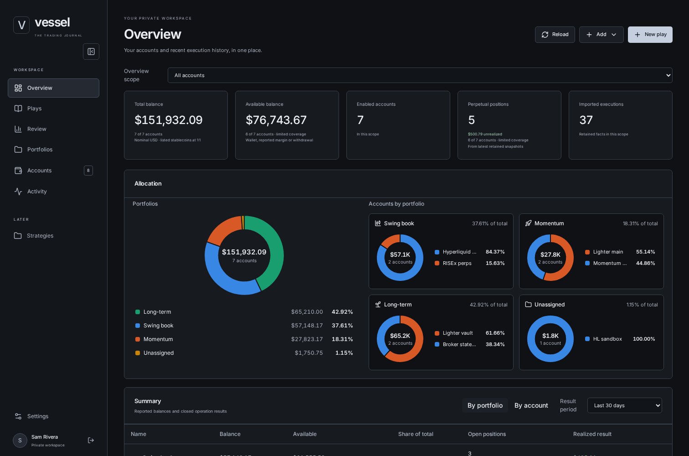 | 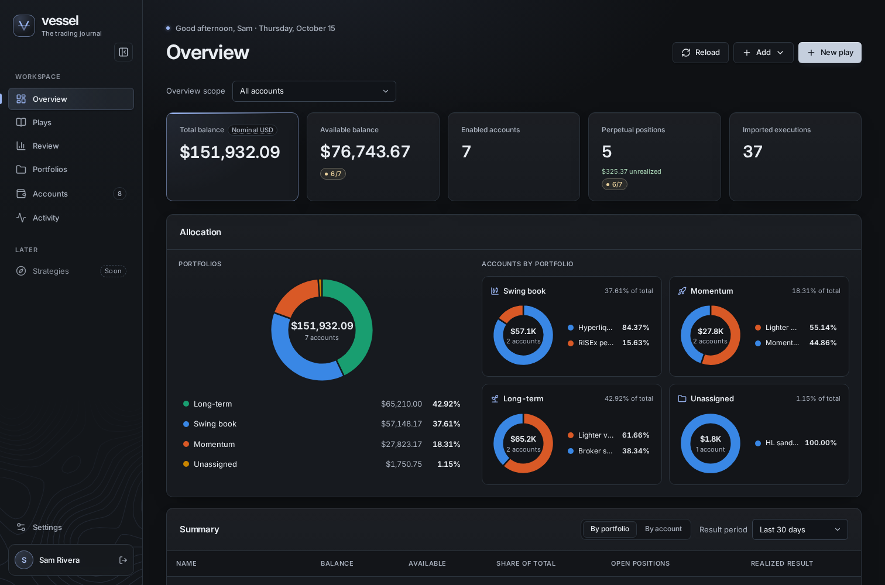 |
| 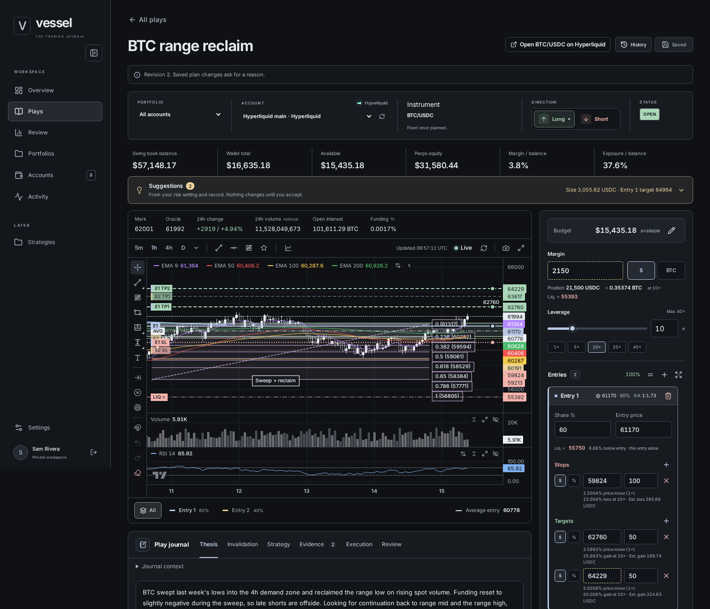 | 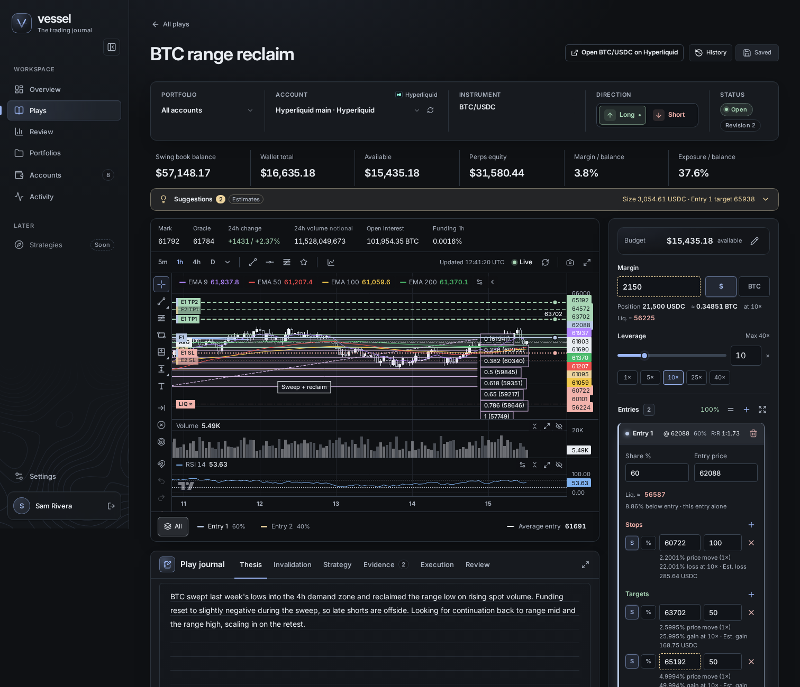 |

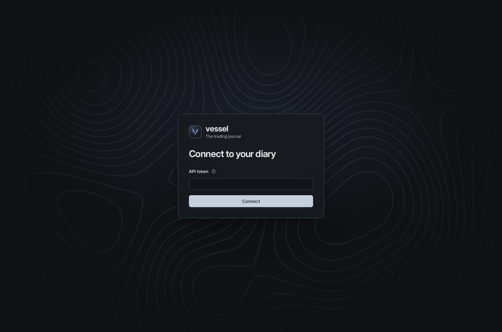

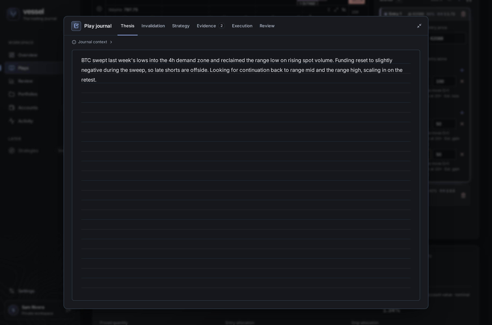

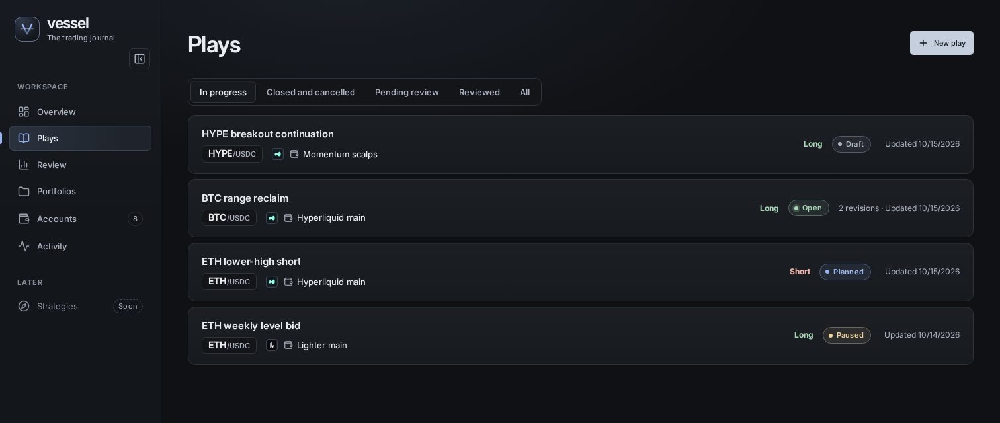

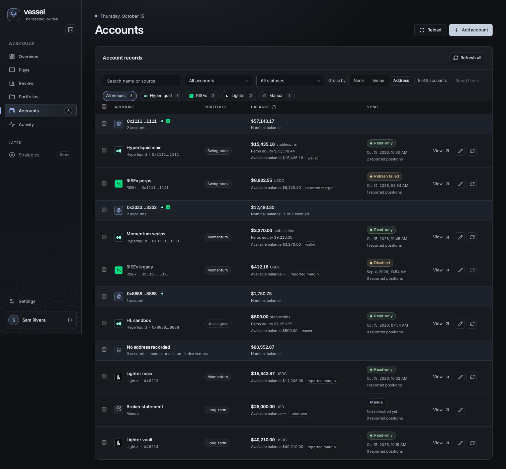

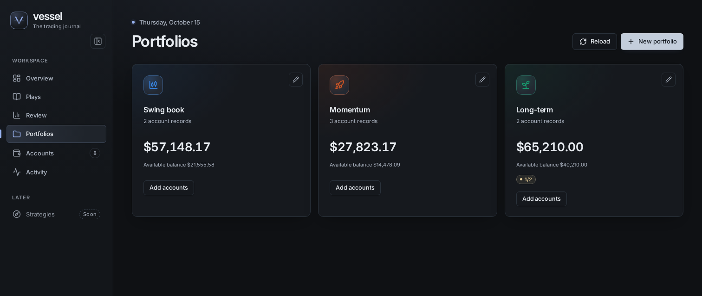

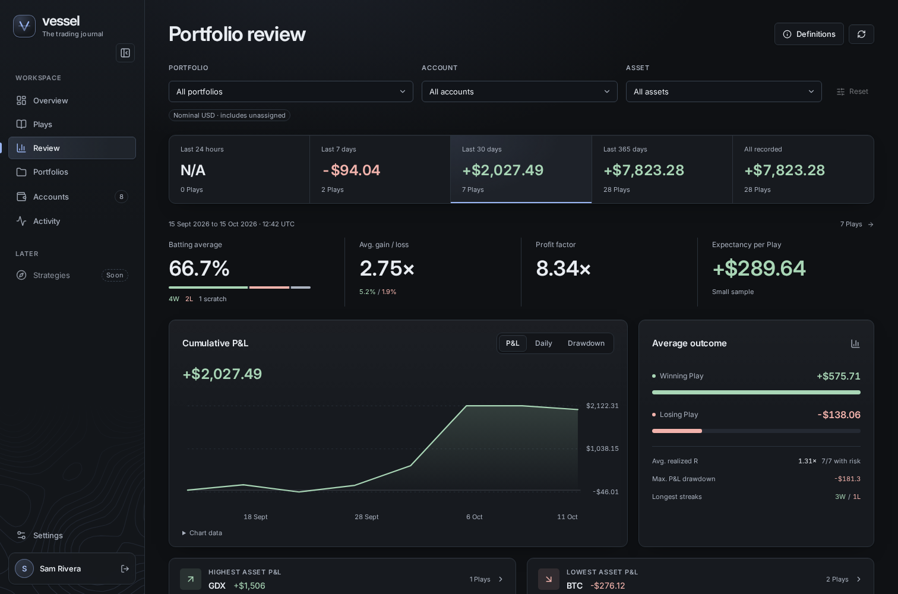

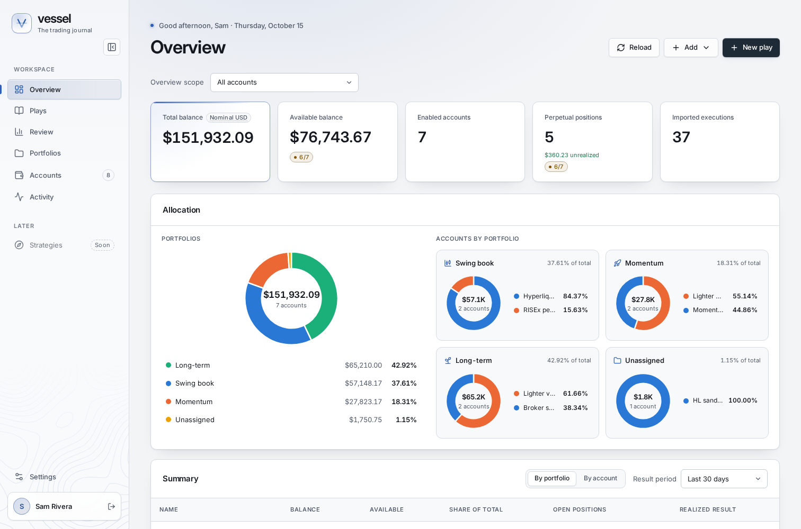

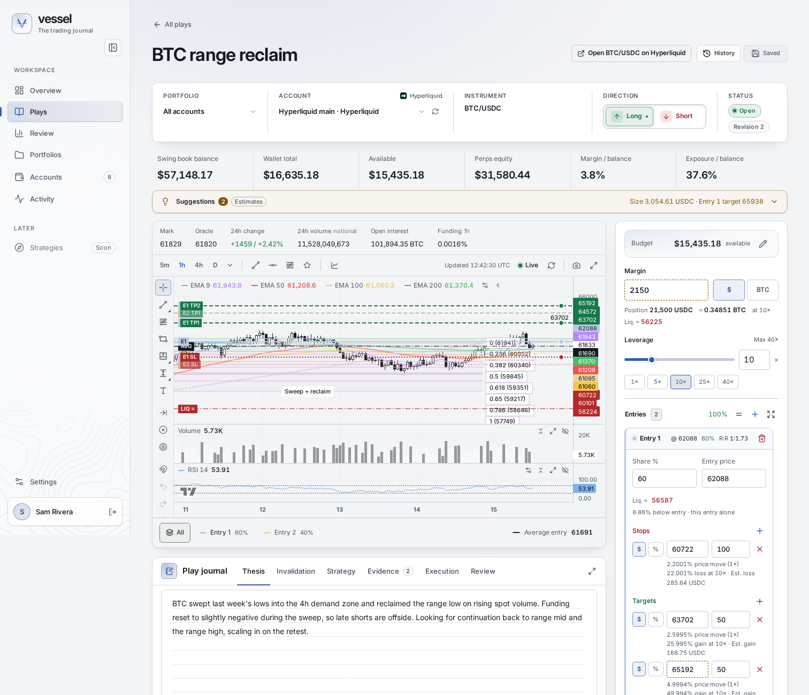

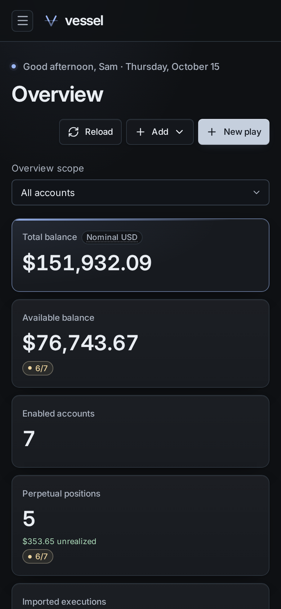
