# Wallet sign-in: design proposal

October 17, 2026. The owner asked what replacing the shared API token with per-user EVM wallet sign-in would involve, and to add the wallet selector and related screens to the design. This is a disposable proposal for the owner to refine; nothing is implemented in the app. The analysis and plan are in [multi-user-wallet-auth.md](../../architecture/multi-user-wallet-auth.md).

- **Page:** `prototype/wallet-sign-in.html`. It is self-contained, so you can open it directly. Each section is one screen or state.
- **Captures:** `prototype/wallet-sign-in-capture.mjs` with an external Playwright (`PLAYWRIGHT_MODULE`, optional `CHROMIUM_PATH`). Reduced motion is on, so spinners are still.
- **Data:** synthetic people, addresses and invitation codes, shown in the Graphite theme. Address colours use the same FNV-1a hue as account source chips (`components/accounts/identity.ts`), so a sign-in wallet that is also a venue source has one colour everywhere.
- **Wallet marks** are placeholders. Production shows the icon and name each wallet announces through EIP-6963 and bundles no wallet logos.

## Principles

- **Keep what was approved.** It is the same first-screen card on the contour background, the same brand block and type scale, and theme tokens only.
- **Vessel's own selector, not a vendor modal.** Wallets are discovered in the browser and listed in Vessel's components. WalletConnect is a row like any other, shown only when the server enables it.
- **Say once what signing means.** One reassurance line: no transaction, no gas, no approvals. Detail goes in an info tip, following the visual-refresh rule of less helper text.
- **The server writes the message, the browser shows it.** The preview mirrors what the wallet will display, so the user can compare.
- **Required notices stay visible:** the lock-out warning when creating a journal (there is no reset), the WalletConnect relay disclosure, and every failure state.
- **A sign-in wallet is not a venue account.** Settings says so, and linking a wallet imports nothing.

## Screens

| # | Screen | Capture |
| --- | --- | --- |
| 1 | Choose a wallet. Detected browser wallets, last used first, then WalletConnect | 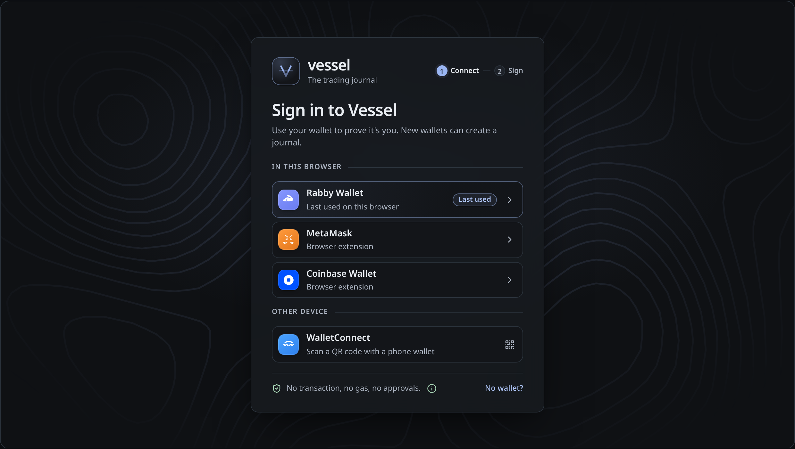 |
| 2 | Connecting. Waiting for the wallet's own approval; Cancel always available | 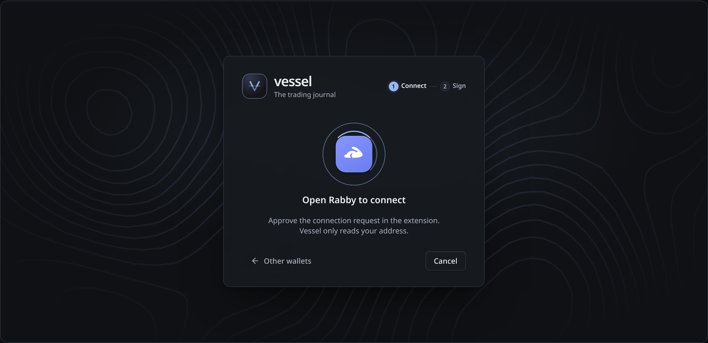 |
| 3 | WalletConnect (later, only if its licence review passes). Vessel's own QR panel over the headless provider, with the relay disclosure | 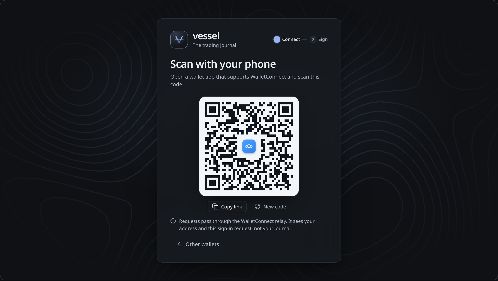 |
| 4 | Sign the message. Connected identity, message preview with countdown, domain check | 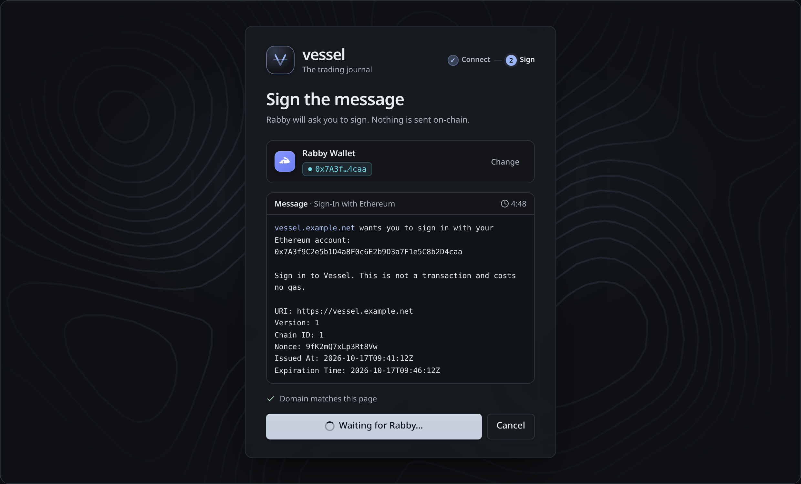 |
| 5 | Create your journal. Only after a valid signature from an unknown wallet; invitation field on invite-only servers | 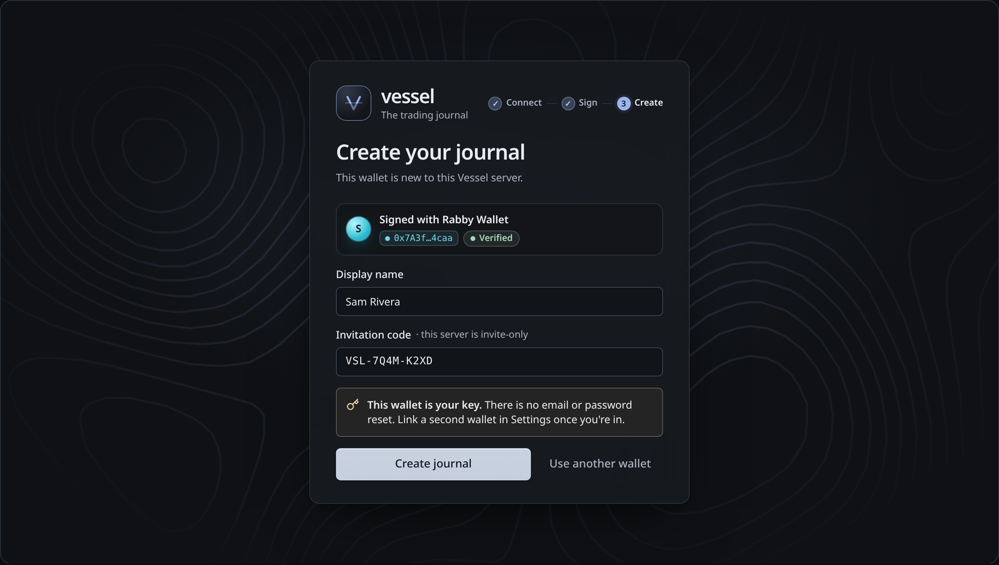 |
| 6 | Edge states. Declined, expired, account switched, invitation needed, smart-contract wallet, rate-limited, no wallet, suspended, unreachable | 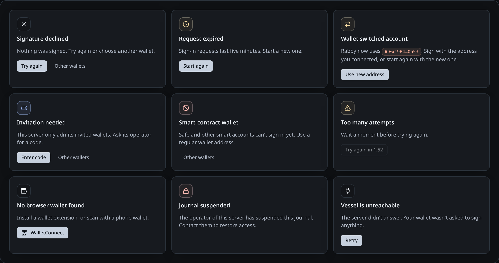 |
| 7 | Account menu. The sidebar owner card opens a menu instead of disconnecting at once | 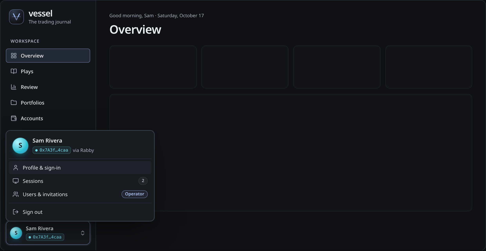 |
| 8 | Settings → Profile & sign-in. Display name, sign-in wallets, sessions. It replaces the Private session panel; Settings today stacks panels, so the tab strip is new | 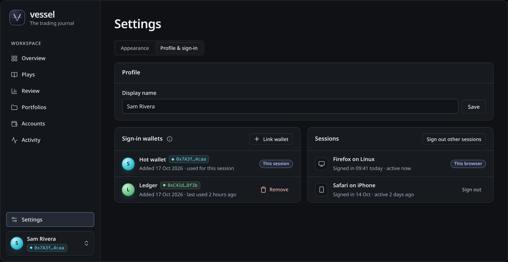 |
| 9 | Link another wallet. First a step-up signature from a wallet already linked, then the same selector in a dialog and a signature from the new wallet with a distinct statement | 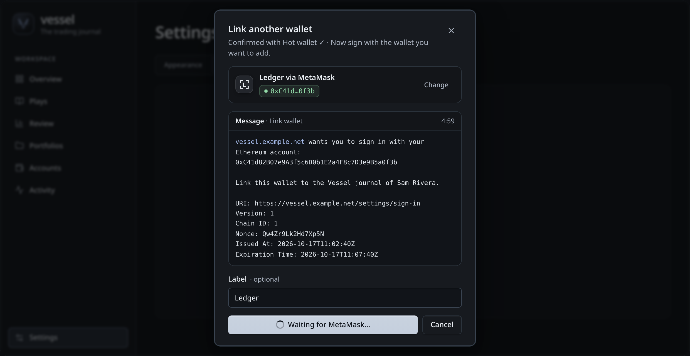 |
| 10 | Operator → Users & invitations (later phase). Registration mode, invitations, users; never journal contents | 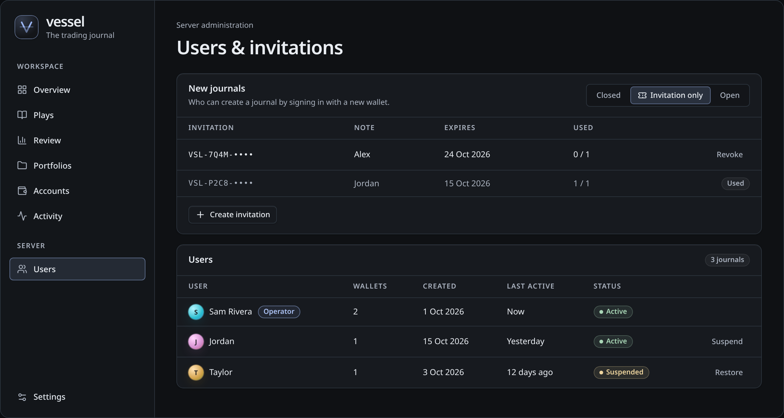 |
| 11 | Mobile. In-app wallet browsers are detected as injected wallets; opening wallet apps needs WalletConnect, so the first version shows only in-app browsers | 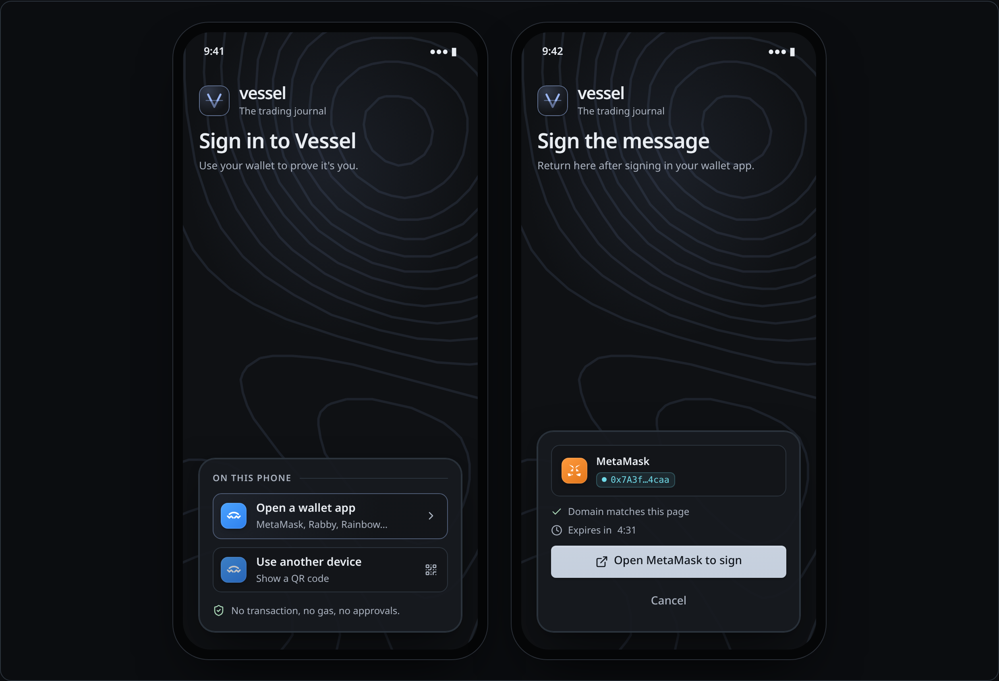 |

## Changes to approved copy

- "Connect to your diary" and the API token field are replaced by "Sign in to Vessel".
- The sidebar owner card currently disconnects at once. It now opens the account menu; Sign out keeps today's unsaved-Play confirmation.
- Settings "Private session" with "Disconnect session" becomes Sign out in the account menu and the Profile & sign-in tab.
- Statements that Vessel "never signs anything" become: Vessel never signs, sends or approves anything at a venue; signing in is a wallet signature over a text message.

## Questions for the owner

1. Should the stepper (Connect · Sign · Create) stay, or is a single card with changing content enough?
2. Should the sign-in screen show the message preview, or only the wallet's own prompt? The preview helps careful users and costs space.
3. Is the address-hue avatar the right identity mark for users, or should users pick an initial colour or image?
4. Should the operator page live under Settings, or as a separate Server section in the sidebar for operators only?
5. Mobile without WalletConnect means opening Vessel inside the wallet's browser. Is that enough for the first version?
