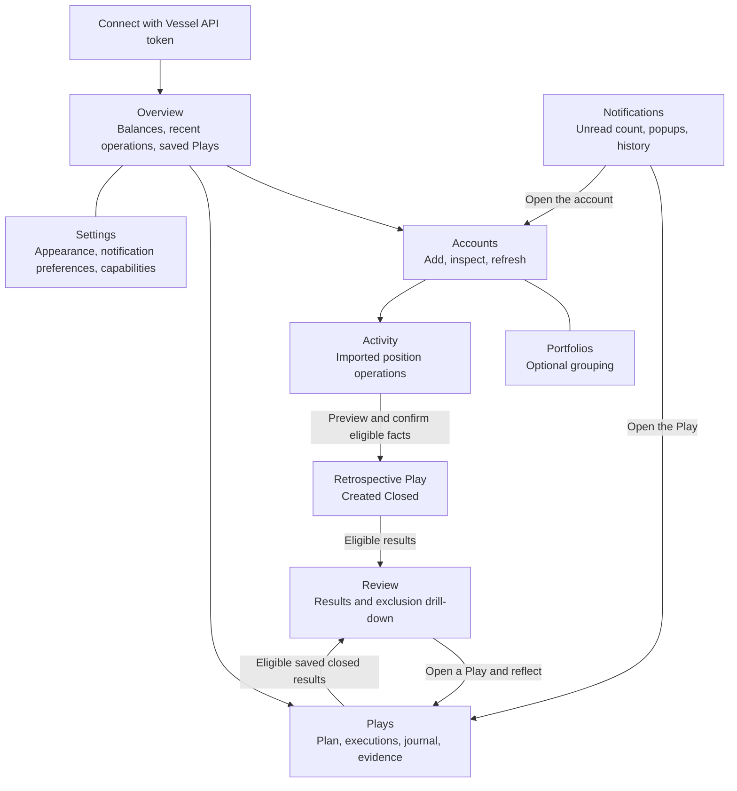
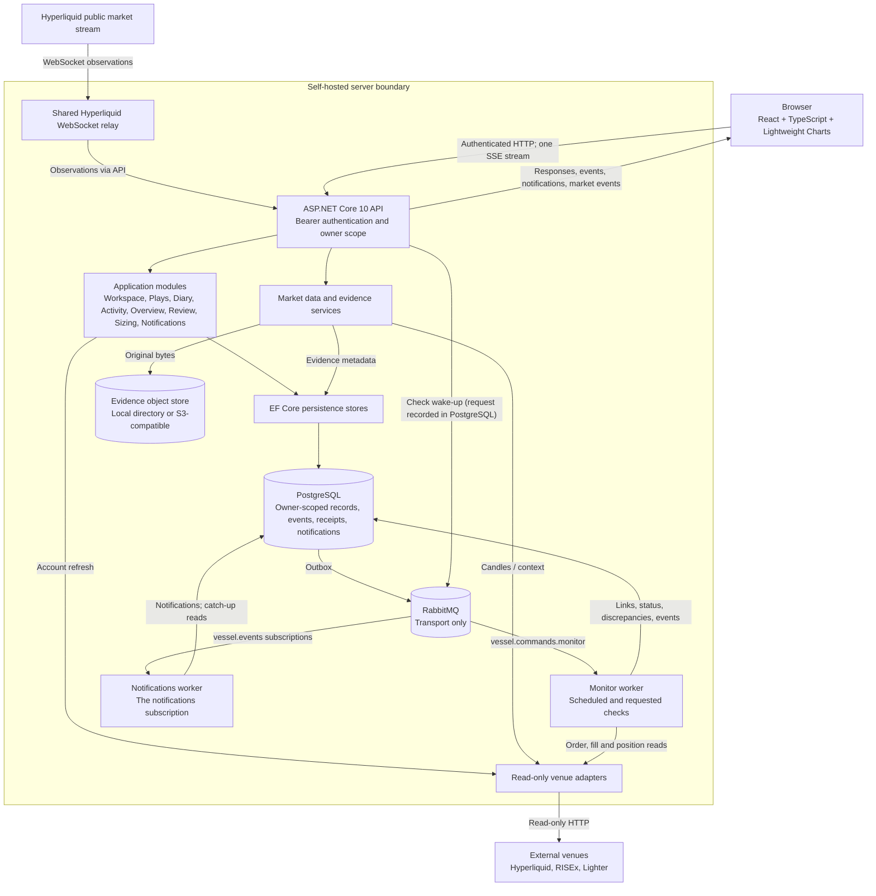
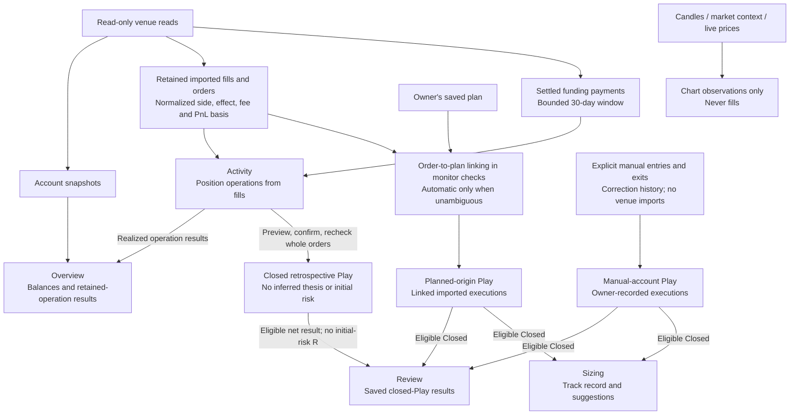
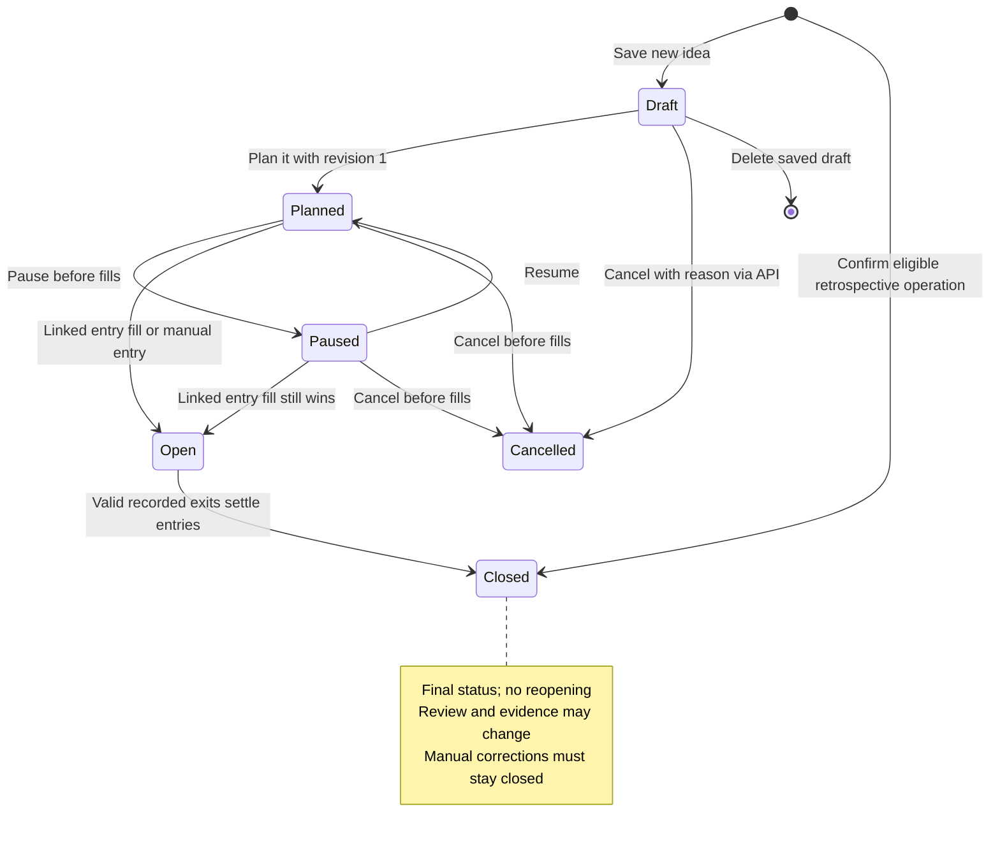

# Vessel current-state diagrams

Read with [Vessel today](../app-status.md). These diagrams describe `main` on
October 17, 2026, after the Notification Hub merged (`43ebaa0`), not a deployment
or a future architecture.

## Screens and owner workflow

Arrows show common journeys, not restrictions on navigation.

The [shell](../../frontend/src/features/workspace/ApplicationShell.tsx) owns
navigation, unsaved Play state and the one event stream that also carries
notifications. Activity does not create Plays automatically.

## Runtime and trust boundaries

Arrows show calls or data delivery, not project-reference dependencies.
The API and the two workers are separate processes built from the same image;
application modules inside the API are not separate services.

Production packaging puts nginx in front of the API and can add a TLS proxy.
PostgreSQL is the record: the event stream reads it, and a subscriber that
missed broker messages catches up from it. The diagram does not imply a
deployed topology. Encryption keys stay in server
configuration; encrypted Lighter tokens stay in PostgreSQL. The browser cannot
read them back. Venue inputs are validated before they become retained facts.
See [backend boundaries](../architecture/backend-guide.md),
[messaging and workers](../architecture/messaging-and-workers.md),
[credential storage](../architecture/venue-credentials.md) and
[deployment packaging](../../deploy/README.md).

## Facts, intent and reports

Activity and Review answer different questions. Manual records never enter the
imported Activity branch; retrospective records never enter the sizing branch.

Unknown costs and incomplete or contradictory executions can block scoring.
Funding appears in Activity beside the operations; it never changes execution
P&L, Review or sizing.
See [diary rules](../architecture/diary-completion-contract.md),
[Review](../architecture/portfolio-review.md) and the
[sizing eligibility filter](../../backend/src/Vessel.Application/Sizing/SizingService.cs).

## Play lifecycle

This is the saved-record lifecycle. An unsaved editor draft is browser memory,
not a database record. Execution progress and review are separate tracks.

Imported transitions happen in monitor checks, not when a Play is opened.
Imported closure also requires complete, compatible linked executions and no
resting entry order. A flat venue position alone is insufficient. Draft
cancellation is an API/domain capability; the current Draft toolbar offers
Delete instead. See [Play rules](../../backend/src/Vessel.Domain/Plays/Play.cs)
and [lifecycle contract](../architecture/play-lifecycle.md).
