# Vessel UI/UX audit

> Historical review of `a51c7f2`. For the current assessment at `7559248`, read the [October 13 review](2026-10-13-review.md) and [feature delta](2026-10-13-product-delta.md). Old missing-feature and bug claims are not current findings.

October 2, 2026. Hands-on audit of the built application at `a51c7f2` from the point of view of a discretionary perpetuals trader. The companion [trader review](trader-review.md) covers product scope; [roadmap.md](roadmap.md) turns both into buildable steps.

## How it was tested

- An isolated stack: a throwaway PostgreSQL container, the real API and Vite on separate loopback ports, with a random token. The private `.env`, the owner's database and the running LAN services were not used or touched.
- Seeded data: portfolio "Swing book"; a Hyperliquid account on the public placeholder address `0x…0001` (wallet $13.20, perps $0.10 after one refresh); manual accounts "Bybit main" ($25,000) and "Paper sandbox" ($5,000.50).
- Live Hyperliquid candles, market statistics and the SSE stream worked. Headless Chromium 151 at 1440×900 and 390 px. No console errors, no failed requests and no page-level horizontal overflow.
- Scenario: *plan a HYPE long with two or three scaled entries, stop, two partial targets each, size it at 1% risk, check R:R and liquidation, capture the chart, write the thesis.*
- **Not verified:** real human timing (times are estimates from interaction counts), touch input, screen readers, populated fill tables, venue error states, long sessions, widths other than 1440 and 390.

All screenshots are in [`screenshots/`](screenshots/).

## 1. Summary

The visual design is calm, consistent and readable. Graphite works, focus rings are visible, and the chart, drawing tools and evidence capture feel professional.

The workflow fails a trader in three places:

1. **The app won't do the arithmetic.** Five of the eight summary cells and both capital ratios say "Not calculated". Sizing at 1% risk needed an external calculator (102.04 HYPE).
2. **Nothing validates the plan.** A long with its stop above the entry, target shares totalling 160%, a Short with Long-side levels, and 25× leverage on a 10× market are all accepted silently.
3. **The chart is below the fold.** At 1440×900 the chart starts at y≈659; the candle area is about 375 px tall.

Planning a two-entry trade took **35 clicks, 17 typed fields and 3 dropdowns** (about 48 clicks for three entries), counted from the scripted browser walkthrough. An estimated 4–6 minutes for a human, plus the calculator.

## 2. Workflow friction log

| # | Step | What happened | Problem | Severity |
| --- | --- | --- | --- | --- |
| 1 | Open Plays | Title, draft notice, context row, capital strip and the Deferred sizing assistant take the first 659 px | Chart is barely visible without scrolling | High |
| 2 | Pick account | Account must come before the instrument | Only venue accounts get a chart, and the manual $25k account gets none. Capital context and chart can't coexist for a manual-venue trader | High |
| 3 | Pick instrument | Native `<select>` with 178 "BTC perpetual"-style options | No search, favourites, recents or price | Medium |
| 4 | Direction | Clear green ↑ Long, red ↓ Short | — | — |
| 5 | Budget | "Unavailable" even with a known $25,000 account value; pencil → type → Save | Mandated by the current contract (no automatic budget); feels redundant and the value feeds nothing. Changing it is an owner decision | Medium |
| 6 | Size by 1% risk | No risk input; sizing assistant says "Deferred" | Core need missing | High |
| 7 | Size input | Switching to quantity clears the size; the select reads "Quantity · instrum…" | Clipped label; "currency units"/"instrument units" never says USDC or HYPE | Medium |
| 8 | Leverage | 5× preset works | Catalogue says HYPE max 10×; slider allows 100× silently; no liquidation price | High |
| 9 | Entry levels | Seven fields; each target needs "Add target", a price and a share | Unit switches and captions repeat on every row; the sidebar shows about half an entry at a time | Medium |
| 10 | Add entry 2 | Share is blank | Allocation still reads "100% allocated" in green | Medium |
| 11 | Split equally | 50/50 or 33.33/33.33/33.34 | Fine; cannot weight by risk | Low |
| 12 | Check R:R and P&L | Summary shows size, leverage and average entry only | See section 3 | High |
| 13 | Capture | One click; Evidence tab opens | Image lacks title, direction, leverage, R:R; overlapping tags are captured as-is | Medium |
| 14 | Thesis | Tabs work | No prompts (trigger, timeframe, invalidation); journal is far below the plan | Low |
| 15 | Sanity checks | Wrong-side stop, 160% target shares, Short with Long levels | No warning at all | High |
| 16 | Save | Not possible | A reload loses everything, captures included | High |

## 3. What the summary shows

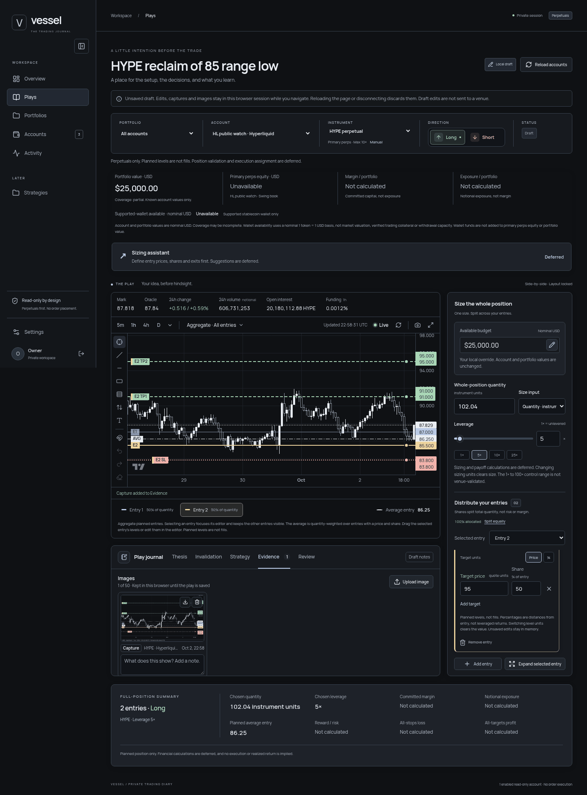

| Figure | Shown |
| --- | --- |
| Chosen quantity, chosen leverage, planned average entry | Real values |
| Committed margin, notional exposure, reward/risk, all-stops loss, all-targets profit | "Not calculated" |
| Margin/portfolio, exposure/portfolio | "Not calculated" |
| Available budget | "Unavailable" unless overridden, even with a known account value |
| Liquidation, risk $ and %, R per target, break-even after fees, funding over the hold | Absent |

The HYPE plan ran on the Hyperliquid account (perps equity $0.10), so the $25,000 risk reference is an explicit budget override. As a trader this reads as *"the app knows my numbers but won't do arithmetic."* The muted placeholders are honest, but most of the summary is dead weight. Linear figures labelled "estimate" are far better than nothing. For this plan:

```text
Notional ≈ 102.04 × 86.25 = $8,801 · Margin @5× ≈ $1,760 · All-stops loss ≈ $250 (1.0%)
```

**Recommendation:** replace the summary with the risk-first block from [trader review M2](trader-review.md#m2-risk-first-sizing-and-a-complete-money-summary). Show estimates with an ⓘ listing assumptions (fees, funding, isolated margin, every order fills).

## 4. Plays page

### 4.1 Hierarchy: get the chart above the fold

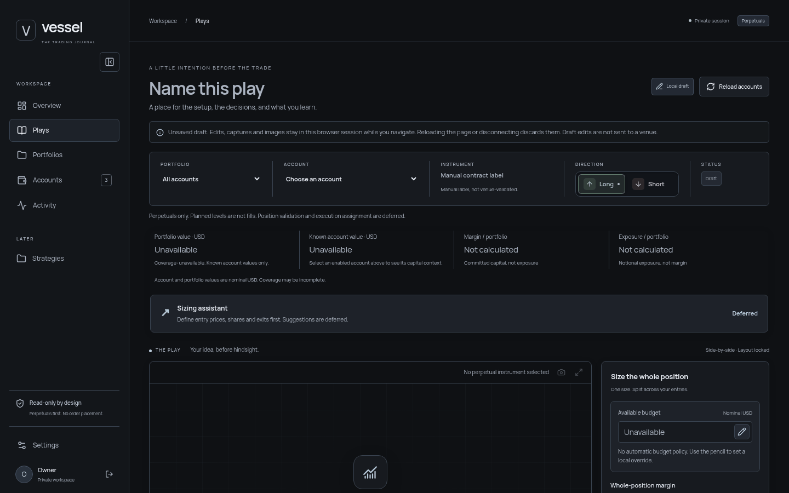

**Problem.** Six stacked bands precede the chart: the eyebrow and title, the draft notice, the context row, a caveat line, a four-cell capital strip with its own caveat, and a sizing assistant that only says "Deferred". The "Local draft" badge has a pencil and a border, so it looks like a button, but it does nothing.

**Improve.** Two rows, then the workspace. Target: chart top at about y≈260 at 1440×900.

```text
┌──────────────────────────────────────────────────────────────────────────────┐
│ HYPE reclaim of 85 ✎   [Hyperliquid main ▾] [HYPE-PERP ▾ 87.92] [↑Long|↓Short]│
│ ● Unsaved ⓘ   Acct $25,000 · Portfolio $25,000 (partial) · Budget $25,000 ✎   │
│                                    Risk [1.0]% = $250   [Save Play] [⋯]      │
├───────────────────────────────────────────────┬──────────────────────────────┤
│ chart                                         │ position editor              │
```

- Fold the draft notice into an "Unsaved ⓘ" chip, which turns into "Saved 14:05" once Plays persist.
- Collapse the caveat lines into ⓘ popovers.
- Hide the sizing assistant until it works; then fold it into the risk field (`Risk 1% → size`).
- Remove the desktop-only "Side-by-side · Layout locked" caption. It is internal and still shows at 390 px.

This keeps the locked section order (capital above, chart left, journal below the chart, position right, summary below) and only compresses its height. Folding the optional sizing assistant into the risk field needs owner approval.

### 4.2 Chart readability

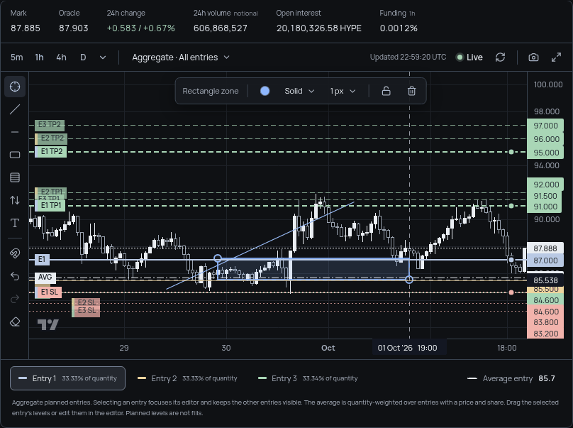

**Problems.**

- Tags for levels within about 1% overlap: E1/E2/E3 TP1 at 91/91.5/92 are unreadable, and E2 and E3 SL collide. The E2 entry tag hides under AVG.
- Equal prices (E1 SL = E3 entry = 84.6) hide one tag, and the axis shows "84.600" twice in different colours.
- Entry colours `#edd49e` (amber) and `#a9d6b6` (green) clash with the semantic colours: Entry 3 reads as a target, and Entry 2 sits beside red stops.
- No risk/reward shading. The trader must read the R distance from tag positions.
- The floating drawing edit bar covers the top of the price area.

**Improve.**

```text
Collision handling          Merged identical price       Risk/reward bands
 ┌ TP1 ×3 · 91–92 ┐          ┌ 84.60  E1 SL · E3 ┐        ░░░ green: entry → TP (with "1.25R")
 │ E3 TP2  97.00  │          └───────────────────┘        ▒▒▒ red:   entry → stop ("−1R")
```

- Stack colliding tags with leader lines, or group them ("TP1 ×3 · 91–92"); expand on hover or selection.
- One tag per price, listing every level at that price.
- Entry palette away from red/green: blue, violet, cyan, white, sand.
- Shade entry → stop (red) and entry → target (green) for the selected entry or the aggregate, with R on every target tag: `E1 TP1 · 1.25R`.
- Dock the drawing edit bar into the chart toolbar.
- Header statistics: `$606.7M` for 24h volume (unit is missing today), `$1.77B OI` as well as the HYPE quantity, and funding as `0.0012%/h · 10.5% APR`.

### 4.3 Validation (none today)

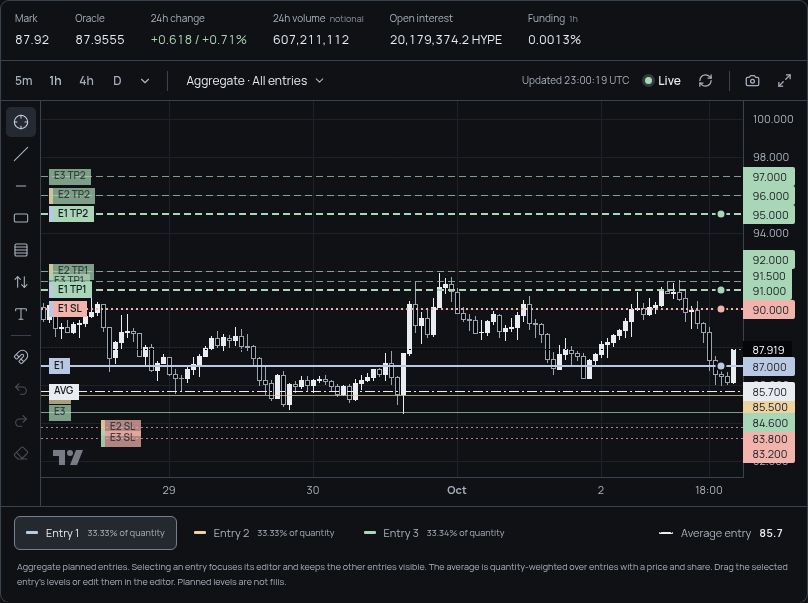

Above: direction is Short, but every stop is below its entry and every target above it. No warning.

| Rule | Inline message | Summary badge |
| --- | --- | --- |
| Stop on the wrong side | "Stop 90 is above the Long entry 87" | "2 issues" |
| Target on the wrong side | "TP1 85 is below the Long entry 87" | |
| Entry shares ≠ 100% (blank counts as 0) | "Entries total 66.67%; 33.33% unassigned" | |
| Target shares ≠ 100% per entry | "Targets total 160%" | |
| Leverage above catalogue max | "Above HYPE max 10×" | |
| Isolated liquidation inside the stop | e.g. at 10× on HYPE: "Liquidation ≈ 81.7 is beyond the stop 83.8 ✓" or, when it is not, "Liquidation precedes the stop" | |
| Direction switched with levels set | Offer "Mirror levels to Short?" (the prototype did this automatically) | |

Use inline text with `role="alert"` on the field, and a badge next to Save that lists and focuses each issue.

### 4.4 Position editor

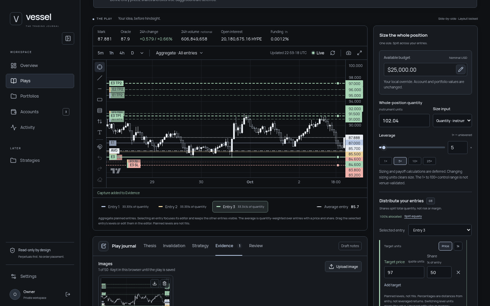

**Problems.**

- The sidebar is about 264–330 px tall at 1440×900, so about half of one entry fits.
- "Planned levels, not fills… Switching level units clears the value…" repeats in every entry card.
- Every level has its own Price/% switch with a "Target units" caption.
- No derived values per entry (risk per unit, R per target).
- "100% allocated" turns green while an entry share is blank.
- Leverage presets offer 25× on a 10× market.

**Improve.**

1. One shared explanation at the top of the editor behind ⓘ.
2. An inline unit suffix inside each input: `[ 91.00 | $ % R ]`.
3. A compact table for entries, used in the expanded editor and optionally in the sidebar:

   ```text
   Entry  Price  Share  Stop   Risk/u  TP1 (50%)    TP2 (50%)    +TP
   E1     87.00  50%    83.80  3.20    91 · 1.25R   95 · 2.50R   ＋
   E2     85.50  50%    83.80  1.70    91 · 3.24R   95 · 5.59R   ＋
   ───────────────────────────────────────────────────────────────
   Avg    86.25  100%          2.45    Blended R:R 2.76
   ```
4. Presets derived from the instrument: for HYPE (max 10×) show 1×, 3×, 5×, 10×, and mark the highest safe value from the liquidation check.
5. Real unit names: "Margin (USDC)" and "Quantity (HYPE)".
6. Keep the size when switching margin ↔ quantity by converting through the average entry and leverage (the prototype did).

### 4.5 Evidence

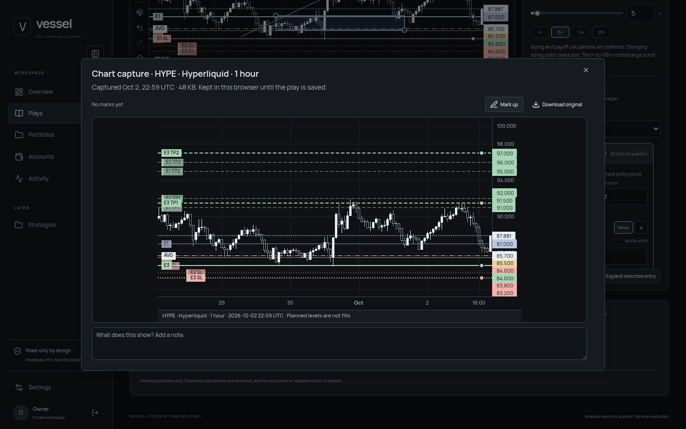

Capture is the strongest part: one click, the Evidence tab opens, markup is available.

**Improve.** Captures should stand alone as journal artefacts. Compose a header strip:

```text
HYPE reclaim of 85 · LONG 5× · avg 86.25 · SL 83.80 · R:R 2.76 · 1h · 2026-10-02 22:59 UTC
```

Also: cards truncate "HYPE · Hyperliqui…" (show the instrument and time only), and offer "include note" on download.

### 4.6 Journal

**Problems.** Thesis sits far below the plan and has no prompts. All five tabs are single free-text areas.

**Improve.** Short prompts and structured fields, keeping free text:

```text
Thesis       Trigger: [ 4h reclaim of 85      ]  Timeframe: [4h ▾]  Setup: [Range reclaim ▾]
             Why now (one line): [ funding reset, OI flushed                       ]
Invalidation [ 4h close below 83.5 ] or [ no reclaim by Fri 00:00 UTC ]
Management   After TP1: [stop to BE + fees ▾]  Time stop: [24h]
```

### 4.7 Mobile (390 px)

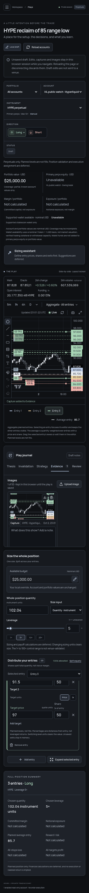

The stack works and nothing overflows, but the page is 3,881 px tall. A trader on a phone mostly checks a plan or adds a note. Use a segmented control at the top: `Chart · Position · Journal · Summary`, with the risk line (`−$250 · R:R 2.76`) sticky at the bottom. This changes the shared responsive stack locked in `docs/design/approved-baseline.md`, so it needs owner approval.

## 5. Other pages

### Overview

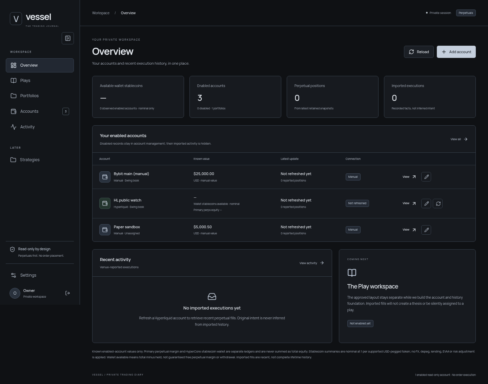

| Issue | Improvement |
| --- | --- |
| "COMING NEXT · The Play workspace · Not enabled yet" is stale; Plays works (`ApplicationShell.tsx:191`) | Replace with "Recent plays" or a "Plan a trade →" call to action |
| First KPI is "Available wallet stablecoins" | Lead with known equity and coverage, e.g. "Known equity $30,000.60 · 3/3 accounts valued"; wallet as the second line |
| "Known value" mixes wallet and account value per row | One meaning per column, or separate "Perps equity" and "Wallet" columns |
| Footer "1 enabled read-only account" with three enabled accounts; it counts venue accounts only (`ApplicationShell.tsx:216`) | "3 accounts · 1 venue-connected (read-only)" |
| Long footnote paragraph | Move it into an ⓘ popover |
| No performance at all | After M7: "This week: 7 trades · +3.1R · adherence 86% · open risk 2.0%" |

### Portfolios

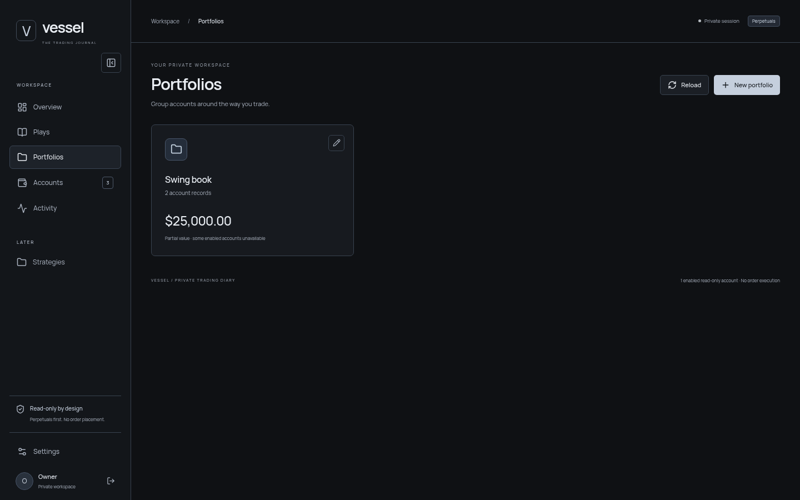

"Partial value" doesn't say which account is missing. List accounts under the total: `HL public watch — not refreshed`.

### Accounts and account detail

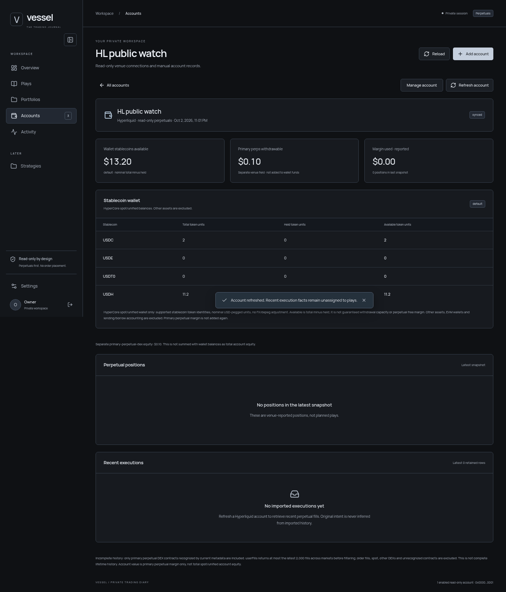

| Issue | Improvement |
| --- | --- |
| A manual account's value cannot be edited after creation | "Account value (USDC) · as of [date]" in Manage account |
| Detail subtitle copied from the Accounts list; name shown twice; breadcrumb lacks the account | Subtitle with venue and address; breadcrumb "Accounts / Bybit main" |
| After a refresh, "Recent executions" still says "Refresh a Hyperliquid account to retrieve…" | "No fills in the latest import (up to 2,000 recent)" |
| Perps equity is not a KPI card | Make equity the first card |
| Zero balance rows (USDE 0, USDT0 0) | Hide behind "Show zero balances" |
| Local 12-hour times here, UTC 24-hour on the chart | One setting, with the zone labelled |
| Refresh toast covers the table mid-screen | Bottom-right toast |
| "5000.50" comes back as "5000.5" | Preserve the exact string, as the decimal principle requires |

### Activity

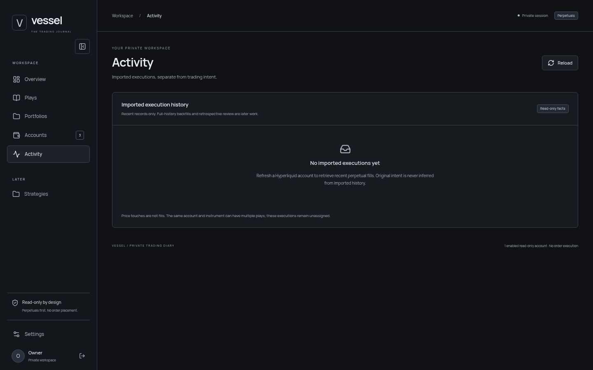

Only the empty state was verified (the placeholder address has no fills). By design it is a flat fill list; see [trader review M5](trader-review.md#m5-fills--trades-linked-per-order-or-fill-with-an-unreviewed-inbox) for the trades view and inbox.

### Settings

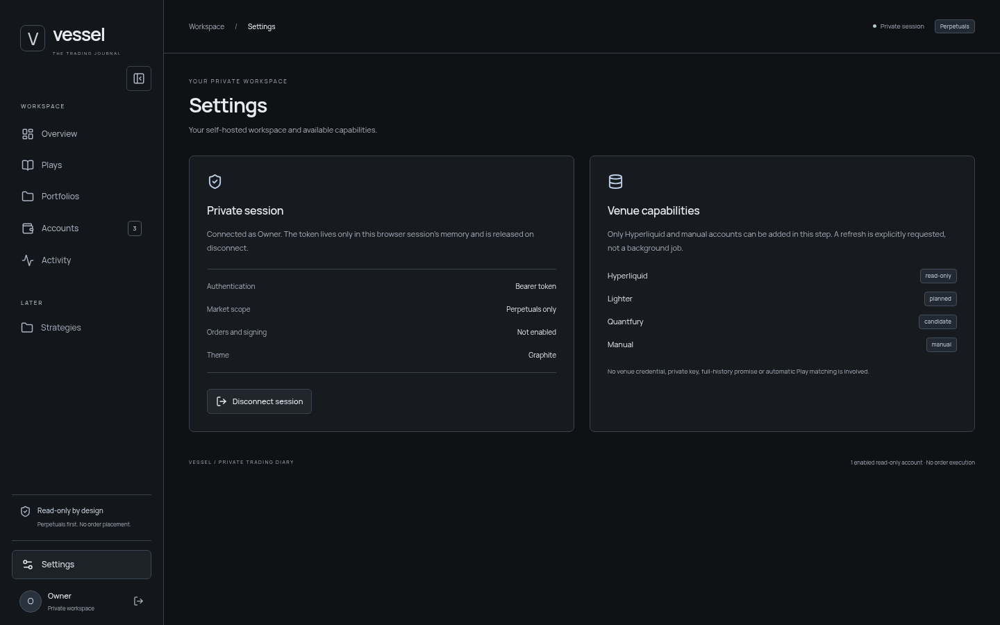

Theme is display-only and there are no trader preferences. Add: default risk %, default account, timezone (UTC or local), number format, default leverage, and soft limits (daily loss R, max open risk %).

## 6. Accessibility and keyboard

- Focus rings are visible throughout.
- From the title it takes about **33 Tab presses** to reach the position editor; the order runs through every chart tool, the legend and the journal. Add skip links ("Skip to position", "Skip to journal") or put the editor earlier in the DOM order.
- The TradingView attribution link has no accessible name.
- Drawings cannot be placed by keyboard (already documented as a limit).
- Add keyboard shortcuts for frequent actions (see trader review N10).

## 7. Bugs found

| # | Bug | Repro | Severity |
| --- | --- | --- | --- |
| B1 | No plan validation | Long, stop 90 above entry 87, target shares 80 + 80, then switch to Short: no warning anywhere | High |
| B2 | Leverage above venue maximum accepted | HYPE shows "Max 10×"; the 25× preset and slider up to 100× are accepted | High |
| B3 | Misleading allocation | Add entry → "100% allocated" in green while the new share is blank | Medium |
| B4 | Overlapping and hidden chart tags | Three entries with TP1 at 91/91.5/92; equal prices hide a tag | Medium |
| B5 | Stale Overview card | Overview → "The Play workspace · Not enabled yet" | Medium |
| B6 | Ambiguous footer count | Three enabled accounts → "1 enabled read-only account" | Low |
| B7 | Clipped select label | Size input → Quantity reads "Quantity · instrum…" at 1440 | Low |
| B8 | Wrong empty-state copy after refresh | Refresh `0x…0001` → "Refresh a Hyperliquid account to retrieve…" | Low |
| B9 | Wrong account detail subtitle | Copied from the Accounts list | Low |
| B10 | Internal caption on mobile | "Side-by-side · Layout locked" at 390 px (`PlayWorkspace.tsx:109`) | Low |
| B11 | Unnamed link | TradingView attribution has no accessible name | Low |

## 8. Top 10 UI/UX improvements, ranked

| # | Improvement | Example |
| --- | --- | --- |
| 1 | **Calculate the plan** (estimates, labelled) | `Risk −$250 (1.0%) · Reward +$689 (2.76R) · $8,801 notional · $1,760 margin @5× · Liq ≈ 72.6 (isolated est.)` |
| 2 | **Risk-based sizing input** | `Risk [1]% of $25,000 = $250 → 102.04 HYPE` |
| 3 | **Plan validation** with inline messages and an issues badge | §4.3 |
| 4 | **Readable chart levels**: collisions, merged prices, non-semantic entry colours, R/R shading, R on tags | §4.2 |
| 5 | **Chart above the fold** by compressing the header bands | §4.1 |
| 6 | **Persist drafts**: autosave now (even locally), full Plays later | "Saved 14:05" chip |
| 7 | **Compact entry table** with per-row R and "+TP" | §4.4 |
| 8 | **Account value as the default budget**, editable manual account values | §5 Accounts |
| 9 | **Searchable instrument picker** with favourites, recents and live price | `[🔍 hy ] HYPE 87.92 +0.7% ★` |
| 10 | **Fix Overview**: replace the stale card, lead with equity, fix the footer | §5 Overview |

## Screenshot index

| File | Shows |
| --- | --- |
| `overview-desktop.png` | Overview at 1440, before refresh |
| `portfolios-desktop.png` | Portfolios with one partial-value card |
| `accounts-desktop.png` | Accounts table |
| `accounts-add-dialog.png` | Add account dialog |
| `account-detail-hl-refreshed.png` | Hyperliquid account detail after refresh, toast over the table |
| `activity-desktop.png` | Activity empty state |
| `settings-desktop.png` | Settings |
| `plays-desktop-empty.png` | Plays first view; workspace starts at y≈659 |
| `plays-desktop-filled-full.png` | Full page: HYPE long, two entries, 5×, 102.04 HYPE, capture taken |
| `plays-desktop-filled-workspace.png` | Three-entry plan, chart and sidebar at 1440×900 |
| `plays-chart-drawing.png` | Trend line, zone, edit bar, overlapping tags |
| `plays-chart-level-editor.png` | In-chart level editor (E3 · Target 2) |
| `plays-chart-expanded.png` | Expanded chart dialog |
| `plays-entry-expanded.png` | Expanded entry editor |
| `plays-evidence-viewer.png` | Capture in the evidence viewer |
| `plays-short-with-long-levels.png` | Short with Long-side levels, no warning |
| `plays-manual-account-placeholder.png` | Manual account: chart placeholder, budget "Unavailable" despite $25k |
| `plays-mobile-390-filled-full.png` | 390 px stacked layout, filled plan |
